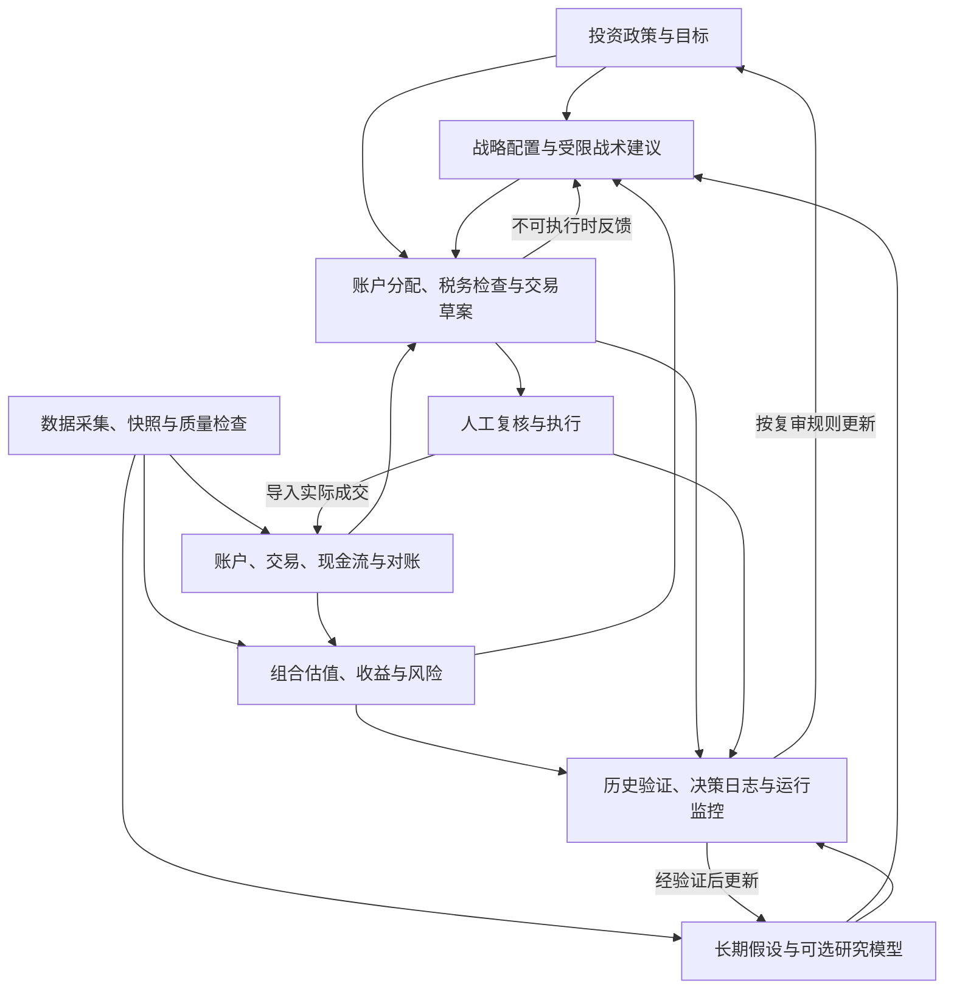

# 个人投资研究与决策框架 V0.2

**Personal Investment Research OS**  
**编制日期：** 2026-10-22  
**文档性质：** 综合方案 A、B、C 的改进设计；供后续需求确认、开发与验收使用。  
**建设原则：** 先准确核算现状，再建立配置纪律，随后验证研究模型。

## 1. 目标、假设与边界

### 1.1 系统要回答的六个问题

1. 我在各账户实际持有什么，可用现金是多少，记录是否准确？
2. 我的收益来自市场、配置、资金投入、汇率还是其他因素？
3. 当前组合是否符合资金用途、期限、流动性需求和风险承受能力？
4. 距离既定战略配置有多大偏离，是否需要调整？
5. 如果调整，在哪个账户、使用哪些资金或批次，成本和税务影响如何？
6. 新的研究判断是否具有足够证据，值得改变现有决策？

主要目标是支持可解释、可复查的长期投资决策。短期市场预测和战术配置属于可选研究能力，默认不影响实际配置。

### 1.2 使用场景假设

下列条件继承方案 C，均为**待用户确认的设计假设**，不代表已确认的个人情况。

| 项目 | 初始设计假设 | 未确认时的处理 |
|---|---|---|
| 税务身份 | 美国税务居民 | 允许税前研究，不生成个人税务结论 |
| 基准货币 | 美元 | 所有示例注明美元；实际口径由配置决定 |
| 投资期限 | 主要目标为十年以上，另有短期现金需求 | 分目标设置期限，不将全部资金视为长期资金 |
| 账户 | 可能包括应税、401(k)、传统 IRA、Roth IRA、HSA | 只启用实际存在的账户；不假设账户资格或供款资格 |
| 工具 | 以美国注册的 ETF、共同基金及现金类工具为主 | 上市地、注册地、法律结构分别检查 |
| 国际敞口 | 优先通过上述基金实现 | 不因此假设不存在汇率或境外经济风险 |
| 投资操作 | 人工决定、人工下单 | 系统只生成草案、检查结果和记录 |
| 数据与软件 | 不依赖付费订阅，使用免费软件和可合法使用的数据 | 无法满足质量要求时缩小功能范围 |

### 1.3 第一版范围

第一版完成：少量基金与现金工具的数据处理、账户账本、合并估值、收益核算、战略目标比较、风险监控、再平衡草案和决策日志。

第一版不要求：自动交易、完整报税、全市场选股、日内交易、复杂衍生品、完整历史期权回测、同时支持所有券商与所有国家。

美国之外的账户、直接 A 股交易、个股及期权保留扩展入口；新增市场必须补充市场规则与测试，不能仅凭增加代码或数据接口就宣称已支持。

“零付费”指不依赖新增付费数据或软件订阅，不意味着计算、存储、维护时间和交易没有成本。已有本地设备可作为日常运行环境；云开发环境不视为免费且永久在线的调度服务。

## 2. 总体架构

采用单机模块化应用，共享明确的数据契约。模块是逻辑边界，不要求拆成独立服务器。



| 模块 | 职责 | 核心输出 |
|---|---|---|
| G：目标与政策 | 定义用途、期限、约束、基准、复审规则 | 投资政策及版本 |
| D：外部数据 | 采集、质量控制、版本管理、来源与语义登记 | 有使用资格的数据集 |
| B：账本与对账 | 管理账户、交易、现金流、批次和公司行动 | 可核对的组合事实 |
| A：核算与风险 | 估值、收益、资金流、风险敞口及目标进度 | 组合状态和风险报告 |
| R：研究与预测 | 长期资本市场假设、情景、宏观及可选模型 | 带期限和不确定性的研究结果 |
| S：配置 | 战略目标、偏离带、受限战术建议 | 目标配置与调整理由 |
| I：实施规划 | 账户可行性、税务检查、成本、数量及批次建议 | 待人工确认的交易草案 |
| V：验证与运行 | 历史重放、基准比较、日志、监控和恢复 | 验证证据与运行状态 |

投资政策约束所有模块；数据质量与验证也是贯穿全流程的能力。研究模型不得直接跳过账户与实施检查产生订单。

## 3. 投资政策：摘要与可执行附录

保留一页摘要，详细规则存入结构化配置。摘要便于使用，附录保证计算口径完整。

| 内容 | 必须明确的事项 |
|---|---|
| 资金目标 | 用途、时间、目标金额；按名义或实际购买力表达 |
| 未来资金流 | 预期供款、提款及不确定范围；应急资金的统计边界 |
| 风险承受 | 可接受损失、资金短缺风险及对应行动；不将回撤上限当作保证 |
| 账户与身份 | 账户持有人、账户类型、税务辖区、可买标的与提款限制 |
| 战略配置 | 资产类别目标、偏离范围、现金下限及集中度限制 |
| 基准 | 可复现的资产、权重、再平衡方式、收益口径与起始日 |
| 交易边界 | 是否允许杠杆、做空、衍生品；初版默认不支持这些能力 |
| 再平衡 | 检查频率、偏离触发方式、成本阈值、资金使用顺序；区分权重百分点偏离与相对比例偏离 |
| 战术预算 | 默认关闭；启用后明确偏离、换手和风险预算 |
| 复审 | 常规复审日期，以及生活、目标、市场制度或税法重大变化的触发条件 |

短期宏观波动不能直接重写战略目标；长期结构变化可以通过正式复审更新长期假设。政策修改要保存旧版本、原因及生效时间，不能事后修改过去的基准来美化结果。

个人资料未完成时可运行清楚标记的示例组合，但不得把示例权重输出为个人配置建议。

## 4. 账户、交易与核算底座

### 4.1 主要数据对象

宏观和行情适合标准化时间序列表；账户、交易和税务批次应使用专门的关联表。

| 对象 | 最小内容 |
|---|---|
| 账户 | 稳定 ID、持有人、券商、类型、币种、可买标的与权限、数据完整性 |
| 证券 | 稳定 ID、代码及有效期、注册地、上市地、币种、法律结构、资产类别 |
| 交易与现金事件 | 事件 ID、账户、证券、类型、数量、价格、费用、币种、交易日、结算日、状态 |
| 税务批次 | 来源交易、买入时间、原始成本、调整后成本、剩余数量、卖出匹配及调整依据 |
| 公司行动 | 分红、再投资、拆并股、合并等事件及其生效信息 |
| 价格与估值 | 价格类型、时点、币种、来源、质量、是否估计 |
| 对账 | 券商报告值、系统值、差异、容差、状态、处理依据 |
| 决策与成交关联 | 决策 ID、草案版本、批准记录、实际成交、偏离原因 |

### 4.2 核算规则

- 原始导入文件保留快照和校验信息；同一文件重复导入不得重复入账。
- 券商后续更新和更正应有明确处理方式，不把待结算与已结算记录算成两笔交易。
- 更正记录保留原因和历史，不静默覆盖；必要时使用冲销及替代事件。
- 纳入统计边界的账户之间转移，属于内部转移；跨越统计边界的资金才计为外部流入或流出。
- 分红与分红再投资分别记录，后者增加新的持仓与成本批次。
- 持仓估值采用与实际数量一致的未复权市场价格，并通过公司行动调整数量；不得将实际分红与已包含分红的总收益重复相加。
- 可用现金、账面现金、待结算款项分别处理；交易草案遵守账户实际可用额度和适用规则。
- 券商成本基础作为主要参考，但同时保留可解释的调整记录。未知成本不得默认为零。
- 首版只支持已实现处理规则的公司行动；遇到未知类型，相关账目进入待核验状态。

### 4.3 对账与收益

对账覆盖证券数量、现金、交易、分红和成本批次。容差根据币种精度、份额精度和券商舍入方式设定；超出容差的差异不能被自动消除。

同时提供两种收益口径：

1. **时间加权收益（TWR）**：用于评价投资组合表现。按外部现金流分段计算并连乘；缺乏所需估值时，不冒充精确 TWR。
2. **资金加权收益（MWR/XIRR）**：用于评价投资者实际资金经历；存在无解或多解时明确提示。

若使用 Modified Dietz 等近似方法，报告标明方法和限制。没有足够数据时先报告估值及损益，不强制输出看似精确的年化收益。

基金费用通常已经反映在净值或基金总收益中，不能无依据再扣一遍；交易费用与个人税款需另行处理。税前表现、已发生税费后的表现、假设未来提款税负后的情景估值分别展示。

传统退休账户与 Roth 的相同名义余额不代表相同税后可支配价值。保持名义账面口径用于对账，另提供基于明示税率与提款假设的税后情景，避免静默混算。

## 5. 数据平台与使用资格

### 5.1 数据目录

每个序列登记原始发布者、获取渠道、字段定义、频率、时区、单位、许可、更新节奏、历史覆盖、修订特征、可接受延迟、交叉核验方法及备用方式。

将质量分解为四个维度：

- **来源可信度**：官方、发行方、研究机构或第三方接口。
- **数据性质**：直接观测、调查、模型估计或预测。
- **时间适用性**：是否保留历史版本、何时可以获知。
- **用途适用性**：可用于展示、研究、历史回测、风险监控或成交估算。

官方发布的模型估计仍是模型估计。两个转载相同上游数据的渠道可用于检查传输差异，但不构成两次独立验证。不要求每个序列都有两个独立原始来源；替代要求可以是原始文件留存、口径检查、历史规律或其他可解释的核验。

### 5.2 时间与版本契约

| 字段 | 定义 |
|---|---|
| `series_id` / `instrument_id` | 稳定对象标识 |
| `observation_at` | 观测对应时点或期间 |
| `published_at` | 该版本的实际发布时间；未知则明确为空 |
| `available_at` | 按已声明时间规则，可以用于决策的最早时点 |
| `retrieved_at` | 本系统取得数据的时点 |
| `vintage_id` | 供应方历史版本或本系统明确标记的快照版本 |
| `source_id` / `upstream_id` | 获取渠道与原始来源 |
| `value` / `unit` / `currency` | 数值及口径 |
| `price_type` / `adjustment` | 市场价、净值、收益率、复权与总收益处理 |
| `quality_status` / `reason` | 质量状态及理由 |
| `schema_version` / `content_hash` | 数据结构版本及内容校验信息 |

模型版本属于运行记录和衍生输出，不必混入每一条原始行情。每次报告通过运行清单关联数据快照、代码、配置、模型与税务规则版本。

历史研究重放只能使用当时已发布的版本，并说明数据覆盖。实际系统决策重放还要满足当时系统确实已取得该数据。今天取得的历史版本档案可以支持历史研究，但不能冒充过去实际运行过的决策记录。

仅有发布日期而无时刻时，采用公开、保守的可用时间规则。今天保存快照不能恢复过去缺失的历史版本；这类序列不得支持无法证实的实时历史回测。

### 5.3 核心数据与边界

| 数据 | 初始用途 | 关键限制 |
|---|---|---|
| 券商 CSV、账单、年度税务文件 | 账户与交易事实、对账 | 券商记录可能更正；跨账户事项不能仅凭单一文件判断 |
| 基金发行商资料 | 费用、持仓、净值、分配构成 | 净值不等于交易价；税务分类可能在年度文件中最终确认 |
| 免费行情接口 | 日线、分红、拆股、研究收益 | 核验许可、复权与缺失；第三方接口可能中断 |
| Treasury、FRED/ALFRED、原始统计机构 | 利率、宏观、历史修订 | 保留上游来源；有些系列不具备完整历史可用版本 |
| SPF、GDPNow、ACM 等 | 调查预期、增长估计、期限溢价研究 | 分别保留方法与版本，不能当作直接观测或等价备用序列 |
| SEC 财报 | 后续证券研究 | 按申报可用时间处理修订、期间、单位及财务口径 |
| 学术因子与机构 CMA | 风格归因、假设比较 | 核对期限、币种、算术/几何、税费及历史修订 |
| IRS 与适用州税务资料 | 规则来源 | 按纳税年度及生效日期核验；未核验规则不得用于个人税务结论 |

第一阶段只接入账本与核心基金流程必需的数据；其他来源在对应模块启用时接入。

## 6. 收益、风险与货币口径

### 6.1 统一收益口径

每项计算注明币种、投资期限、频率、税费、名义/实际、价格收益/总收益，以及算术/几何定义。

- 长期年化复合增长率不能直接作为单期均值方差优化的算术期望收益。
- 波动率和协方差应对应资产收益及相应期限；预期收益估计误差另行表达。
- 将高频风险按时间平方根缩放，必须说明相应假设及适用限制。
- 国债年化收益率不是当期基金回报；债券基金也不等同于持有单只债券到期。
- 历史基金总收益需核验分红再投资与公司行动。成立前代理历史单独标记，不拼装成真实基金业绩。

### 6.2 汇率

若汇率定义为“一单位当地货币值多少美元”，未对冲当地资产换算满足：

\[
1+r_{USD}=(1+r_{local})(1+r_{FX})
\]

当地资产上涨 10%、当地货币升值 5%，换算收益为 15.5%。使用反向报价时须先正确转换。

美国上市国际基金的美元收益通常已经反映其底层汇率影响，不能额外再加一次汇率收益。基金计价货币不等于经济风险来源；对冲产品还需处理对冲效果与成本。

### 6.3 风险报告

基础报告包括资产类别、国家、行业、发行方、货币、久期及信用等敞口，并考虑基金之间持仓重叠。无法穿透时标明代理估计与覆盖率。

同时报告历史波动、回撤、集中度、相关性、风险贡献、情景损失和流动性。风险贡献需注明模型和时点。

资金目标层面另分析通胀侵蚀、供款中断、提款顺序风险及资金不足情景。长期目标未定义时不展示“退休成功率”等个人结论。模拟概率依赖假设，不能当作客观保证。

### 6.4 风险因子分类

| 风险领域 | 主要分析内容 | 避免的误判 |
|---|---|---|
| 股票 | 市场、行业、国家与风格敞口 | 多只股票基金不必然带来独立风险来源 |
| 利率 | 久期、曲线变化，必要时考虑凸性 | 长债基金不能只用短端利率解释 |
| 信用 | 信用利差、违约、回收与流动性 | 信用债基金同时包含利率风险 |
| 通胀 | 名义与实际利率、购买力、通胀保护机制 | 通胀挂钩债券仍有价格和利率风险 |
| 汇率 | 底层货币与对冲结构 | 美元上市不等于没有外汇风险 |
| 黄金等其他资产 | 实际利率、美元、供需及风险偏好情景 | 单一资产不等于单一纯风险因子 |
| 流动性与结构 | 价差、折溢价、赎回及法律结构 | 净值稳定或成交量大不保证所有情景都可低成本退出 |

经济情景分解与统计回归归因分别标明方法，不把两套相互重叠的贡献简单相加。数据不足时采用明确标识的代理，避免伪装成精确穿透分析。

## 7. 研究模型与配置决策

### 7.1 基线优先

系统可以在没有宏观预测模型、没有自主 CMA 的情况下运行：使用明确批准的战略目标，进行核算、风险检查及再平衡草案生成。

长期资本市场假设（CMA）用于检验目标合理性与情景敏感性；战术预测必须证明增量价值后才获得有限影响权限。

### 7.2 研究模块

| 模块 | 初版处理 | 后续准入要求 |
|---|---|---|
| 宏观状态 | 描述增长、通胀、信用与政策背景，不直接下结论改仓 | 标签或概率有可复核定义及历史可用数据 |
| 长期 CMA | 记录外部假设与简单可解释分解，保留区间 | 完整公式、期限一致、情景与输入敏感性分析 |
| 风险模型 | 历史风险、简单收缩估计、明确压力情景 | 验证稳定性、估计覆盖和失效条件 |
| 战术信号 | 默认关闭，可在模拟研究中记录 | 扣除成本后的样本外增量价值和可执行性 |
| 标的选择 | 费用、跟踪差异、流动性、结构、可买性 | 不能以费用率单项代替完整评估 |
| 个股及复杂策略 | 暂不进入首版 | 独立的数据、风险与验证要求 |

### 7.3 CMA 计算要求

股票、债券、现金和其他资产分别定义可解释的收益分解；记录起始估值、收入、增长、再投资、价格变动及费用假设，避免重复计入同一收益来源。

国债当前收益率已经包含期限溢价相关定价，不能不加说明再叠加 ACM 数值。SPF 调查预期与盈亏平衡通胀含义不同，不得自动互换。不同期限溢价模型应并列比较，不静默拼接。

机构 CMA 用于比较假设而非投票取平均。长周期预测独立历史样本有限；不能用几个重叠十年窗口宣称模型已得到充分验证。

每条研究输出包含：生成与数据截止时间、预测起止时间、资产或因子、收益定义、币种、中心估计、区间或情景概率、模型与数据版本、适用条件、失效条件及质量状态。区分未来收益的不确定性与模型参数的估计不确定性。

若用于组合决策，除单资产预测外还须提供同期限的联合情景或适用协方差，保留相关风险。只知道每个资产的边际区间，不足以推导组合损失分布。

### 7.4 战略、战术与实施

战略配置定义资产类别目标和偏离带；战术偏离使用单独预算、理由和到期复审条件。数据或证据不足时，保持既有政策并暂停新增战术偏离。

首版再平衡按以下顺序评估，而非机械执行：新增资金及分红、账户内低成本调整、必要的应税卖出；始终考虑目标、流动性、风险与税务综合影响。

账户实施是配置的反馈环节：

1. 根据战略目标产生候选调整。
2. 检查账户余额、标的菜单、买卖限制、成本批次及可用现金。
3. 比较不同实施路径的税费、换手与目标偏离。
4. 若不可行，反馈可接受的替代方案或继续等待新增资金。
5. 输出具体账户、证券、金额/数量及必要的批次草案，交人工确认。

不得假设资金可以在不同税务账户之间自由转移。份额取整后重新检查现金和约束。

后续若引入优化器，先确保收益、风险、成本和期限口径一致；对预期收益不确定性进行收缩或稳健处理。输入质量不足、约束冲突或无可行解时明确报告，不通过静默放松政策来获得答案。

## 8. 税务与账户规则

### 8.1 定位

税务模块提供可追溯的情景估算、候选筛选和检查事项；第一版不承担自动报税或全面税务认定。

规则注册表至少包含：辖区、纳税年度、生效与失效时间、适用资格、参数、官方依据、核验日期、核验状态。历史分析使用对应历史规则；规则变化按生效时间更新，不只在每年一月刷新。

供款规划必须检查收入、年龄、账户及计划资格、已供款金额、雇主供款和其他适用条件。不在文档中固定当年度额度或把示例供款顺序当作个人建议。

### 8.2 资产放置

债券优先递延税、增长资产优先 Roth、国际股票优先应税账户，都只能作为待比较的候选方案。

比较需要同时考虑：账户容量、可买工具、分红性质、当前和未来税率、提款时间、外国税收抵免的可用性、未实现利得、流动性与交易成本。未确认关键条件时输出差异与待核验项，不给出唯一税务最优解。

### 8.3 洗售与税损收割

亏损卖出涉及卖出前 30 天至卖出后 30 天的窗口，共 61 个日历日。适用账户、证券及具体税务处理由经过核验的规则决定。

| 阶段 | 系统行为 |
|---|---|
| 卖出前 | 刷新相关账户交易；检查过去买入、数量、待执行订单、自动投资及分红再投资安排 |
| 卖出后至窗口结束 | 记录待监控事项，检查新导入交易，提示潜在冲突 |
| 窗口结束后 | 按实际买入与卖出数量、适用规则复核批次影响，保留依据 |

证券等价关系使用有依据的风险分组与人工复核；不同代码或不同发行商不自动等于不构成实质相同证券。部分数量冲突要按数量处理，不能只给整笔交易二元判断。

相关账户或配偶交易覆盖不完整时，结论为“覆盖不足、待核验”。IRA 等相关买入不能简单套用普通应税账户的成本调整方式，需按适用规则处理。

月度导入适合月报，但交易前检查需要更及时的数据。离线或数据陈旧时不能宣称实时检查通过；后续窗口未结束时不能宣称未来买入已排除。系统不自动改变券商的分红再投资或定投设置。

税损收割候选同时展示潜在当期税务影响、未来成本基础影响、替代持仓偏离、交易成本和不确定项。不得把亏损乘以当前税率直接等同于永久获利。

## 9. 模型、流程与回测验收

### 9.1 四类验收分别通过

| 类别 | 要证明的内容 |
|---|---|
| 数据与核算 | 来源、时间、单位正确；交易不重计；持仓与现金可对账 |
| 策略历史研究 | 可用数据、成交时序、成本与基准公平；结果可复现 |
| 预测质量 | 相比预先指定的简单基准，误差或概率校准有可解释改善 |
| 实际决策价值 | 预测经约束和成本转为行动后，改善风险、成本、目标达成或收益表现 |

流程测试不等于策略有效；预测准确不等于有投资价值；漂亮的回测也不证明个人账户能实施。

### 9.2 历史研究规范

- 在评估前记录研究问题、基准、指标、数据区间、参数选择方式及停止条件。
- 时间序列采用按时间划分的训练、验证和测试；保留未用于调参的评估区间。
- 预测期限重叠时，处理训练测试标签交叉及有效样本量，不能把重叠结果当作独立证据。
- 只使用当时可获知的数据及版本；信号之后才可能发生的交易才可计入回测。
- 纳入分红、费用、价差、滑点、必要的税务假设和资金流；未知项给出敏感性范围。
- 记录资产成立与退市、选择规则及代理序列。用今天挑选的基金集合回测时披露选择偏差，不宣称无幸存者偏差。
- 测试多个市场阶段及参数敏感性；报告失败尝试，防止只保留最佳模型。
- 区分真实可交易历史、代理情景、纸面模拟与实际成交表现。

### 9.3 重要功能验收例子

- 同一券商文件重复导入两次，余额和交易数不重复增加。
- 账户间转账不改变合并组合的投资收益。
- 分红再投资、拆股和交易费用不会重复计入损益。
- 未知成本和未覆盖账户不会生成“税务检查通过”。
- 历史决策不能读取未来发布或后来修订的数据。
- 数据过期后，相应建议被阻止，而旧报告仍可查看。
- 账户无现金、标的不可买或约束冲突时，交易草案明确不可执行。
- 给定固定数据、代码与配置，同一报告可以重现。

验收标准在运行前确定；不得为使测试通过而事后修改基准、容差或质量规则。

## 10. 运行、故障与人工决策

### 10.1 运行节奏

| 时点 | 工作 |
|---|---|
| 计划数据更新 | 按序列发布节奏抓取、校验、保存；不要求个人每天查看 |
| 月度 | 导入账单、对账、更新估值和风险、输出一页月报 |
| 交易草案生成前 | 刷新关键行情、账户与相关税务数据，检查现金和规则 |
| 特定事件后 | 监控洗售窗口、公司行动、规则变更及未解决对账差异 |
| 季度 | 审查目标偏离、风险、成本、到期研究假设和决策结果 |
| 年度及重大变化时 | 复审 IPS、CMA、数据许可与税务规则；处理年度文件及后续更正 |

税务日历按核验后的规则生成；不能假设某月收到的所有税务文件都是最终版本。

### 10.2 数据失效处理

| 状态 | 允许行为 |
|---|---|
| 有效 | 运行所有已获准的用途 |
| 部分缺失 | 仅运行不依赖缺失字段的功能，显示覆盖范围 |
| 过期 | 允许查看历史结果；停止依赖其当前有效性的新增建议 |
| 冲突或无效 | 隔离相关数据和输出，列明待核验事项 |

过期阈值按数据发布时间、交易日历与用途设置。市场价格和季度财报不能共用一个时长阈值。

备用源必须通过语义一致性检查。不同模型、净值与市价、不同汇率定义不能静默替换。每次切换记录来源与时间。

暂停模型不妨碍人工处理紧急现金需求或风险事件，但系统要明确哪些事实和检查尚不可用。

### 10.3 决策记录

每项非例行决策至少记录：触发原因、目标、数据与运行版本、考虑过的替代方案、账户与批次草案、成本及不确定项、否决条件、复查日期、人工决定、实际成交和事后结果。

研究假设、交易草案和实际成交为三种不同状态。评价时区分决策过程质量与短期盈亏，避免用结果倒推当时判断必然正确或错误。

## 11. 软件实现与界面

### 11.1 初始技术栈

Python、pandas/NumPy、Parquet、DuckDB、pytest、Git；按需要使用 Streamlit 展示。早期采用确定性的简单规则，不预先安装复杂贝叶斯或优化框架。后续模型需要时再引入 statsmodels、scikit-learn、CVXPY 等。

使用统一项目配置和依赖锁文件。原始快照保留，标准化及衍生结果可重建。单机批处理采用单写入者流程，避免多个进程同时修改分析库。

```text
investment-research-os/
├── config/
│   ├── profile.yaml          # 已确认的个人资料与缺失状态
│   ├── ips.yaml              # 政策、目标、基准、约束
│   ├── instruments.yaml      # 证券与资产类别注册表
│   ├── sources.yaml          # 数据定义、时间规则、备用方式
│   └── tax_rules/            # 按辖区、年度管理的已核验规则
├── src/investment_os/
│   ├── connectors/
│   ├── data_quality/
│   ├── ledger/
│   ├── accounting/
│   ├── risk/
│   ├── research/
│   ├── allocation/
│   ├── implementation/
│   ├── validation/
│   └── reporting/
├── data/                     # 本地数据，默认不提交 Git
│   ├── raw/
│   ├── normalized/
│   └── derived/
├── app/
├── tests/                    # 使用合成或去标识测试数据
├── reports/
├── research/
└── docs/
```

目录表示职责，不要求首版把所有目录实现成独立框架。

### 11.2 三个初始页面

1. **组合与目标**：账户合并与分账户视图、收益口径、风险、目标偏离、再平衡草案。
2. **数据与对账**：来源、截至时间、覆盖率、缺失与冲突、账目差异及规则核验状态。
3. **研究与决策记录**：基准、研究假设、模型验证、草案、人工决定及复盘。

宏观、个股和高级税务页面随对应模块验收后扩展。

每份重要输出显示数据截至时间、估值口径、数据覆盖、运行版本、关键假设、未解决事项和适用范围。

### 11.3 部署、隐私与维护

默认在本地单机批量运行。云环境适合开发、测试与研究，但进程、调度和连接不假设永久存活；迁移日常任务时单独验证启动、存储与恢复流程。

凭证不进入 Git。真实账户资料、原始账单和个人报告默认保留在受控存储中；备份依据数据敏感度和许可安排，并验证恢复。上传云端或交给外部 AI 前明确数据范围和授权，优先使用去标识或汇总数据。

AI 可帮助解释公开资料、提出研究假设和起草报告；数值必须来自可追溯计算，税务规则必须有可核验依据。AI 不直接修改账本事实、批准规则或决定仓位。

每项新增数据或模型同时登记维护负担；当复杂度持续增加而决策价值不明确时，优先停用或简化。

## 12. 建设阶段与完成条件

| 阶段 | 主要交付 | 必须通过的关卡 |
|---|---|---|
| P0：需求与契约 | 确认适用场景、IPS 草案、账户/证券/数据契约 | 未确认条件有显式状态；示例与真实资料分开 |
| P1：账本与数据 | 一个已支持格式的券商导入、核心行情、现金与持仓核算 | 导入幂等、现金和数量可对账、异常可定位、快照可恢复 |
| P2：基础决策流程 | 收益、风险、固定战略目标、再平衡草案和日志 | 资金流与分红正确；账户和现金约束有效；结果可复现 |
| P3：账户与税务检查 | 批次、已实现损益、规则版本、洗售候选与窗口跟踪 | 不完整数据不得通过；关键场景有验证；复杂事项可转人工复核 |
| P4：研究与模型 | CMA、情景、历史重放、可选战术模拟 | 与预设基准公平比较；时间无泄漏；保留失败结果与不确定性 |
| P5：扩展 | 个股、新市场、复杂策略或期权 | 分别通过数据、制度、风险及样本外验证；无数据则不宣称具备能力 |

P2 即可形成有用的个人配置辅助系统；无需等待宏观预测或复杂优化完成。P4 的模型未通过验证，不影响已通过验收的核算与基础配置能力，但不得获得新的实际决策权限。

## 13. 下一步应完成的设计文档

1. **投资政策与个人资料表**：确认本框架的适用假设，明确资金目标与基准。
2. **账户与交易契约**：事件、现金流、批次、公司行动、对账及更正规则。
3. **数据目录与时间契约**：核心序列定义、来源、可用时间、质量及失败行为。
4. **账户实施与税务规则规范**：可买性、现金、批次、检查状态、人工复核边界。
5. **验收与研究协议**：核算案例、历史重放、基准、成本、测试隔离和模型准入。

其中第二、第三和第五项先服务 P1/P2 的具体流程，避免在尚未运行账本前设计完所有市场和模型。

## 14. 官方资料入口与核验说明

以下是后续实施时优先核验的官方入口，不代表本次已在线确认其当前接口、免费额度或最新规则。访问方式、许可、税法与参数均需在模块启用前核验并保存日期。

- FRED / ALFRED：[FRED API 文档](https://fred.stlouisfed.org/docs/api/fred/)、[ALFRED](https://alfred.stlouisfed.org/)。
- 美国财政部：[利率统计](https://home.treasury.gov/policy-issues/financing-the-government/interest-rate-statistics)。
- SEC：[开发者资源](https://www.sec.gov/about/developer-resources)。
- 费城联储：[专业预测者调查](https://www.philadelphiafed.org/surveys-and-data/real-time-data-research/survey-of-professional-forecasters)。
- 纽约联储：[期限溢价研究数据](https://www.newyorkfed.org/research/data_indicators/term-premia-tabs)。
- IRS：[Publication 550](https://www.irs.gov/publications/p550)、[Publication 590-A](https://www.irs.gov/publications/p590a)、[Publication 590-B](https://www.irs.gov/publications/p590b)、[Publication 969](https://www.irs.gov/publications/p969)、[Publication 514](https://www.irs.gov/publications/p514)。

**交付状态：** 本文件是完善后的分析与建设框架。账户事实、个人税务身份、年度参数、数据连通性及软件功能尚未因本文件的编制而得到确认或实现；实际开发按上述阶段逐项验收。
