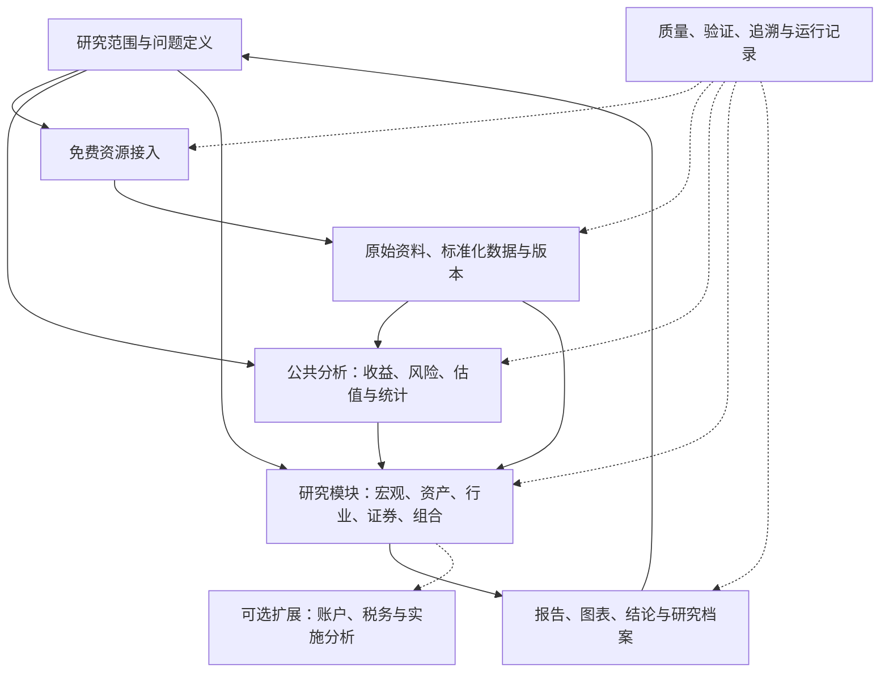

# 个人投资分析框架 V0.3

**Personal Investment Research OS**

**修订日期：** 2026-10-22

**文档性质：** 个人研究系统的总体设计基线，为后续模块细化与实现提供基础。

**当前状态：** 架构文档已形成；P1 首个案例所需契约与 P2 小规模贯通已实现（见[实现说明](implementation.md)）；P3、P4 尚未开始。

## 1. 目标、范围与设计边界

### 1.1 已确认的项目目标

> 设计一个个人使用的分析框架，先构架大框架，为后续细化做基础。全部使用可获得的免费资源，并考虑可靠性与可扩展性。

框架面向投资研究，覆盖全球经济、市场、大类资产、地区、行业、证券和组合分析。研究成果可以是描述、解释、比较、预测或策略模拟，不要求每项成果都转化为买卖行动。

当前任务是明确模块职责、输入输出、依赖关系、资源路径、可靠性规则和扩展方式。具体模型、参数、指标全集和页面布局在对应模块细化时确定。

### 1.2 核心范围与可选扩展

| 范围 | 定位 |
|---|---|
| 研究定义、数据与资料管理、公共分析、结果与验证 | 核心能力，所有研究分支共用 |
| 宏观、市场、大类资产、行业、证券、组合研究 | 大框架内的研究分支，可独立细化和启用 |
| 预测与策略模拟 | 按问题需要启用，不是描述性研究的必经环节 |
| 全球、美国、中国及其他市场 | 保留统一标识及市场差异接口，实际支持范围逐项验证 |
| 个人账户、税务、实际配置与实施分析 | 未来可选应用，不作为研究核心的前置条件 |
| 自动交易、商业服务、付费数据能力 | 不属于当前建设范围 |

个人资金规模、券商账户、税务身份和风险承受能力不阻碍总体设计或公开数据研究。资金金额可在后续特定模拟中作为显式参数，不决定研究范围或架构。美元、美国税务居民、十年以上投资期限均不再作为全局前提；研究分别声明币种、地区与期限。

日、周、月、季度及年度数据可作为起步候选；首个贯通案例优先选择数据容易核验的低频问题。具体市场和频率是案例选择，不将总体架构锁定为某一种 ETF、某一个市场或某一种策略。

### 1.3 免费资源的定义

必要运行链路应具备无需付费订阅或购买许可的路径，包括数据取得、计算、存储、分析和报告生成。允许免费注册、免费 API key、官方文件下载及人工导入；不以限时试用、赠送额度、付费 AI API 或付费云服务作为必要依赖。

默认利用已有个人设备本地运行。免费不等于硬件、电力、维护时间和存储没有成本，也不意味着免费服务永久可用。来源停止免费、许可改变或质量不足时，替换来源、降级功能或暂停相关研究，不能静默转为付费依赖。

## 2. 设计原则

1. **先明确边界，再逐项实现。** 总体设计描述完整研究地图，首个实现只验证其中一条小规模路径。
2. **来源与计算可追溯。** 重要结果关联原始资料、数据版本、转换步骤、代码和配置。
3. **按用途判断可靠性。** 官方来源、完整历史、历史可用性和适合某种分析是不同维度。
4. **不同研究有不同证据要求。** 描述性报告不必输出预测；计算正确不等于模型有效；相关性不自动构成因果解释。
5. **模块可独立替换。** 数据供应方、研究方法、展示方式及 AI 辅助不相互绑定。
6. **缺失和失败显式表达。** 不以零、隐含前值、替代模型或未经说明的代理掩盖数据缺口。
7. **个人维护规模。** 默认单机、模块化、批处理；先使用简单方法，不预建微服务或全市场复杂模型。

## 3. 总体架构与模块契约



模块是逻辑职责，不要求独立服务。研究分支可以直接使用合格数据和公共分析，不必顺序经过宏观、预测、筛选与优化；验证贯穿全程。

| 模块 | 主要输入 | 核心输出 | 依赖与失败行为 | 扩展方式 |
|---|---|---|---|---|
| Q：研究定义 | 问题、研究对象、方法与范围 | 研究说明、比较基准、评价方式 | 缺少关键范围时限制相关结论 | 新问题类型或研究协议 |
| D：资源接入 | 来源登记、访问配置、原始文件 | 原始快照、取得记录、访问状态 | 失败时保留旧版本并报告，不伪造新数据 | 来源适配器或文件导入器 |
| S：数据与资料 | 原始快照、语义和转换规则 | 标准化对象、质量结果、版本及血缘 | 冲突数据隔离，缺失标记；衍生数据可重建 | 新对象结构及版本迁移 |
| A：公共分析 | 合格数据、方法和参数 | 指标、收益、风险、估值及统计结果 | 输入覆盖不足时停止受影响计算 | 可独立验证的计算组件 |
| M：研究分支 | 研究定义、数据、公共计算 | 描述、解释、预测或模拟成果 | 输出适用范围、证据与限制 | 新分析模块和模块契约 |
| O：成果与档案 | 研究结果、证据与运行记录 | 报告、图表、可检索实验和结论 | 不隐藏失败、缺失或不支持的结论 | 新报告与展示适配器 |
| V：质量与验证 | 各阶段记录、规则与基准 | 校验结果、验证证据、运行状态 | 按依赖限制受影响输出，保留可复查历史 | 新质量规则、实验评估方法 |
| E：可选应用 | 研究成果、另行定义的账户与规则 | 账户、税务或实施分析 | 单独检查事实完整性与适用条件 | 独立应用模块，不反向阻断研究 |

后续细化每个模块时，至少写清回答的问题、输入、输出、依赖、失败行为和扩展方式。跨模块通过有版本的数据对象及结果契约交换信息，不能依赖另一个模块的临时文件布局或界面状态。

## 4. 研究范围与公共分类

| 研究分支 | 可回答的问题 | 后续细化边界 |
|---|---|---|
| 宏观与政策 | 增长、通胀、信用、流动性和政策如何变化？ | 观测、调查与模型估计分开；状态定义可复核 |
| 市场与大类资产 | 不同资产的收益、估值和风险如何比较？ | 统一期限、币种、收益及费用口径 |
| 地区与行业 | 结构、周期、集中度和相对表现有何差异？ | 分类标准及有效时间；经济敞口与上市地分开 |
| 证券与基金 | 财务、估值、费用、持仓及工具结构有何特点？ | 财报期间与申报时间、分红拆股、证券标识及历史变化 |
| 组合与情景 | 资产如何共同影响风险，假设变化会造成什么结果？ | 模拟权重、成本、联合情景及相关性明确，无需真实持仓 |
| 预测与策略实验 | 某种信号是否改善预测或模拟表现？ | 基准、时间可用性、样本外检验与成本假设 |

资产分类和风险分类分别维护。股票、利率、信用、通胀、汇率、商品、流动性与工具结构是可扩展的风险分类起点。一个工具可以暴露于多个风险来源；ETF 数量不能替代分散程度，国债收益率不能直接当成债券基金回报。

市场扩展要说明交易日历、时区、币种、单位、会计口径、公司行动和数据覆盖。组合模拟或交易策略另检查交易规则；纯宏观描述不需要等待交易制度模块完成。

## 5. 免费资源目录与接入方式

### 5.1 来源登记的最低内容

每项来源登记：原始发布者、取得渠道、数据对象、字段语义、历史与频率覆盖、发布时间和修订特点、免费范围、使用许可、注册要求、额度或限速、取得方式、可接受延迟、核验日期、质量检查、替代路径及维护负担。

将状态分别记录为：

- **候选来源**：只有资料入口，访问及覆盖尚未核验。
- **说明已核验**：已阅读官方说明，尚不代表程序接入成功。
- **接入已验证**：指定获取方式和样本取得成功，记录条件与日期。
- **用途已验证**：在明确数据范围内通过相应分析或历史研究要求。

状态按来源、数据集和用途记录，不能因一个样本下载成功就宣称整个来源可用。自动 API、官方文件下载和人工导入均是正式接入路径；人工导入同样记录来源、取得时间、原始文件与转换规则。

### 5.2 初始资源地图

下表是后续核验的候选地图，不构成全量接入承诺。2026-10-22 的说明核验仅覆盖表内注明的官方文档；本项目尚未进行接口连通性、批量下载或历史完整性测试。

| 类别 | 候选资源 | 当前依据与限制 |
|---|---|---|
| 宏观与历史修订 | [FRED API](https://fred.stlouisfed.org/docs/api/api_key.html)、[ALFRED](https://alfred.stlouisfed.org/help)，以及原始统计机构 | 说明已核验：FRED API 要求 key；ALFRED 提供历史版本，发布日期有不同确定依据；按序列核验覆盖 |
| 美国国债曲线 | [Treasury 历史数据](https://home.treasury.gov/resource-center/data-chart-center/interest-rates/daily-treasury-rate-archives) | 说明已核验：有 CSV 档案和 XML 入口；当前期与历史档案需分别确认 |
| 公司申报与财报 | [SEC EDGAR API](https://www.sec.gov/search-filings/edgar-application-programming-interfaces) | 说明已核验：申报与 XBRL API 无需 key；聚合接口有口径与覆盖限制，接入时遵守访问规则 |
| 基金资料 | 基金发行方公开费用、净值、持仓与分配资料 | 候选；逐家核验下载和历史覆盖；净值不替代成交价 |
| 证券行情 | [yfinance 项目](https://github.com/ranaroussi/yfinance)等第三方工具 | 项目说明已核验：非 Yahoo 官方工具，数据权利另受上游条款约束；作为可替换接入，不保证持续可用 |
| 学术因子与估值 | [Kenneth French](https://mba.tuck.dartmouth.edu/pages/faculty/ken.french/data_library.html)、Shiller、Damodaran 等公开资料 | 候选；细化时核验下载、方法、许可与历史修订 |
| 全球宏观 | 世界银行、IMF、BIS、OECD 等官方资料 | 候选；按数据集确认免费范围、接口和可比口径 |
| 中国宏观与证券 | 国家统计局、人民银行、外汇局、交易所及公开披露平台；社区工具可作接入候选 | 候选；按数据集核验可获得性、口径变化、历史范围与接口稳定性 |
| 调查与模型估计 | SPF、GDPNow、ACM、机构公开资本市场假设等 | 候选；分别记录调查或模型方法，不能当作直接观测或相互无条件替代 |

FRED 的[使用条款](https://fred.stlouisfed.org/docs/api/terms_of_use.html)明确部分序列涉及第三方权利；通过官方平台取得数据不等于所有数据具有相同使用权限。使用范围按具体资源登记，不将公开网页、免费 API 与可自由再分发混为一谈。

完整历史期权链、逐笔与订单簿、历史指数成分和退市证券等资源，在取得并验证适用免费数据前列为能力缺口。不承诺具备相应完整历史回测能力；允许明确标记的理论分析和有限样本研究。

## 6. 数据、时间与结果契约

### 6.1 数据对象

共享标识、来源和版本规范，但不强制将所有资料压成一张长表。

| 对象 | 结构重点 |
|---|---|
| 宏观、行情与指标序列 | 观测期间、数值、单位、频率、币种与数据版本 |
| 资产、证券与市场 | 稳定 ID、代码有效期、分类、上市地、经济敞口、市场规则引用 |
| 财报与事件 | 实体、指标、期间、申报、修订、单位及事件生效时间 |
| 文献、公告与研究资料 | 原始文档、来源、发布日期、页码或段落定位；提取内容与原文关联 |
| 研究定义与结果 | 问题、假设、方法、范围、结果类型、证据及限制 |
| 实验与运行 | 数据快照、代码、配置、方法版本、运行状态和输出清单 |

### 6.2 时间与版本

| 字段 | 含义 |
|---|---|
| `observation_at` | 观测对应时点或期间 |
| `published_at` | 该版本实际发布时间，未知则留空 |
| `available_at` | 按明示规则最早可用于该项研究决策的时点 |
| `retrieved_at` | 系统实际取得资料的时点 |
| `vintage_id` | 供应方历史版本，或明确标记的本地快照版本 |
| `source_id` / `upstream_id` | 获取渠道及原始来源 |
| `schema_version` / `content_hash` | 对象结构版本及内容校验信息 |
| `quality_status` / `reason` | 数据质量及理由 |

数值对象还需记录单位、币种、频率、价格类型与复权方式等语义。具体必填规则按对象细化，不向不适用字段填入伪值。模型与代码版本属于实验或运行记录，通过血缘关联原始数据。

历史预测与策略重放只允许使用当时可获知的数据版本；今天取得的历史版本可以支持历史研究，但不能冒充过去实际运行过的记录。仅有发布日期时声明保守时间规则；无法恢复的历史版本明确标记，不能用今天的快照补作当时数据。

描述性研究可使用最新修订历史，但必须标明口径，不据此声称具备当时的预测能力。

### 6.3 不同成果的输出契约

所有成果共有：研究 ID、类型、研究范围、生成与数据截止时间、方法、数据和运行版本、主要结果、证据、覆盖及限制。各类型再增加相应字段：

| 成果类型 | 特有内容 | 验证重点 |
|---|---|---|
| 描述与比较 | 指标定义、比较口径、图表及资料定位 | 数据与计算正确，比较条件一致 |
| 解释与归因 | 机制假设、替代解释、分解或模型假设 | 不重复归因；因果主张需额外识别依据 |
| 预测 | 预测起止时间、目标、点估计与适用区间或概率 | 预设基准、样本外误差、校准与失效条件 |
| 情景与策略模拟 | 情景、规则、模拟组合、成本、交易时序 | 假设可复查、无时间泄漏、基准公平、结果敏感性 |

不是每种成果都有未来收益、概率或配置权重。未经校准的情景权重不能被描述为客观概率；模拟、预测和观测结果明确区分。

## 7. 公共计算与可靠性

### 7.1 统一分析口径

每项计算声明币种、期限、频率、名义或实际、税费、价格收益或总收益、算术或几何口径。

- 总收益处理中不得将已经包含的分红再加一次；基金费用已反映在净值时不能无依据重复扣减。
- 国债年化收益率与持有期收益分开；代理历史与真实工具历史分开。
- 协方差描述相应期限的资产收益联合变动；预期收益估计误差另行表达，不能混为同一个风险对象。
- 长期复合增长率不能直接作为单期算术预期收益；风险跨频率缩放需注明假设。
- 若汇率为“一单位当地货币值多少基准货币”，换算满足 `1 + r_base = (1 + r_local) × (1 + r_fx)`；已含汇率影响的基金收益不重复换算。
- 机构资本市场假设比较前统一期限、币种和方法；不能机械平均不兼容的估计。
- 模型输出、经济情景与统计归因不自动相加；组合情景需要共同假设或适用相关结构。

### 7.2 质量与失败行为

质量至少区分来源可信度、数据性质、时间适用性和用途适用性。官方发布的模型估计仍是估计；同一上游的两个转载渠道不构成两次独立验证。

| 情况 | 行为 |
|---|---|
| 取得失败或限流 | 有界重试、缓存或已验证替代路径；记录失败，不生成虚假的更新日期 |
| 部分缺失 | 显示覆盖，运行不依赖缺失部分的分析；填补方法须显式声明 |
| 超过用途要求的更新时间 | 旧结果可查看，停止依赖新鲜数据的当前分析；固定快照的历史研究可继续 |
| 口径冲突或异常 | 隔离受影响输入与输出，保留诊断信息 |
| 备用源可用 | 先检查语义、单位、时间、复权与用途兼容性，再记录切换 |
| 免费资源不足 | 缩小范围、频率或结论；相关能力标记未支持 |

原始资料保留快照与校验值，更正追加新版本并记录关系。缓存只保证已取得数据可复查，不等于恢复未取得的历史或保证可无限留存；存储和备份遵循资源许可。

## 8. 研究验证与证据积累

验证强度与结论类型相称，不为简单描述报告强制运行完整策略回测。

| 层面 | 需要证明的事项 |
|---|---|
| 数据与工程 | 字段、时间、单位和转换正确；来源可追溯；固定输入可复现；失败状态真实 |
| 分析方法 | 公式与方法适用，假设明确；必要时与手算或可信参考交叉核验 |
| 预测与策略 | 与事先指定基准公平比较；评估数据未被用于调参；成本与时序明确 |
| 研究结论 | 证据支持所述范围，区分结果、解释、假设及仍未知事项 |

预测和策略实验在评估前登记问题、基准、指标、数据区间、参数选择方式与停止条件；按时间划分训练、验证与测试，处理标签重叠、有效样本量和多次试验选择偏差。报告失败尝试、参数敏感性和不同市场阶段，不能只保留最佳结果。

策略模拟按研究范围处理分红、费用、价差、滑点、交易制度及资金流；税务影响仅在显式税务情景下加入。未知成本给出敏感性范围。现存标的回测需披露选择与存活偏差，成立前代理不冒充真实业绩。

每次研究从开始即保存定义、数据版本、运行记录与结果。后续可以扩展检索、比较和复查提醒，但不能等到高级模型阶段才开始留痕。负面结论和证据不足也是可交付成果，模型没有优于基准不等于框架实施失败。

## 9. 软件、展示与扩展机制

### 9.1 实现方向

采用本地单机、批处理、模块化项目。Python、pandas/NumPy、Parquet、DuckDB、Git 和 pytest 是初始技术候选；Jupyter 用于探索，Streamlit 或静态报告按展示需要选择。具体版本、许可和兼容性在实现时核验并锁定，不在架构阶段预装完整模型生态。

核心计算可以脱离交互界面运行；研究笔记调用可复用计算，正式结果不依赖未保存的交互状态。保持原始资料、标准化数据、衍生结果和运行清单分离。分析库采用单写入者流程，备份与恢复按实际数据规模验证。

```text
investment-research-os/
├── config/                  # 研究范围、来源、资产及方法登记
├── src/investment_os/
│   ├── connectors/          # API、官方文件和人工导入
│   ├── data/                # 数据对象、版本与血缘
│   ├── quality/             # 质量检查与用途限制
│   ├── analytics/           # 公共收益、风险、估值和统计
│   ├── research/            # 宏观、资产、行业、证券、组合等分支
│   ├── validation/          # 实验与验证
│   ├── reporting/           # 图表、报告和研究档案
│   └── extensions/          # 将来按需增加的应用
├── data/                    # 原始、标准化、衍生数据；默认不提交 Git
├── research/                # 研究说明和探索笔记
├── runs/                    # 数据、代码、配置及输出清单
├── reports/
├── app/                     # 可选交互界面
├── tests/
└── docs/
```

目录表示职责而非已实现功能，也不要求立即创建所有目录。

### 9.2 可扩展性的具体承诺

- 同类序列或标的尽量通过注册表新增；新来源通过适配器接入。
- 新研究方法通过明确输入输出替换或并列比较，不修改已有原始事实。
- 新对象类型、市场制度或模型需求允许增加结构与代码；变更限制在相关模块，提供结构版本、必要迁移和回归验证。
- 旧数据、旧实验及旧报告保持可识别；不以新算法静默重写过去结果。
- 展示读取结构化研究成果；更换界面不改变计算定义。

可扩展不意味着“支持所有资产只需增加配置”。新增能力必须分别说明数据、计算、适用范围与验证状态。

### 9.3 AI、隐私与运行成本

AI 可辅助提取资料、提出假设、解释和起草报告；关键数值来自可追溯计算，提取内容保留原文定位。核心接入、计算、验证和报告生成须有不依赖 AI 的运行路径。任何本地模型也需核验许可、资源需求和任务质量，不预设其免费即可胜任。

密钥和个人敏感资料不进入 Git；公开来源数据的存储与分享仍遵循许可。当前设计不需要真实账户文件。更新节奏由数据发布与研究用途决定，不假设云环境或个人设备持续在线。

## 10. 建设顺序与阶段完成条件

| 阶段 | 主要交付 | 完成条件 |
|---|---|---|
| P0：总体架构 | 目标、范围、模块、依赖、资源地图、可靠性和扩展边界 | 后续模块可据此独立细化；核心不依赖账户、税务或付费服务；未实现能力明确 |
| P1：公共契约与资源核验 | 首个案例所需的数据目录、对象与时间契约、风险分类、结果及运行规范 | 具体免费取得路径有证据；样本可读；用途与缺口明确；无须穷尽所有市场 |
| P2：小规模贯通验证 | 资料取得 → 标准化 → 公共分析 → 报告与运行记录 | 数值可复核、来源可追溯、固定输入可重现、缺失或失效能正确限制输出 |
| P3：研究模块渐进扩展 | 宏观、资产、行业、证券、组合等模块按需要增加 | 各模块具备输入输出及独立验证；已有流程不因扩展失效 |
| P4：高级研究或可选应用 | 按需增加复杂预测、策略、新市场或个人账户等应用 | 分别满足数据、方法与用途要求；不以模型获利作为软件完成标准 |

首个贯通案例只用于检验公共接口和工作流程，可以是利率曲线变化等低频描述性研究。具体案例在 P1 选择，不预先要求个人配置或真实投资。预测与策略在对应分支验证；无关研究不必等待它们通过。

当前文档对应 P0 的设计交付。2026-10-22 起，P1 已覆盖首个案例所需的来源登记与契约，P2 已用美国国债收益率曲线案例跑通并通过复现校验（见[实现说明](implementation.md)）；P1 其余市场与对象、P3、P4 尚未实现。来源说明核验不等于样本接入或用途核验完成。

## 11. 后续细化与待定事项

优先围绕首个贯通案例补充以下规范，可先作为小节或少量文件，不强制建立庞大文档体系：

1. 数据目录与取得方式：免费条件、样本、范围、维护和失效路径。
2. 公共对象与时间契约：标识、单位、历史版本、质量和血缘。
3. 资产与风险分类：工具、经济敞口、市场差异及代理关系。
4. 研究结果与运行规范：问题、成果类型、证据、快照和复现方式。
5. 与案例相称的验证方式：计算参考、失败场景和结论边界。

首个案例、先接入的少量来源、更新频率和展示方式在 P1 细化，可按可获得性与维护成本选择。具体预测模型、策略参数和 UI 细节随模块确定。个人税务、账户及投资政策仅在启用对应应用时确认，当前不作为待补齐的必填个人资料。

## 12. 修订说明与历史追溯

V0.3 按用户于 2026-10-22 确认的定位修订，主要变化如下：

- 从账户与配置流程优先，调整为先完成个人研究框架，再细化公共契约和研究模块。
- 保留方案 A 的广泛研究范围与模块分离；保留 V0.2 的时间契约、语义检查、收益口径、版本与验证原则。
- 将描述、解释、预测和策略模拟分别定义，不再让所有研究输出承担预测或交易字段。
- 个人账户、税务、实际配置与实施分析转为可选扩展；不设美国税务居民或真实账户为全局前提。
- 将免费要求覆盖到必要运行链路，加入人工导入路径、来源核验状态及明确的能力缺口。
- 将“只加配置即可扩展”的宽泛承诺改为模块边界、结构版本及相称验证。

[历史方案索引](archive/README.md)保存 A、B、C 和按字节归档的 V0.2。历史账户与税务规则仅供对应扩展重新评估，不能直接作为当前已核验规则。

**交付边界：** 本版本是总体设计基线。架构文档完成、软件实现完成、数据用途核验通过和研究模型有效是不同状态，分别记录与验证。
