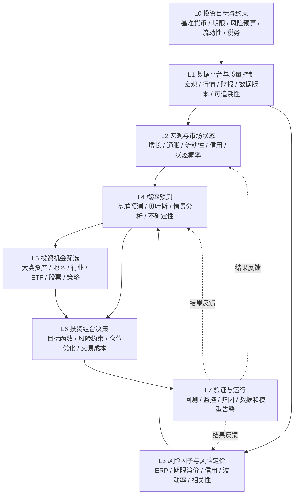

# 个人投资研究与决策系统：总体架构 V0.1

**Personal Investment Research OS**  
**版本：** V0.1  
**日期：** 2026-10-22  
**定位：** 个人使用、机构级研究逻辑、零付费资源、可靠、可复现、可扩展。

> **设计目标**：构建从全球经济与大类资产研究，逐步深入到地区、行业、股票、ETF、债券和期权策略的个人投资分析系统。研究、预测、资产配置和交易实施相互独立，以便持续扩展而不推翻基础架构。

---

## 一、系统的六项设计原则

| 原则 | 具体要求 |
|---|---|
| **零付费** | 数据、软件、数据库和日常运行均使用免费资源；不以付费行情或商业 API 为基础。 |
| **数据可信** | 优先政府、监管机构、交易所、学术机构；非官方数据须标记质量等级。 |
| **模型可验证** | 每个模型必须能回测、比较基准、追踪版本，并区分历史表现和未来预测。 |
| **模块化扩展** | 全球、美国、中国市场使用统一接口，但允许采用不同分析模型。 |
| **AI 可替换** | AI 辅助研究、提取信息、生成假设；核心计算与风险控制不依赖某个 LLM。 |
| **决策可解释** | 每个配置建议都能追溯到数据、风险因子、预测、参数和约束。 |

**现实边界：** 完全免费和数据可靠之间存在权衡。美国宏观经济、国债收益率、上市公司财报等免费官方数据较充足，但完整的历史期权链、逐笔成交、订单簿、历史指数成分股等数据通常难以同时做到完整、可靠、长期免费。系统必须能明确标注数据缺口，不能以未经验证的数据悄悄填补。

---

## 二、总体架构：八个模块



### 各层输入和输出

| 模块 | 核心输出 |
|---|---|
| **L0 — Investment Policy** | 投资政策配置、风险预算与约束。 |
| **L1 — Data Platform** | 可追溯、可复现的数据集。 |
| **L2 — Macro & Regime** | 宏观状态、状态概率和主要变量变化。 |
| **L3 — Risk & Pricing** | 风险敞口、风险溢价估计、协方差与模型误差。 |
| **L4 — Forecast** | 资产未来收益的概率分布及预测不确定性。 |
| **L5 — Selection** | 有依据的候选资产与证券、筛选结果。 |
| **L6 — Portfolio Decision** | 目标仓位、组合风险、调整原因及交易成本。 |
| **L7 — Validation & Operations** | 历史预测记录、样本外表现、监控及模型告警。 |

**关键接口：L4 输出预测分布，L6 根据预测分布和投资约束决定配置。** 不应由 LLM 直接把新闻转成具体仓位。L1 和 L7 应优先建设，它们是后续模型可信性的基础。

---

## 三、市场范围：全球架构、美国先行、中国独立扩展

| 市场模块 | 系统定位 | 第一阶段工作 |
|---|---|---|
| **全球** | 宏观比较、跨国资产配置、汇率与资本流动。 | 建立全球宏观观察框架。 |
| **美国** | 资产配置、证券筛选和组合研究的主要实施市场。 | **优先完整建设。** |
| **中国内地** | 中国宏观、政策、A 股及债券市场研究。 | 预留数据与市场制度接口。 |
| **其他市场** | 欧洲、日本及新兴市场。 | 先通过全球指数或 ETF 获取代表性敞口。 |

每项证券至少区分：

1. **上市及交易市场**（在哪里交易）；
2. **经济风险来源**（究竟暴露于哪些国家、行业与风险因子）；
3. **计价货币与汇率敞口**；
4. **投资者实际可使用的工具及市场准入规则**。

例如，美股上市的中国主题 ETF 不等同于直接交易 A 股，其上市地、监管结构和货币风险可能不同。

---

## 四、免费数据资源与可信度控制

### 4.1 初始数据源目录

| 数据类别 | 推荐免费资源 | 主要用途 | 系统优先级 |
|---|---|---|---|
| 美国宏观 | [FRED](https://fred.stlouisfed.org/) / [ALFRED](https://alfred.stlouisfed.org/) | CPI、就业、利率、信用、数据历史修订 | 核心 |
| 美国国债 | [U.S. Treasury](https://home.treasury.gov/resource-center/data-chart-center/interest-rates) | 名义/实际收益率曲线、TIPS、短期国债 | 核心 |
| 国债期限溢价 | [New York Fed ACM](https://www.newyorkfed.org/research/data_indicators/term-premia-tabs) | 模型估计的 1–10 年期国债期限溢价 | 核心 |
| 美股财报 | [SEC EDGAR](https://www.sec.gov/edgar/search/) / [SEC APIs](https://www.sec.gov/search-filings/edgar-application-programming-interfaces) | 营收、利润、现金流、资产负债 | 核心 |
| 美国风险因子 | [Kenneth French Data Library](https://mba.tuck.dartmouth.edu/pages/faculty/ken.french/data_library.html) | 市场、价值、规模、盈利等因子 | 核心 |
| 股票 / ETF 行情 | [yfinance](https://github.com/ranaroussi/yfinance) 等免费接口 | 日线、分红、拆股、总收益计算 | 核心，但需核验 |
| 波动率指数 | [Cboe](https://www.cboe.com/tradable_products/vix/vix_historical_data/) | VIX 等公开波动率指数历史 | 核心 |
| 全球宏观 | [World Bank](https://data.worldbank.org/) / [IMF Data](https://data.imf.org/) / [BIS Statistics](https://www.bis.org/statistics/) | 跨国增长、信用、利率、外部资产负债 | 扩展 |
| 中国宏观 | [国家统计局](https://www.stats.gov.cn/) / [人民银行](https://www.pbc.gov.cn/) / [SAFE](https://www.safe.gov.cn/) | 增长、信用、货币、跨境资本流动 | 扩展 |
| 中国证券 | [上交所](https://www.sse.com.cn/) / [深交所](https://www.szse.cn/) / [AKShare](https://github.com/akfamily/akshare) | A 股、指数、债券、市场资料 | 扩展 |

**重要限制：**

- FRED/ALFRED 适合构建带发布时间与历史版本的宏观数据库。
- 美国财政部的收益率曲线属于市场报价整理结果；ACM 期限溢价属于**模型估计结果**，不能混同为可直接观察的价格。ACM 公开期限主要为 1–10 年，不能直接当作 20 年以上 TLT 期限溢价。
- SEC 财务资料应采用实际申报时间，不能把季度归属时间当作投资者已知时间。
- yfinance 是**非官方**行情工具，不应假定长期稳定、完整或无使用限制。关键字段应抽样与基金发行人、交易所或其他权威资料交叉核验。
- 公开 VIX 指数历史不等于可免费获得完整的历史期权报价、Greeks、成交及订单簿。
- AKShare 的接口可能变更、失效或被移除，必须设自动测试和来源备选方案。

### 4.2 数据可信度分级

| 等级 | 来源类型 | 使用原则 |
|---|---|---|
| **A** | 官方机构、监管机构、原始发行方或公开方法清晰的原始数据 | 作为核心输入，仍要核实发布时间与修订。 |
| **B** | 有公开方法论的学术与专业机构估计数据 | 保存模型方法、版本与假设。 |
| **C** | 非官方第三方聚合、网页提取或社区接口 | 允许研究用途，关键字段交叉核验；失败与缺失不得默认为零。 |

### 4.3 免费数据的能力边界

| 研究内容 | 免费资源可行性 |
|---|---|
| 美国宏观、国债曲线 | 高 |
| 美股公开财报 | 高 |
| ETF 日线、历史总收益 | 可行，但须检查质量、授权和复权方法 |
| 中低频技术指标 | 高，取决于基础行情 |
| 部分波动率指数 | 高 |
| 稳定、完整、实时期权链 | 不保证有可靠的无条件免费来源 |
| 完整历史期权链及历史 Greeks | 通常付费 |
| 逐笔成交、订单簿 | 通常付费 |
| 全市场无幸存者偏差的历史成分股及退市股数据库 | 免费数据通常存在缺口 |

**第一版专注日频、周频、月频投资研究，而非高频交易。**

---

## 五、模型体系：循序升级，不先堆叠深度学习

| 模型层 | 第一版采用 | 后续可扩展 |
|---|---|---|
| 市场状态 | 收益率曲线、信用利差、通胀、趋势等规则/统计模型 | Bayesian Regime / Hidden Markov Model |
| 预期收益 | 市场基准、估值及历史数据收缩估计 | Bayesian / Black–Litterman |
| 风险预测 | 历史波动、EWMA、协方差收缩 | GARCH / 状态空间模型 |
| 因子分析 | 线性回归、多因子模型 | 动态因子 / 贝叶斯回归 |
| 机会筛选 | 标准化多因子评分 | Elastic Net / Gradient Boosting |
| 组合优化 | 风险预算、带约束均值方差优化 | CVaR / Bayesian Robust Optimization |
| 回测验证 | 滚动样本外测试 | 参数稳定性、Bootstrap、概率校准 |

### 5.1 初始决策函数

$$
\max_{\mathbf w\in\mathcal C}
\left[
\hat{\boldsymbol\mu}^{\top}\mathbf w
-\frac{\gamma}{2}\mathbf w^\top\hat\Sigma\mathbf w
-\rho\,TC(\mathbf w,\mathbf w_0)
-\xi\|\mathbf w-\mathbf w_{\rm base}\|_2^2
\right]
$$

含义：

- $\hat{\boldsymbol\mu}$：模型估计的预期收益向量；
- $\hat\Sigma$：预期收益协方差矩阵；
- $\gamma$：风险厌恶参数；
- $TC(\mathbf w,\mathbf w_0)$：从当前持仓 $\mathbf w_0$ 调整到目标持仓的预估交易成本；
- $\mathbf w_{\rm base}$：长期战略基准组合；
- $\xi$：对过度偏离战略基准的惩罚；
- $\mathcal C$：仓位、杠杆、流动性及风险约束集合。

参数应有统一收益/成本口径，并通过真实风险约束及历史验证校准，不应主观随意指定。

**关键规则：** 当预期收益估计不可靠时，回退到固定战略配置、风险预算或其他低参数敏感度方法，不能强迫优化器给出貌似精确的答案。

---

## 六、本地免费软件技术栈

| 功能 | 工具 | 理由 |
|---|---|---|
| 语言 | [Python](https://www.python.org/) | 免费、量化生态成熟 |
| 数据处理 | [pandas](https://pandas.pydata.org/) / [NumPy](https://numpy.org/) | 通用计算与验证 |
| 本地分析库 | [DuckDB](https://duckdb.org/) | 本地 SQL、Parquet 支持好 |
| 文件格式 | [Apache Parquet](https://parquet.apache.org/) | 适合列式历史数据存储 |
| 统计分析 | [statsmodels](https://www.statsmodels.org/) / [scikit-learn](https://scikit-learn.org/) | 回归、时间序列、机器学习 |
| 贝叶斯模型 | [PyMC](https://www.pymc.io/) | 后续复杂概率估计 |
| 投资组合优化 | [CVXPY](https://www.cvxpy.org/) / [PyPortfolioOpt](https://pyportfolioopt.readthedocs.io/) | 优化约束与模型实现 |
| Dashboard | [Streamlit](https://streamlit.io/) | 免费本地交互界面 |
| 自动测试 | [pytest](https://docs.pytest.org/) | 数据与模型测试 |
| 版本管理 | [Git](https://git-scm.com/) | 源码、配置与模型版本 |
| 本地调度 | macOS `launchd` / Linux `cron` | 无需付费云服务 |

**部署原则：** 第一版采用单机、本地数据库、批量更新，不预先引入复杂的服务器或微服务。

### 6.1 推荐项目目录

```text
investment-research-os/
├── config/              # 投资目标、约束和参数
├── data/
│   ├── raw/             # 原始数据、来源与版本
│   ├── validated/       # 已校验数据
│   └── features/        # 指标和风险因子
├── src/
│   ├── connectors/      # FRED、SEC、ETF 行情等接口
│   ├── markets/         # US / Global / China
│   ├── macro/           # 宏观与状态模型
│   ├── risk/            # 风险计量与溢价
│   ├── forecasts/       # 概率与贝叶斯预测
│   ├── selection/       # 资产和证券筛选
│   ├── portfolio/       # 优化和组合管理
│   └── backtest/        # 回测、验证、归因
├── app/                 # Streamlit 界面
├── research/            # Jupyter 研究笔记
├── tests/               # 自动测试
├── reports/             # 研究报告
└── docs/                # 数据与模型规范
```

### 6.2 数据最小规范（Data Contract）

| 字段 | 用途 |
|---|---|
| `series_id` / `asset_id` | 指标或证券稳定标识 |
| `source` | 数据来源 |
| `observation_date` | 经济指标或行情对应日期 |
| `published_at` | 实际发布/可以被投资者获知的时间 |
| `retrieved_at` | 系统取得数据的时间 |
| `vintage` | 历史修订版本 |
| `currency` / `unit` | 货币和单位 |
| `adjustment` | 价格复权、总收益等处理信息 |
| `quality_status` | 有效、缺失、异常、待核验 |
| `model_version` | 使用数据时的模型版本 |

**历史重放规则：** 任意指定过去某一决策日，系统应只使用当时已经发布、且按当时版本可获得的数据，避免未来信息泄漏。

---

## 七、第一版资产研究范围

研究对象用于代表风险因子，**不代表实际持仓建议**。

| ETF | 代表的风险领域 |
|---|---|
| **SPY** | 美国大型股票市场风险 |
| **SGOV** | 短期美国国债及现金类基准 |
| **IEF / TLT** | 美国中长期国债久期风险 |
| **LQD / HYG** | 投资级和高收益信用风险 |
| **IAU** | 黄金敞口 |
| **VXUS** | 美国以外股票市场风险 |

合计 8 个研究标的。它们不是纯因子，例如 HYG 同时包含信用、利率与流动性风险。

**历史数据注意：** SGOV 历史有限；较早期研究可使用同期短期国债数据构建明确标识的代理基准，但不能把代理序列冒充真实 ETF 历史。

---

## 八、最终 Dashboard 的五个页面

| 页面 | 主要功能 |
|---|---|
| **1. Macro Monitor** | 增长、通胀、利率、信用、金融条件与宏观状态。 |
| **2. Risk Premium** | 风险溢价、波动、相关性、定价变化与模型不确定性。 |
| **3. Opportunity** | 候选资产、证券评分、预期收益区间及研究依据。 |
| **4. Portfolio** | 战略/战术配置、风险贡献、压力测试、目标仓位。 |
| **5. Research & Validation** | 历史预测、模型表现、数据可靠性、回测与绩效归因。 |

**所有重要结论都显示：**

- 数据截至时间与来源；
- 模型版本与不确定性；
- 相对长期基准的变化；
- 数据不足时明确标记，而非强制发出交易信号。

示例输出：

> TLT 相对于其他资产的预期风险调整后吸引力有所提高；但证据不足以支持强方向判断，因此维持基准仓位，不进行战术增配。

---

## 九、建设阶段与验收条件

| 阶段 | 工作内容 | 完成条件 |
|---|---|---|
| **P0 架构基础** | 投资范围、风险分类、数据规范、接口与目录 | 数据源和模型可以独立替换 |
| **P1 数据平台** | 免费数据接入、历史存储、异常检查、价格复权 | 数据可追溯、可重复取得、问题可发现 |
| **P2 风险分析** | 波动率、相关性、久期、信用与跨资产风险 | 结果可解释且与可信基准交叉校验 |
| **P3 配置模型** | 战略配置、简单优化、风险预算、压力测试 | 对固定配置等简单基准完成公平回测 |
| **P4 概率预测** | 贝叶斯、情景模型、Black–Litterman | 样本外预测有可检验的增量价值 |
| **P5 证券研究** | 行业、风格、个股基本面与技术因子 | 候选名单及绩效归因可复现 |
| **P6 期权及全球扩展** | 期权策略、其他国家及中国市场 | 数据质量足以支持相应研究结论 |

**总规则：** 模型越复杂，验证要求越严格。无法获得完整历史期权链时，不得以当前期权数据反推历史精确报价并声称完成了真实市场回测。

---

## 十、架构基线与优先深化事项

| 决策项 | V0.1 基线 |
|---|---|
| 使用对象 | 个人投资者 |
| 主要市场 | 美国，保留全球与中国内地接口 |
| 分析周期 | 日度数据、周度研究、月度配置，支持 3–6 个月战术预测 |
| 资产范围 | 少量大类风险 ETF 起步，再下钻行业、股票及期权 |
| 数据成本 | $0；允许免费 API 注册，但不依赖付费订阅 |
| 本地计算 | Python + DuckDB + Streamlit |
| 核心方法 | 因子模型 + 概率预测 + 稳健组合优化 |
| AI 角色 | 研究辅助、信息解释、假设提出和报告生成 |
| 交易权限 | 先研究、回测与模拟，不直接自动下单 |

### 最优先制定的两个规范

**1. Data Catalog & Data Contract（数据目录与数据契约）**

明确每个数据指标从哪里来、是否存在历史缺口、发布日期、修订历史、复权方法、可信级别及备用来源，确保更换数据提供方不破坏模型。

**2. Risk Factor Taxonomy（风险因子分类体系）**

定义股票、国债、信用、黄金、汇率及期权的风险来源，统一风险敞口与收益分解，避免重复计算同一风险。

只有基础规范稳定后，再细化贝叶斯模型、技术指标、多因子筛选、风险溢价估计、交易工具与 AI Agent 工作流。

---

## 总结

**推荐总路线：**

> 全球视野研究 → 美国市场先行 → 免费可靠的数据底座 → 可解释的风险因子 → 概率预测 → 带风险约束的组合决策 → 严格样本外验证 → 行业、证券、期权和中国市场渐进扩展。

第一版不是为了“预测所有市场”，而是为了建立一个**可审计、可复现、能够拒绝不可靠预测的个人投资研究基础设施**。

---

*注：上述为系统总体设计文档，不构成具体投资建议。免费资源的覆盖范围、接口稳定性、许可与使用限制可能变化；实施阶段须逐项核验。*
