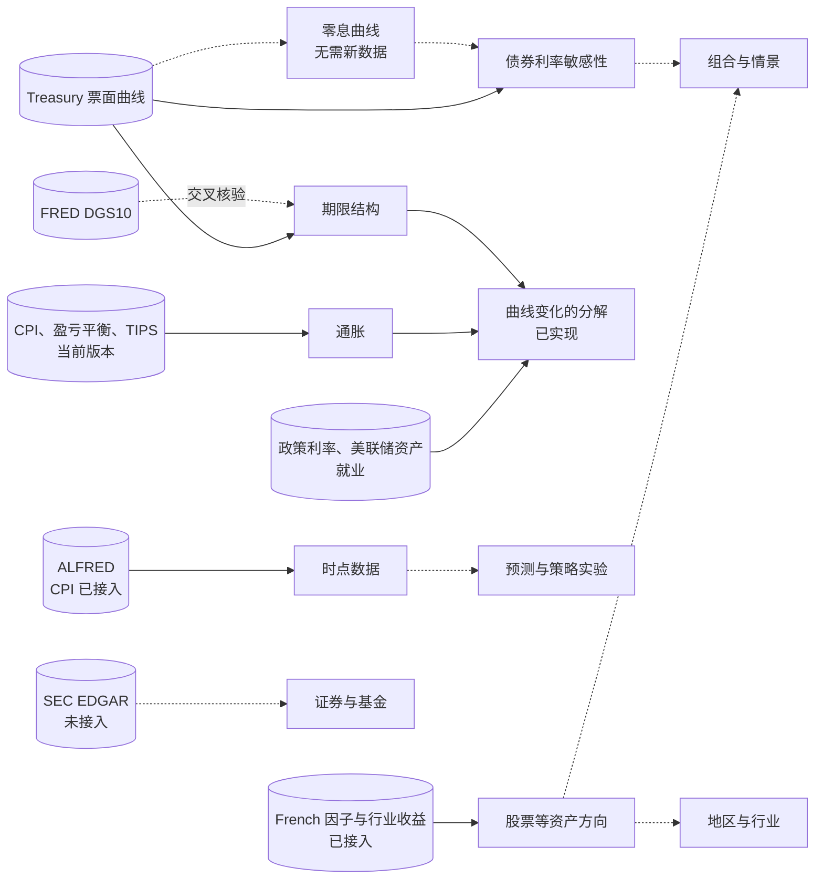

# 研究框架地图

本文把[架构](architecture.md) §4 的研究分支落成可以导航的地图：每个分支研究什么、包括哪些研究方向、依赖什么。新研究动手前，先在这里找到自己的位置。

网站使用的结构（分支、方向、数据集、研究、能回答与不能回答的问题、`needs`）登记在 `site/content.yaml` 的 `branches` 中。各方向现在的状态由登记与运行记录自动得出，见网站的研究能力地图（`map.html`）。本文只写分类原则与依赖关系，不记录状态。

## 1. 分类方式

| 维度 | 取值 | 作用 |
|---|---|---|
| **研究分支**（主轴） | §4 的 6 个分支 | 首页与能力地图的导航，每个研究方向只属于一个分支 |
| 研究方向 | 分支下的具体主题 | 状态、数据与研究登记的单位 |
| 风险来源（标签） | 股票、利率、信用、通胀、汇率、商品、流动性、工具结构（`risk`：equity、rates、credit、inflation、fx、commodity、liquidity、instrument） | 横向联系：同一风险出现在不同分支 |
| 成果类型（标签） | 描述与比较、解释与归因、预测、情景与策略模拟 | 读研究定义的 `result_type`，说明成果的性质与验证要求 |

研究定义里的 `branch`（如 `rates_curve`、`par_bond_scenarios`）是代码中的实现分支，即 `research/` 下注册的函数，不参与导航。

研究方向的状态分为四种：已有研究、已有数据、数据已登记（本次构建未取得）、规划中。分支状态取其方向中最好的一项。

## 2. 已确认的决定（2026-10-23）

- **原网站的 8 个领域改为研究方向**，归入 §4 的研究分支，id 保持不变。其中 6 个属于「市场与大类资产」：原来的领域实际上是按资产划分的研究方向。
- **D1**：假设平价债券的利率敏感性研究归入「市场与大类资产 · 债券利率敏感性」，成果类型为情景模拟。「组合与情景」留给多资产研究。两项已有研究因此在同一分支，共享 Treasury 票面曲线，回答不同问题。
- **D2**：首页按研究分支展示。已有研究或数据的分支展开到方向与研究，规划中的分支合并为一行。
- **D3**：波动率方向的风险标签为「工具结构」，不在风险分类中新增「波动率」。
- **D4**：结构登记在 `site/content.yaml`，替换原来的 `domains`；本文只写原则与依赖。

## 3. 各分支的依赖

只写已经明确的依赖。候选数据源登记在 `config/sources.yaml`（网站的数据资源目录按研究方向列出），不构成接入承诺。

### 3.1 宏观与政策

**总问题**：增长、通胀、信用、流动性和政策如何变化？

- **通胀**：当前版本 CPI、10 年期盈亏平衡通胀率与 TIPS 实际收益率通过 FRED 图表 CSV 取得（接入已验证）。盈亏平衡通胀率含风险溢价，不等于通胀预期。CPI 的历史版本已由 ALFRED 接入（2026-10-23），可以用于时点研究；盈亏平衡通胀率与 TIPS 收益率只有当前版本。
- **政策利率与流动性**：联邦基金有效利率、SOFR、3 个月国库券利率与美联储总资产已接入（FRED）；短端比较复用 Treasury 曲线。政策利率预期需要期货或调查数据，尚无来源。
- **增长与就业**：失业率与非农就业人数已接入：FRED 当前修订版本，以及 ALFRED 的全部历史版本（2026-10-23），后者可用于时点研究，例如非农就业的年度基准修订。名义 GDP 的当前版本与 ALFRED 历史版本也已接入；实际 GDP 尚未接入。调查与模型估计（SPF、GDPNow 等）须与观测值分开登记。

本分支是解释曲线变化的前提。曲线研究的限制写明「名义收益率，未扣除通胀」「不构成因果解释」。

### 3.2 市场与大类资产

**总问题**：不同资产的收益、估值和风险如何比较？

- **美国国债期限结构**：Treasury 票面曲线（描述性用途已核验），FRED DGS10 用于同源交叉核验；`analytics/rates.py`；美国国债交易日历。曲线变化的会计分解（解释与归因）另用 TIPS 实际收益率、盈亏平衡通胀与联邦基金利率。
- **债券利率敏感性**：Treasury 票面曲线；`analytics/bonds.py`。用已有票面曲线推导零息曲线，不需要新数据，就能支持非平移冲击与关键利率久期，正好对应该研究写明的限制。
- **股票**：美国股票市场与 Fama/French 因子（三因子、五因子、动量）的月度收益已接入（Kenneth French 数据库，2026-10-23）；市场超额收益加无风险利率即市场总收益。标普综合指数 1871 年起的价格、股息、盈利与 CAPE 估值也已接入（Shiller，2026-10-24）。行业与个股层面的估值，以及公司行动、成分变化处理尚未接入。长期回报与风险的描述研究已使用年度与月度市场回报（「美国主要资产的长期回报与风险」，2026-10-25，[研究设计](study-long-run-assets.md)）。
- **信用**：穆迪 Baa、Aaa 公司债收益率相对 10 年期国债的利差（日度，FRED）与 Damodaran 由收益率推算的 Baa 年度回报已接入（2026-10-23）。这是收益率利差，不是期权调整利差；高收益债与公司债指数的实际回报仍无免费可核验来源。Baa 年度回报已用于「美国主要资产的长期回报与风险」。
- **波动率**：Cboe VIX（日度，FRED）已接入（2026-10-23）。比较隐含与已实现波动率还需要股票日度收益（French 日度因子可作候选）；完整历史期权链列为能力缺口。
- **跨市场比较**：发达、欧洲、日本、日本以外亚太、北美与新兴市场的股票因子月度收益（French，Bloomberg 数据，美元计价，1990 年起），以及主要汇率与美元广义指数（FRED H.10）已接入（2026-10-24）。以当地货币计的回报、各国国债与宏观数据、多市场交易日历尚无；币种换算已有 `to_base_currency`。

### 3.3 地区与行业

**总问题**：结构、周期、集中度和相对表现有何差异？

美国 12 个行业组合的价值加权月度收益已接入（Kenneth French 数据库，按 SIC 代码每年 6 月重新分组）。行业估值、集中度与成分变化，以及美国以外的地区尚无数据。

### 3.4 证券与基金

**总问题**：财务、估值、费用、持仓及工具结构有何特点？

- **公司财报**：SEC EDGAR 的设计见 [EDGAR 设计说明](edgar-design.md)（草案）：全部申报主体的财报事实，以申报编号为版本、接受时间为发布时间，按季度或公司分区存储；先用约 15 家公司验证。
- **基金费用与持仓**：需要逐家核验基金发行方的公开资料；净值不能代替成交价。
- **真实债券与债券基金**：需要真实现金流、价格或总收益数据。有了这些数据，假设平价债券可以与真实工具（如 TLT）对比。

共同前置：交易日历、公司行动、证券标识等市场制度对象（[实现说明](implementation.md) §8）。

### 3.5 组合与情景

**总问题**：资产如何共同影响风险，假设变化会造成什么结果？

需要至少两类资产的收益序列、相关性，以及权重与成本假设；不需要真实账户。Damodaran 历史回报表已提供 1928 年起股票、国库券、国债、公司债、房地产与黄金的年度回报（2026-10-23），并已用于「美国主要资产的长期回报与风险」中的相关性与风险统计（2026-10-25）；月度多资产回报仍缺债券等资产，组合构建与再平衡研究尚未开始。单一资产的冲击情景已在 3.2 实现，可作为组件。

### 3.6 预测与策略实验

**总问题**：某种信号是否改善预测或模拟表现？

需要时点数据：ALFRED 历史版本（CPI 已接入，其他序列按需登记），或本地快照（2026-10-23 起由本机 launchd 每个工作日保存，见[实现说明](implementation.md) §6）。还需要预设基准、样本外评估与预登记（未实现）。候选信号来自上游分支的描述性研究。

## 4. 依赖关系图

实线表示已经实现，虚线表示规划中的依赖。

较近的三条路径，按依赖排列，不是排期：

1. **零息曲线**：不需要新数据，直接扩展利率敏感性研究。
2. **通胀与政策数据**：第一批 FRED 序列已于 2026-10-23 接入，并已用于第一项解释与归因研究「国债曲线变化的分解」（2026-10-24，[研究设计](study-curve-attribution.md)）；区分期限溢价与政策预期还需要 ACM 期限溢价或期货数据。CPI 的历史版本已由 ALFRED 接入；其他序列的历史版本按研究需要登记。
3. **资产总收益数据源**：美国股票市场、因子与行业的月度收益已由 Kenneth French 数据库接入（2026-10-23）；组合研究还缺债券等其他资产的收益。

## 5. 新增研究或方向时

1. 在本文确定所属分支与方向。找不到合适位置时，先修改本文，不要硬塞。
2. 在 `site/content.yaml` 对应方向的 `studies` 中登记研究 id。新方向写明 `risk` 标签；未开始的方向写 `planned: true` 与 `needs`。
3. 网站会把没有归入任何方向的研究单独列出，提醒补登记。
