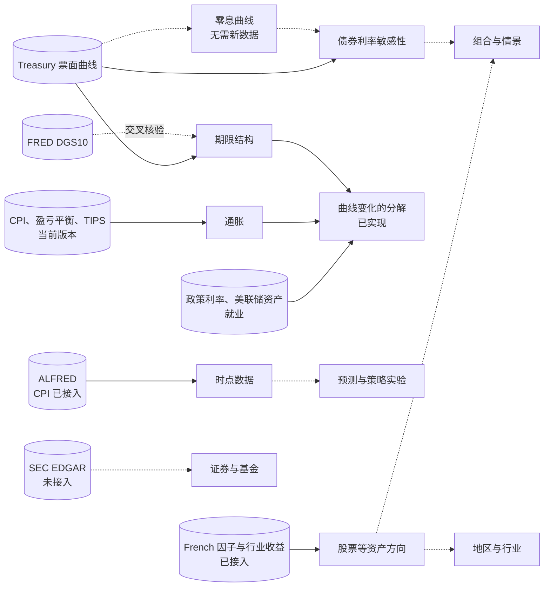

# 研究框架地图

本文落实[架构](architecture.md) §4 的两条分类轴。30 项研究的逐项映射、纳入条件与限制见[研究分类映射](research-classification.md)。

## 1. 目录的单一来源

`site/content.yaml` 的 `classification.objects` 与 `classification.questions` 是双语词表；`studies.<id>.routes` 保存配对入口。每条包含 `object`、`subject`、`question`、`topic`、`target` 和双语 `scope`，恰有一条 `primary: true`。默认目录按主对象组织，筛选在同一条入口内匹配全部条件，再按研究 ID 去重。公司集合 `collections` 只控制展示，不改变研究归属。

`classification.capabilities` 登记具体范围的数据能力与规划，`classification.references` 登记参照入口。未登记组合不自动生成规划或缺口原因。用户主动查询时解释无已发布匹配研究及未评估状态。数据存在不等于该用途已核验。

`discovery.py` 生成首页、能力地图共享的目录和 `summary.json`；`targets.py` 核对当前结果是否含对应内容，构建再核对公开文件及稳定章节 ID。研究页地址不变。成果类型、期间、市场、截止日及检查状态读研究定义与运行记录，不在网站配置重复维护。

旧六个分支迁移为 `data_groups`，只保留来源与接入登记以及旧链接锚点，移除了 `directions.studies`；`primary_direction` 与精选入口不再使用。研究定义的 `branch` 是计算实现分支，保持不变。能力地图不以一个方向的最佳状态推断整个对象的研究能力。

## 2. 数据来源分组与依赖（保留的接入索引）

只写已经明确的依赖。候选数据源登记在 `config/sources.yaml`（网站的数据资源目录按研究方向列出），不构成接入承诺。

### 3.1 宏观与政策

**总问题**：增长、通胀、信用、流动性和政策如何变化？

- **通胀**：当前版本 CPI、10 年期盈亏平衡通胀率与 TIPS 实际收益率通过 FRED 图表 CSV 取得（接入已验证）。盈亏平衡通胀率含风险溢价，不等于通胀预期。CPI 的历史版本已由 ALFRED 接入（2026-10-23），可以用于时点研究；盈亏平衡通胀率与 TIPS 收益率只有当前版本。
- **政策利率与流动性**：联邦基金有效利率、SOFR、3 个月国库券利率与美联储总资产已接入（FRED）；短端比较复用 Treasury 曲线。政策利率预期需要期货或调查数据，尚无来源。
- **增长与就业**：失业率与非农就业人数已接入：FRED 当前修订版本，以及 ALFRED 的全部历史版本（2026-10-23），后者可用于时点研究，例如非农就业的年度基准修订。名义 GDP 的当前版本与 ALFRED 历史版本也已接入；实际 GDP 尚未接入。调查与模型估计（SPF、GDPNow 等）须与观测值分开登记。

这些序列可供曲线分解使用，不因此构成宏观研究成果。曲线研究的限制写明「名义收益率，未扣除通胀」「不构成因果解释」。

### 3.2 市场与大类资产

**总问题**：不同资产的收益、估值和风险如何比较？

- **美国国债期限结构**：Treasury 票面曲线（描述性用途已核验），FRED DGS10 用于同源交叉核验；`analytics/rates.py`；美国国债交易日历。曲线变化的会计分解（解释与归因）另用 TIPS 实际收益率、盈亏平衡通胀与联邦基金利率。
- **债券利率敏感性**：Treasury 票面曲线；`analytics/bonds.py`。用已有票面曲线推导零息曲线，不需要新数据，就能支持非平移冲击与关键利率久期，正好对应该研究写明的限制。
- **股票**：美国股票市场与 Fama/French 因子（三因子、五因子、动量）的月度收益已接入（Kenneth French 数据库，2026-10-23）；市场超额收益加无风险利率即市场总收益。标普综合指数 1871 年起的价格、股息、盈利与 CAPE 估值也已接入（Shiller，2026-10-24）。行业与个股层面的估值，以及公司行动、成分变化处理尚未接入。长期回报与风险的描述研究已使用年度与月度市场回报（「美国主要资产的长期回报与风险」，2026-10-25，[研究设计](study-long-run-assets.md)）。
- **信用**：穆迪 Baa、Aaa 公司债收益率相对 10 年期国债的利差（日度，FRED）与 Damodaran 由收益率推算的 Baa 年度回报已接入（2026-10-23）。这是收益率利差，不是期权调整利差；高收益债与公司债指数的实际回报仍无免费可核验来源。Baa 年度回报已用于「美国主要资产的长期回报与风险」。
- **波动率**：Cboe VIX（日度，FRED）已接入（2026-10-23）。比较隐含与已实现波动率还需要股票日度收益（French 日度因子可作候选）；完整历史期权链列为能力缺口。
- **跨市场比较**：发达、欧洲、日本、日本以外亚太、北美与新兴市场的股票因子月度收益（French，Bloomberg 数据，美元计价，1990 年起），以及主要汇率与美元广义指数（FRED H.10）已接入（2026-10-24）。以当地货币计的回报、各国国债与宏观数据、多市场交易日历尚无；币种换算已有 `to_base_currency`。

### 3.3 地区与行业

**总问题**：结构、周期、集中度和相对表现有何差异？

美国 12/49 行业的价值加权和等权总收益、公司数、平均市值与 BE/ME 已接入，并实现风险、因子和宏观环境比较。能源、批零、半导体/软件/计算机服务的专题加入 BEA/BLS 经济背景、各期 SIC 财报样本、Damodaran 独立估值快照和六家公司的指引案例，见 [行业研究](study-industries.md)。缺口是精确历史股票成分与权重、同口径收益分解、完整历史一致预期，以及美国以外的行业；样本营收集中度不能替代股票权重集中度。

### 3.4 证券与基金

**总问题**：财务、估值、费用、持仓及工具结构有何特点？

- **公司财报**：SEC EDGAR 的设计见 [EDGAR 设计说明](edgar-design.md)。15 家公司的核心事实与时点视图已验证；行业专题另从历史原始档案选样，保留申报号、期间、科目、缺失和配对公司口径。季度 TTM、完整普通股资格及母子申报主体去重尚未完成。
- **基金费用与持仓**：需要逐家核验基金发行方的公开资料；净值不能代替成交价。
- **真实债券与债券基金**：需要真实现金流、价格或总收益数据。有了这些数据，假设平价债券可以与真实工具（如 TLT）对比。

共同前置：交易日历、公司行动、证券标识等市场制度对象（[实现说明](implementation.md) §8）。

### 3.5 组合与情景

**总问题**：资产如何共同影响风险，假设变化会造成什么结果？

需要至少两类资产的收益序列、相关性，以及权重与成本假设；不需要真实账户。Damodaran 历史回报表已提供 1928 年起股票、国库券、国债、公司债、房地产与黄金的年度回报（2026-10-23），并已用于「美国主要资产的长期回报与风险」中的相关性与风险统计（2026-10-25）；月度多资产回报仍缺债券等资产，组合构建与再平衡研究尚未开始。单一资产的冲击情景已在 3.2 实现，可作为组件。

### 3.6 预测与策略实验

**总问题**：某种信号是否改善预测或模拟表现？

需要时点数据：ALFRED 历史版本（CPI 已接入，其他序列按需登记），或本地快照（2026-10-23 起由本机 launchd 每个工作日保存，见[实现说明](implementation.md) §6）。还需要预设基准、样本外评估与预登记（未实现）。候选信号来自上游分支的描述性研究。

## 4. 依赖关系图

实线表示已经实现，虚线表示规划中的依赖。

较近的三条路径，按依赖排列，不是排期：

1. **零息曲线**：不需要新数据，直接扩展利率敏感性研究。
2. **通胀与政策数据**：第一批 FRED 序列已于 2026-10-23 接入，并已用于第一项解释与归因研究「国债曲线变化的分解」（2026-10-24，[研究设计](study-curve-attribution.md)）；区分期限溢价与政策预期还需要 ACM 期限溢价或期货数据。CPI 的历史版本已由 ALFRED 接入；其他序列的历史版本按研究需要登记。
3. **资产总收益数据源**：美国股票市场、因子与行业的月度收益已由 Kenneth French 数据库接入（2026-10-23）；组合研究还缺债券等其他资产的收益。

## 3. 新增研究或入口

1. 核对实际输出属于哪个对象、问题及范围；按词表纳入条件登记，不能只按标题分类。
2. 在 `studies.<id>.routes` 登记配对关系并指定一个主归属。集合成员仍有自己的记录及地址。
3. 新内容目标由渲染层分配固定 ID，中英文一致，并在 `targets.py` 定义实际结果的可用条件。空表、缺失可选输入不算可用结果；没有专用展示组件时链接已发布的完整报告并标明形式。
4. 增加有必要的回归检查，覆盖错误配对、未发布结果和内容缺失。构建检查链接目标存在且唯一。
5. 数据、参照及规划按各自状态登记。没有归属的临时研究会显示「尚未分类」，不会被推断分类。

## 4. 产业链参照

[产业链研究设计](supply-chain-research-design.md)采用行业分类 → 细分业务 → 公司业务与财务 → 产业关系的四层数据结构，允许多对多连接。它是研究资料结构，不是第三套网站导航。

网站在数据与参照页展示业务定义、分部映射、候选公司关系及其证据；公司页嵌入该主体的分部映射及直接关系；数据参照页提供同一视图的主体、业务、类型、复核状态与证据申报日期筛选，支持两个主体对照和一跳示意。尚未收录时明确写出。当前 7 条映射均为部分对应且有效期未知，17 条关系均为候选；技术复核不等于人工确认，不据此分摊收入或推算采购份额。完整 NAICS 表不随站点复制，提供官方分类入口与候选对应说明。

研究仍须按具体问题通过数据可行性检查；新导航与参照发布不改变原研究的证据等级或能力边界。

### 具体公司与关系的查找

首页和能力地图在对象 × 问题之外提供主体筛选。主体索引用既有登记 ID，CIK 只用于与公司财报研究精确合并；网站的名称、中文名和证券代码别名仅辅助查找，不产生历史证券身份或估值能力。错拼先给建议，由读者点击选择，不自动替换。

`site/content.yaml` 的 `entity_aliases` 维护网站检索别名，研究的 `entity_ids` 或配对入口的 `entity_ids` 明确登记主体。单公司研究从 `method.cik` 取得身份，显式覆盖发生冲突会拒绝构建。专题中提及一家企业不会自动建立该企业的研究归属。

例如先选「公司 → 结构与业务关系 → 产业与公司关系」，再选 NVIDIA，可进入其关系参照；也可以从「行业与产业链 → 半导体」到同一份记录。没有单独研究页的 TSMC 等主体也可作为关系端点打开。对手方链接始终回到通用视图，匿名对手方保留原登记身份。

URL 使用稳定 `entity` / `compare` ID，并支持业务 `activity`、关系类型 `relation_type`、技术状态 `review` 和 `evidence_before`。日期只限定所有所引证据的申报日期；缺日期的记录不通过日期筛选，不据此声称关系有效或当时可交易。技术状态还检查所引证据是否失效、失败、否定或撤回。人审与技术复核分开显示。

对照只比较当前筛选下的记录覆盖，零条不是现实中没有关系；共享边只列一次。表、对照、示意读取同一批直接记录，不传递推导、不推算份额。网页无脚本仍保留全部静态记录、证据和稳定锚点；脚本筛选不改变原始记录。
