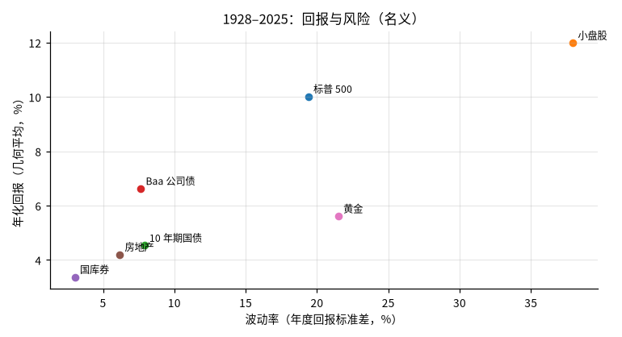
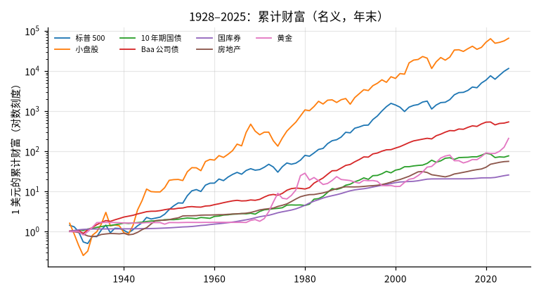
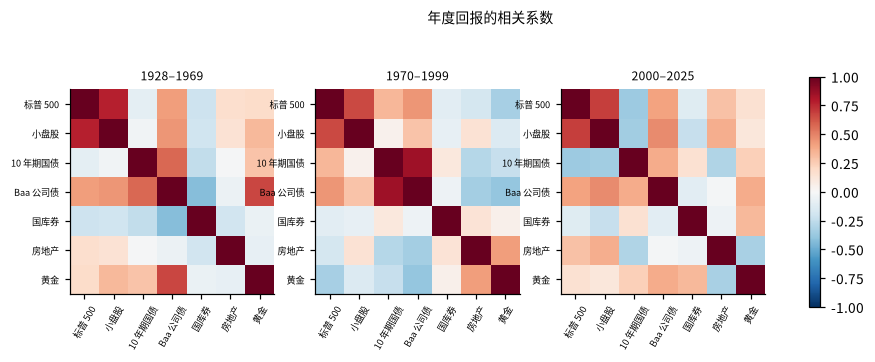
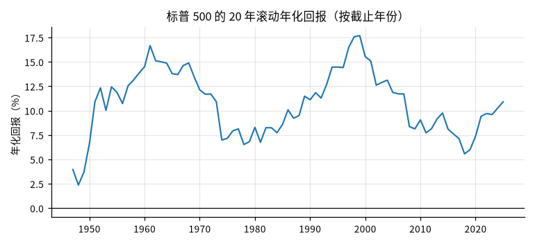

# 美国主要资产的长期回报与风险（1928 年起）

## 概要

**研究问题：** 1928 年以来，美国股票、小盘股、长期国债、公司债、国库券、房地产与黄金的回报与风险各是多少？扣除通胀后呢？资产之间的相关性在不同年代是否稳定？

**成果类型：** 描述与比较　**研究分支：** asset_history　**结论状态：** 完整

**研究范围：** US · USD · 1928-01-01 至 2025-12-31 · annual

**数据截止：** 2025-12-31　**生成时间：** 2026-10-30T02:51:02+00:00

**运行 ID：** `us_asset_history-20261030T025101Z-c6bd3d21`　**结果校验值：** `584eafcd9f54a131`

## 主要结果

1928–2025 年（98 个完整年度）。百分比为年度回报；几何平均即期末财富的年化；最大回撤按年末财富计算。只描述历史，不是预测或配置建议。

| 资产 | 几何平均 % | 算术平均 % | 波动率 % | 最差年份 | 亏损年数 | 最大回撤 % |
|---|---|---|---|---|---|---|
| 标普 500 | 10.0 | 11.9 | 19.4 | -43.8（1931） | 26 | -64.8 |
| 小盘股 | 12.0 | 17.8 | 37.9 | -53.9（1937） | 34 | -84.3 |
| 10 年期国债 | 4.5 | 4.8 | 7.9 | -17.8（2022） | 20 | -21.5 |
| Baa 公司债 | 6.6 | 6.9 | 7.7 | -15.7（1931） | 16 | -15.7 |
| 3 个月国库券 | 3.4 | 3.4 | 3.0 | 0.0（2014） | 0 | 0.0 |
| 房地产 | 4.2 | 4.4 | 6.2 | -12.0（2008） | 15 | -26.2 |
| 黄金 | 5.6 | 7.4 | 21.5 | -32.6（1981） | 34 | -53.5 |

扣除通胀（1948–2025 年，CPI 12 月对 12 月，年均 3.5%，最高 13.3%（1979））：

| 资产 | 实际几何平均 % | 实际算术平均 % | 实际波动率 % |
|---|---|---|---|
| 标普 500 | 7.9 | 9.3 | 16.9 |
| 小盘股 | 8.2 | 11.7 | 28.1 |
| 10 年期国债 | 1.4 | 1.8 | 9.2 |
| Baa 公司债 | 3.2 | 3.6 | 8.1 |
| 3 个月国库券 | 0.6 | 0.6 | 2.4 |
| 房地产 | 1.0 | 1.1 | 4.5 |
| 黄金 | 2.9 | 4.6 | 20.7 |

股票相对无风险资产的历史超额回报（几何平均之差）：相对3 个月国库券 6.6 个百分点，相对10 年期国债 5.5 个百分点。

| 期间 | 股票与 10 年期国债 | 股票与 Baa 公司债 | 股票与黄金 |
|---|---|---|---|
| 1928–2025 | 0.02 | 0.40 | -0.06 |
| 1928–1969 | -0.09 | 0.41 | 0.18 |
| 1970–1999 | 0.33 | 0.44 | -0.33 |
| 2000–2025 | -0.36 | 0.40 | 0.16 |

## 图表

## 口径与补充统计

时期边界前后移动 5 年时，股票与 10 年期国债的相关系数范围：1928–1969 -0.14 至 -0.09（符号不变）；1970–1999 0.17 至 0.36（符号不变）；2000–2025 -0.36 至 -0.16（符号不变）。

月度股票（French CRSP 全市场总收益，1176 个月）：最大回撤 -83.7%（1929-08 至 1932-06），最差单月 -28.7%（1931-09），年化波动率 18.4%。

标普 500 的 20 年滚动年化回报（79 个窗口）：最低 2.4%（截至 1948），最高 17.7%（截至 1999）。

## 验证

**股票跨来源核对：** 通过；对照 french_ff3，98 年相关系数 0.990（阈值 0.98）。标普 500（Damodaran）与 CRSP 全市场（French）指数不同，只核对年度回报高度一致

**月度回撤核对：** 通过；月度 -83.7%，年度 -64.8%。月度数据的最大回撤应不浅于年度数据（年度数据会低估年内跌幅）

**国库券跨来源核对：** 通过；对照 fred_dtb3 年均值，72 年最大差 0.49 个百分点（容差 0.5）

**实际回报方向核对：** 通过；对照 shiller_real，78 年中方向一致的比例 97%（阈值 80%）。Damodaran 标普 500 实际回报与 Shiller 实际总收益（12 月平均到 12 月平均）的方向一致比例；口径不同（年末与月均、CPI 取法），只核对方向

**原始快照抽查：** 跳过；没有可在原始 CSV 中定位的合格观测

## 数据与方法

| 角色 | 数据集 | 版本 | 来源 | 核验状态 |
|---|---|---|---|---|
| annual | damodaran_histret | `v20261030T025048Z-864ffa5e` | damodaran | use_verified |
| cpi | fred_cpiaucsl | `v20261030T025043Z-3ff089d9` | fred_graph | use_verified |
| monthly_market | french_ff3 | `v20261030T025045Z-c7e0022f` | ken_french | use_verified |
| long_real | shiller_real | `v20261030T025050Z-9368882b` | shiller | use_verified |
| tbill_check | fred_dtb3 | `v20261030T025044Z-943e4ac2` | fred_graph | use_verified |

**方法：** 年度回报的算术平均、几何平均（期末财富的年化）、波动率（标准差）、最差年份、亏损年数与最大回撤；实际回报 = (1 + 名义) / (1 + 当年 CPI 通胀) − 1；股票风险溢价为几何平均之差；相关系数按全期与事先固定的时期计算。只用所有资产都有值的完整年度；只描述历史，不估计模型。

**比较基准：** 3 个月国库券（风险溢价的基准）

**可用时间规则：** 观测期间结束后第 60 天结束时（来源时区）

## 限制

- 只描述美国历史；美国是事后表现最好的市场之一，存在幸存者偏差，不代表其他市场或未来

- 债券回报由收益率推算，不是指数实际持有回报；房地产为房价变化，不含租金；黄金在 1971 年以前价格基本固定；国库券回报为年内平均利率

- 不含交易成本、税负与管理费；年度数据低估年内回撤

- 实际回报从 1948 年起（CPI 12 月对 12 月）；相关系数只描述线性同向程度，样本只有几十个年度观测

- 历史统计不是预测，也不是配置建议
