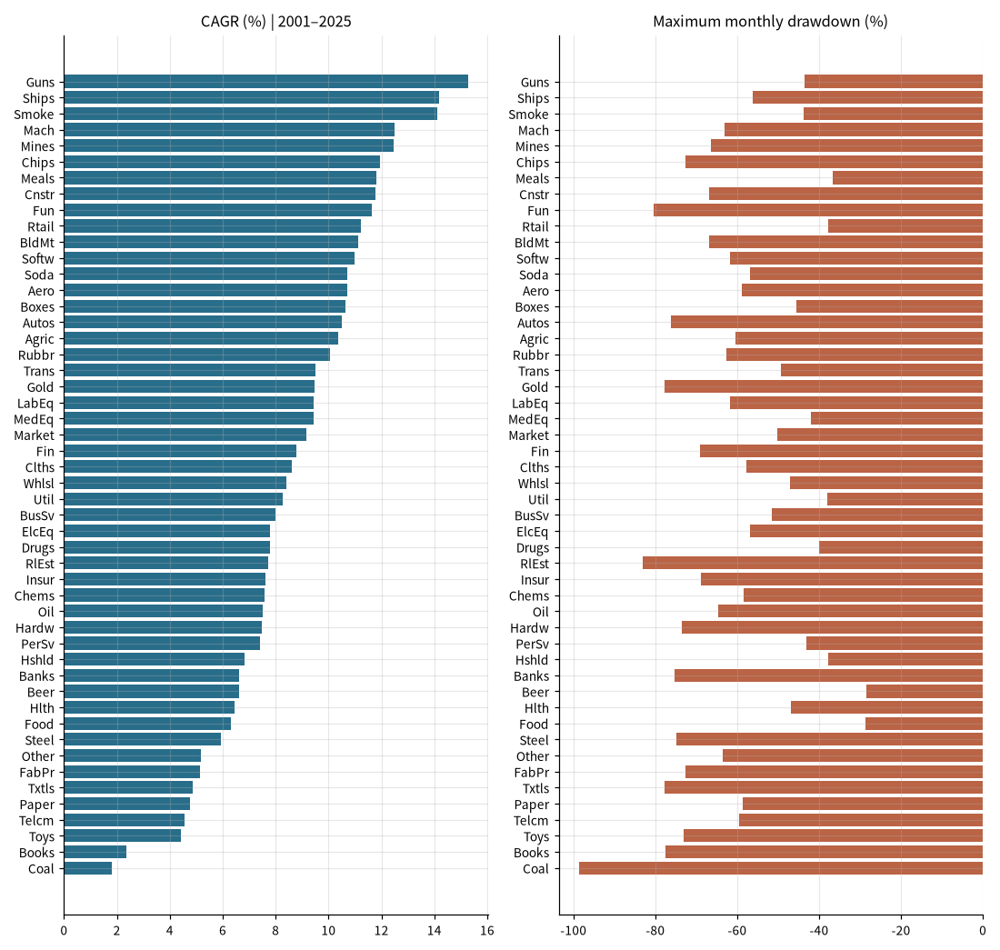
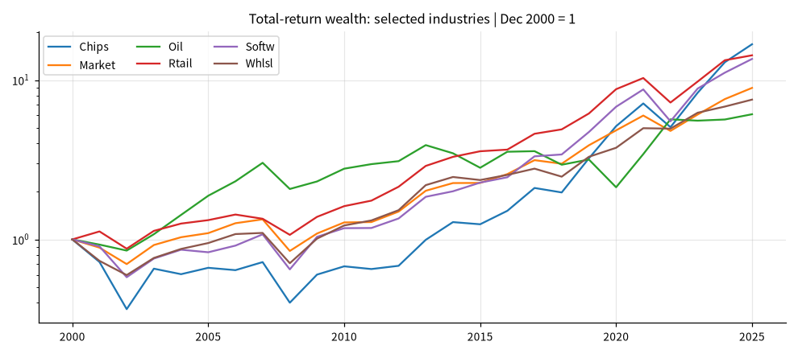
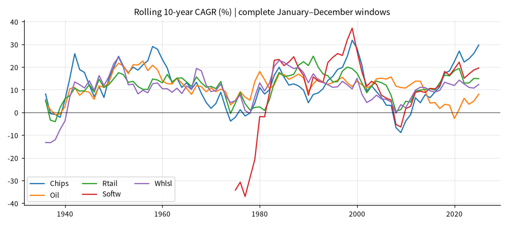

# 美国 49 行业的长期回报、风险与经济背景

## 概要

**研究问题：** 哪些行业回报有经营支持，哪些差异体现风险、样本和估值？

**成果类型：** 描述与比较　**研究分支：** industry　**结论状态：** 部分结论受限

**研究范围：** US · USD · 1926-07-01 至 2025-12-31 · monthly

**数据截止：** 2026-09　**生成时间：** 2026-10-29T14:44:01+00:00

**运行 ID：** `us_industry_49-20261029T144350Z-ed1cf044`　**结果校验值：** `755676c0a13694f3`

## 主要结果

市场回报、美国境内行业产出、全球合并财报和管理层指引分别衡量不同对象。下列对应关系用于研究背景，不能据此建立会计恒等式或因果归因。

本页使用 French 原行业代码。重点细分：Chips 半导体、Softw 软件、Hardw 硬件、Oil 油气、Coal 煤炭、Whlsl 批发、Rtail 零售、Meals 餐饮住宿、Banks 银行、Insur 保险、RlEst 房地产、Fin 其他金融。详细 SIC 定义见来源链接。

市场表现：1926–2025。收益含分红，风险按月度计算；实际年化收益用 CPI 起止端点扣除通胀，未插值缺月。

| 行业 | 月数 | 名义年化 | 实际年化 | 波动 | 最大回撤 | 峰值→谷底 | 恢复月 |
|---|---|---|---|---|---|---|---|
| Aero | 1194 | 12.69% | 9.45% | 31.59% | -94.38% | 1929-07→1932-05 | 1945-06 |
| Smoke | 1194 | 12.52% | 9.28% | 20.23% | -60.26% | 1998-11→2000-02 | 2001-02 |
| Hardw | 1194 | 12.31% | 9.07% | 25.01% | -86.64% | 1929-09→1932-06 | 1945-02 |
| Drugs | 1194 | 11.85% | 8.63% | 19.58% | -74.08% | 1929-08→1932-05 | 1939-11 |
| LabEq | 1194 | 11.55% | 8.33% | 23.31% | -82.21% | 1930-04→1932-05 | 1937-07 |
| MedEq | 1194 | 11.54% | 8.33% | 21.35% | -82.70% | 1929-04→1938-03 | 1945-04 |
| Chips | 1194 | 11.44% | 8.23% | 29.45% | -95.48% | 1929-06→1932-06 | 1944-03 |
| Banks | 1194 | 11.43% | 8.23% | 24.35% | -83.28% | 1929-08→1932-05 | 1934-04 |
| Beer | 1194 | 11.42% | 8.21% | 24.39% | -88.65% | 1929-08→1932-05 | 1943-04 |
| Rtail | 1194 | 11.17% | 7.97% | 20.60% | -84.01% | 1928-11→1932-06 | 1944-05 |
| ElcEq | 1194 | 11.03% | 7.84% | 26.51% | -92.91% | 1929-08→1932-05 | 1951-01 |
| Autos | 1194 | 10.89% | 7.69% | 29.75% | -90.28% | 1929-02→1932-06 | 1936-09 |
| Meals | 1194 | 10.75% | 7.57% | 22.31% | -84.52% | 1929-08→1932-06 | 1945-09 |
| Boxes | 1194 | 10.65% | 7.46% | 21.11% | -78.52% | 1929-08→1932-06 | 1935-05 |
| Mach | 1194 | 10.65% | 7.46% | 25.02% | -90.78% | 1929-08→1932-06 | 1937-07 |
| Fun | 1194 | 10.45% | 7.27% | 32.37% | -96.30% | 1930-04→1933-03 | 1945-11 |
| Market | 1194 | 10.32% | 7.14% | 18.35% | -83.65% | 1929-08→1932-06 | 1945-01 |
| Oil | 1194 | 10.28% | 7.10% | 22.19% | -76.35% | 1929-08→1932-05 | 1936-12 |
| Chems | 1194 | 10.22% | 7.05% | 21.87% | -86.05% | 1929-08→1932-06 | 1936-07 |
| Fin | 1194 | 10.11% | 6.94% | 26.39% | -93.04% | 1929-08→1932-05 | 1951-07 |
| Food | 1194 | 10.11% | 6.94% | 16.37% | -71.42% | 1929-08→1932-06 | 1943-02 |
| BldMt | 1194 | 9.95% | 6.78% | 24.05% | -88.67% | 1929-01→1932-05 | 1937-01 |
| Mines | 1194 | 9.89% | 6.73% | 25.29% | -84.90% | 1929-03→1932-06 | 1937-02 |
| Insur | 1194 | 9.80% | 6.64% | 25.22% | -92.66% | 1929-08→1932-05 | 1945-04 |
| Util | 1194 | 9.19% | 6.04% | 18.84% | -84.78% | 1929-09→1935-02 | 1951-12 |
| Hshld | 1194 | 9.08% | 5.94% | 19.84% | -88.86% | 1929-09→1932-06 | 1949-10 |
| Ships | 1194 | 9.03% | 5.89% | 27.67% | -86.46% | 1929-08→1932-05 | 1936-11 |
| BusSv | 1194 | 8.96% | 5.82% | 24.72% | -89.69% | 1929-09→1934-08 | 1954-02 |
| Agric | 1194 | 8.93% | 5.79% | 25.76% | -90.37% | 1929-02→1932-05 | 1939-09 |
| Telcm | 1194 | 8.92% | 5.78% | 16.14% | -72.04% | 2000-03→2002-09 | 2013-12 |
| Clths | 1194 | 8.66% | 5.53% | 21.56% | -76.32% | 1968-11→1974-12 | 1979-08 |
| Cnstr | 1194 | 8.55% | 5.42% | 32.40% | -92.89% | 1930-05→1935-02 | 1949-12 |
| Trans | 1194 | 8.46% | 5.34% | 24.54% | -91.23% | 1929-08→1932-06 | 1950-12 |
| Books | 1194 | 8.28% | 5.16% | 27.10% | -94.16% | 1930-04→1941-12 | 1946-04 |
| Steel | 1194 | 7.65% | 4.55% | 29.90% | -91.75% | 1929-08→1932-05 | 1946-01 |
| Whlsl | 1194 | 7.55% | 4.46% | 25.12% | -97.65% | 1926-06→1932-06 | 1956-03 |
| Txtls | 1194 | 7.54% | 4.44% | 27.42% | -87.53% | 1928-03→1932-06 | 1944-06 |
| Coal | 1194 | 6.50% | 3.43% | 38.09% | -98.68% | 2008-06→2020-03 | 截至期末未恢复 |
| Other | 1194 | 6.27% | 3.21% | 24.79% | -92.41% | 1969-01→1974-09 | 1987-01 |
| Toys | 1194 | 6.26% | 3.20% | 31.92% | -95.64% | 1928-09→1932-06 | 1954-03 |
| RlEst | 1194 | 4.97% | 1.94% | 33.36% | -97.34% | 1929-08→1942-12 | 1961-02 |
| FabPr | 750（不完整） | — | — | — | — | —→— | 未计算 |
| Gold | 750（不完整） | — | — | — | — | —→— | 未计算 |
| Guns | 750（不完整） | — | — | — | — | —→— | 未计算 |
| Hlth | 678（不完整） | — | — | — | — | —→— | 未计算 |
| Paper | 1158（不完整） | — | — | — | — | —→— | 未计算 |
| PerSv | 1182（不完整） | — | — | — | — | —→— | 未计算 |
| Rubbr | 1134（不完整） | — | — | — | — | —→— | 未计算 |
| Soda | 750（不完整） | — | — | — | — | —→— | 未计算 |
| Softw | 726（不完整） | — | — | — | — | —→— | 未计算 |

市场表现：2001–2025。收益含分红，风险按月度计算；实际年化收益用 CPI 起止端点扣除通胀，未插值缺月。

| 行业 | 月数 | 名义年化 | 实际年化 | 波动 | 最大回撤 | 峰值→谷底 | 恢复月 |
|---|---|---|---|---|---|---|---|
| Guns | 300 | 15.27% | 12.44% | 20.32% | -43.59% | 2008-08→2009-02 | 2013-03 |
| Ships | 300 | 14.18% | 11.37% | 26.19% | -56.27% | 2008-08→2009-03 | 2010-04 |
| Smoke | 300 | 14.12% | 11.32% | 21.25% | -43.72% | 2002-05→2003-03 | 2003-12 |
| Mach | 300 | 12.51% | 9.75% | 24.00% | -63.12% | 2008-05→2009-02 | 2010-12 |
| Mines | 300 | 12.47% | 9.71% | 30.39% | -66.45% | 2007-10→2009-02 | 2010-12 |
| Chips | 300 | 11.94% | 9.19% | 26.70% | -72.72% | 2001-01→2002-09 | 2014-08 |
| Meals | 300 | 11.80% | 9.05% | 16.66% | -36.67% | 2007-10→2009-02 | 2010-03 |
| Cnstr | 300 | 11.79% | 9.04% | 25.99% | -66.92% | 2006-01→2009-02 | 2017-09 |
| Fun | 300 | 11.63% | 8.89% | 29.22% | -80.36% | 2007-10→2009-02 | 2013-04 |
| Rtail | 300 | 11.23% | 8.50% | 17.01% | -37.82% | 2007-05→2009-02 | 2010-11 |
| BldMt | 300 | 11.13% | 8.40% | 23.89% | -66.93% | 2007-05→2009-02 | 2012-12 |
| Softw | 300 | 11.00% | 8.27% | 21.29% | -61.70% | 2001-01→2002-09 | 2011-02 |
| Soda | 300 | 10.72% | 8.00% | 19.31% | -56.87% | 2007-10→2008-11 | 2010-07 |
| Aero | 300 | 10.70% | 7.98% | 23.10% | -58.82% | 2007-09→2009-02 | 2011-04 |
| Boxes | 300 | 10.63% | 7.91% | 19.34% | -45.51% | 2008-05→2009-02 | 2010-12 |
| Autos | 300 | 10.49% | 7.78% | 35.98% | -76.12% | 2007-06→2009-02 | 2013-07 |
| Agric | 300 | 10.37% | 7.65% | 22.35% | -60.44% | 2008-05→2010-06 | 2014-05 |
| Rubbr | 300 | 10.06% | 7.36% | 20.96% | -62.73% | 2007-05→2009-02 | 2011-03 |
| Trans | 300 | 9.51% | 6.82% | 19.79% | -49.24% | 2008-05→2009-02 | 2010-10 |
| Gold | 300 | 9.46% | 6.77% | 36.09% | -77.68% | 2011-11→2015-09 | 2021-05 |
| LabEq | 300 | 9.44% | 6.75% | 21.61% | -61.80% | 2001-01→2002-09 | 2007-09 |
| MedEq | 300 | 9.42% | 6.73% | 16.75% | -41.96% | 2008-08→2009-02 | 2011-04 |
| Market | 300 | 9.15% | 6.47% | 15.53% | -50.31% | 2007-10→2009-02 | 2012-02 |
| Fin | 300 | 8.77% | 6.10% | 23.17% | -69.19% | 2007-05→2009-02 | 2016-11 |
| Clths | 300 | 8.61% | 5.94% | 22.38% | -57.86% | 2007-05→2009-02 | 2010-11 |
| Whlsl | 300 | 8.42% | 5.75% | 17.09% | -47.05% | 2007-05→2009-02 | 2010-12 |
| Util | 300 | 8.26% | 5.60% | 14.38% | -37.91% | 2008-05→2009-02 | 2011-10 |
| BusSv | 300 | 8.00% | 5.34% | 18.51% | -51.57% | 2007-05→2009-02 | 2012-12 |
| ElcEq | 300 | 7.80% | 5.15% | 24.44% | -56.91% | 2008-05→2009-02 | 2010-12 |
| Drugs | 300 | 7.78% | 5.13% | 14.63% | -39.90% | 2000-12→2002-09 | 2011-04 |
| RlEst | 300 | 7.71% | 5.06% | 28.96% | -83.05% | 2007-05→2009-02 | 2018-01 |
| Insur | 300 | 7.63% | 4.99% | 17.86% | -68.93% | 2007-05→2009-02 | 2013-11 |
| Chems | 300 | 7.59% | 4.95% | 21.02% | -58.36% | 2008-05→2009-02 | 2010-12 |
| Oil | 300 | 7.50% | 4.86% | 24.59% | -64.75% | 2014-06→2020-03 | 2022-03 |
| Hardw | 300 | 7.47% | 4.83% | 25.82% | -73.52% | 2001-01→2002-09 | 2012-01 |
| PerSv | 300 | 7.41% | 4.77% | 20.68% | -43.17% | 2007-10→2010-08 | 2013-12 |
| Hshld | 300 | 6.81% | 4.19% | 13.44% | -37.80% | 2007-11→2009-02 | 2011-04 |
| Banks | 300 | 6.61% | 3.99% | 21.71% | -75.23% | 2007-05→2009-02 | 2016-12 |
| Beer | 300 | 6.61% | 3.99% | 13.76% | -28.56% | 2023-07→2025-09 | 截至期末未恢复 |
| Hlth | 300 | 6.43% | 3.82% | 20.75% | -46.87% | 2007-05→2009-02 | 2011-02 |
| Food | 300 | 6.32% | 3.71% | 12.38% | -28.64% | 2007-05→2009-02 | 2010-03 |
| Steel | 300 | 5.95% | 3.34% | 32.49% | -74.93% | 2008-05→2009-02 | 2022-02 |
| Other | 300 | 5.18% | 2.60% | 18.02% | -63.47% | 2007-10→2009-02 | 2013-12 |
| FabPr | 300 | 5.15% | 2.57% | 34.61% | -72.61% | 2008-07→2009-02 | 2012-03 |
| Txtls | 300 | 4.86% | 2.29% | 32.76% | -77.80% | 2007-06→2009-02 | 2013-01 |
| Paper | 300 | 4.75% | 2.18% | 17.72% | -58.70% | 2007-05→2009-02 | 2011-02 |
| Telcm | 300 | 4.55% | 1.98% | 17.99% | -59.48% | 2001-01→2002-09 | 2012-06 |
| Toys | 300 | 4.41% | 1.85% | 24.61% | -73.18% | 2021-06→2023-10 | 截至期末未恢复 |
| Books | 300 | 2.36% | -0.16% | 21.79% | -77.52% | 2004-05→2009-02 | 2015-02 |
| Coal | 300 | 1.81% | -0.69% | 45.26% | -98.68% | 2008-06→2020-03 | 截至期末未恢复 |

市场表现：2016–2025。收益含分红，风险按月度计算；实际年化收益用 CPI 起止端点扣除通胀，未插值缺月。

| 行业 | 月数 | 名义年化 | 实际年化 | 波动 | 最大回撤 | 峰值→谷底 | 恢复月 |
|---|---|---|---|---|---|---|---|
| Chips | 120 | 29.71% | 25.69% | 23.63% | -29.91% | 2021-12→2022-09 | 2023-05 |
| Autos | 120 | 22.11% | 18.33% | 43.44% | -59.43% | 2021-11→2022-12 | 2024-12 |
| Gold | 120 | 21.54% | 17.77% | 36.14% | -56.40% | 2022-03→2024-02 | 2025-08 |
| Cnstr | 120 | 19.95% | 16.23% | 27.21% | -38.03% | 2020-01→2020-03 | 2020-07 |
| Softw | 120 | 19.57% | 15.86% | 18.80% | -39.32% | 2021-10→2022-12 | 2024-01 |
| FabPr | 120 | 19.41% | 15.71% | 37.51% | -55.10% | 2019-02→2020-03 | 2020-11 |
| Mach | 120 | 19.34% | 15.64% | 22.47% | -28.56% | 2021-12→2022-09 | 2023-06 |
| Mines | 120 | 19.07% | 15.38% | 28.06% | -41.45% | 2018-01→2020-03 | 2020-10 |
| Coal | 120 | 18.46% | 14.78% | 43.06% | -82.46% | 2018-06→2020-03 | 2022-03 |
| Steel | 120 | 17.89% | 14.23% | 33.87% | -54.38% | 2018-05→2020-03 | 2021-03 |
| Hardw | 120 | 17.16% | 13.53% | 21.41% | -33.12% | 2021-12→2022-09 | 2024-01 |
| Fin | 120 | 17.02% | 13.39% | 21.37% | -26.30% | 2021-10→2022-09 | 2024-02 |
| BldMt | 120 | 15.32% | 11.74% | 24.74% | -32.74% | 2019-12→2020-03 | 2020-08 |
| Guns | 120 | 15.18% | 11.61% | 21.11% | -23.50% | 2018-09→2018-12 | 2019-06 |
| Rtail | 120 | 14.87% | 11.31% | 18.33% | -29.90% | 2021-11→2022-12 | 2024-02 |
| LabEq | 120 | 14.85% | 11.29% | 19.66% | -32.24% | 2021-12→2023-10 | 2025-11 |
| Fun | 120 | 14.72% | 11.17% | 27.17% | -57.06% | 2021-10→2022-06 | 2024-10 |
| Market | 120 | 14.72% | 11.16% | 15.74% | -24.84% | 2021-12→2022-09 | 2023-12 |
| Aero | 120 | 14.19% | 10.65% | 24.98% | -46.51% | 2019-11→2020-03 | 2023-06 |
| Banks | 120 | 13.62% | 10.10% | 22.41% | -35.17% | 2019-12→2020-03 | 2021-02 |
| Ships | 120 | 12.74% | 9.24% | 22.75% | -42.88% | 2018-09→2020-03 | 2022-03 |
| Whlsl | 120 | 12.32% | 8.84% | 18.19% | -27.72% | 2019-12→2020-03 | 2020-11 |
| MedEq | 120 | 11.80% | 8.34% | 18.32% | -30.73% | 2021-08→2022-09 | 2025-01 |
| Insur | 120 | 11.60% | 8.15% | 16.63% | -23.00% | 2024-11→2025-07 | 截至期末未恢复 |
| Meals | 120 | 11.30% | 7.85% | 17.87% | -29.80% | 2019-08→2020-03 | 2020-11 |
| ElcEq | 120 | 11.14% | 7.69% | 26.88% | -38.02% | 2021-10→2022-06 | 2025-09 |
| Util | 120 | 10.97% | 7.54% | 14.62% | -21.65% | 2020-01→2020-03 | 2021-07 |
| Other | 120 | 10.91% | 7.47% | 16.54% | -22.13% | 2020-01→2020-03 | 2020-11 |
| Agric | 120 | 10.65% | 7.22% | 21.96% | -30.69% | 2018-07→2020-03 | 2020-11 |
| BusSv | 120 | 10.51% | 7.08% | 20.01% | -40.14% | 2021-08→2022-09 | 截至期末未恢复 |
| Drugs | 120 | 10.35% | 6.93% | 15.28% | -15.89% | 2024-08→2025-05 | 2025-11 |
| Trans | 120 | 10.25% | 6.83% | 21.61% | -31.00% | 2018-09→2020-03 | 2020-11 |
| Rubbr | 120 | 10.22% | 6.81% | 20.52% | -33.84% | 2021-12→2022-12 | 截至期末未恢复 |
| Smoke | 120 | 10.17% | 6.76% | 20.62% | -33.93% | 2017-05→2018-12 | 2021-08 |
| Soda | 120 | 9.58% | 6.18% | 15.08% | -22.38% | 2020-01→2020-03 | 2020-12 |
| PerSv | 120 | 9.08% | 5.70% | 20.71% | -34.29% | 2019-07→2020-03 | 2020-11 |
| RlEst | 120 | 8.70% | 5.33% | 28.31% | -43.50% | 2019-12→2020-03 | 2020-12 |
| Oil | 120 | 8.04% | 4.69% | 30.18% | -60.71% | 2018-09→2020-03 | 2022-01 |
| Hlth | 120 | 7.33% | 4.01% | 22.61% | -41.71% | 2021-07→2023-10 | 截至期末未恢复 |
| Boxes | 120 | 7.29% | 3.96% | 18.70% | -30.07% | 2021-08→2022-09 | 2024-08 |
| Hshld | 120 | 6.49% | 3.19% | 14.24% | -27.28% | 2021-12→2022-09 | 截至期末未恢复 |
| Books | 120 | 6.17% | 2.88% | 22.63% | -40.46% | 2018-01→2020-03 | 2021-01 |
| Chems | 120 | 5.62% | 2.35% | 20.91% | -33.52% | 2018-08→2020-03 | 2020-11 |
| Telcm | 120 | 5.28% | 2.02% | 17.11% | -36.46% | 2021-08→2022-09 | 截至期末未恢复 |
| Beer | 120 | 4.55% | 1.30% | 14.33% | -28.56% | 2023-07→2025-09 | 截至期末未恢复 |
| Clths | 120 | 3.82% | 0.60% | 24.19% | -48.93% | 2021-11→2025-04 | 截至期末未恢复 |
| Food | 120 | 1.67% | -1.48% | 13.61% | -22.46% | 2023-04→2025-12 | 截至期末未恢复 |
| Paper | 120 | 0.98% | -2.15% | 17.41% | -34.15% | 2021-05→2022-09 | 截至期末未恢复 |
| Toys | 120 | 0.51% | -2.61% | 28.05% | -73.18% | 2021-06→2023-10 | 截至期末未恢复 |
| Txtls | 120 | -4.30% | -7.27% | 33.07% | -69.01% | 2017-11→2020-03 | 截至期末未恢复 |

市场表现：2010–2025。收益含分红，风险按月度计算；实际年化收益用 CPI 起止端点扣除通胀，未插值缺月。

| 行业 | 月数 | 名义年化 | 实际年化 | 波动 | 最大回撤 | 峰值→谷底 | 恢复月 |
|---|---|---|---|---|---|---|---|
| Chips | 192 | 23.13% | 20.04% | 21.77% | -29.91% | 2021-12→2022-09 | 2023-05 |
| Autos | 192 | 18.20% | 15.24% | 37.35% | -59.43% | 2021-11→2022-12 | 2024-12 |
| Guns | 192 | 17.95% | 14.99% | 18.81% | -23.50% | 2018-09→2018-12 | 2019-06 |
| Softw | 192 | 17.43% | 14.49% | 17.66% | -39.32% | 2021-10→2022-12 | 2024-01 |
| Fun | 192 | 17.31% | 14.37% | 26.70% | -57.06% | 2021-10→2022-06 | 2024-10 |
| Ships | 192 | 17.07% | 14.14% | 26.02% | -42.88% | 2018-09→2020-03 | 2022-03 |
| LabEq | 192 | 15.80% | 12.90% | 18.90% | -32.24% | 2021-12→2023-10 | 2025-11 |
| Rtail | 192 | 15.71% | 12.81% | 16.74% | -29.90% | 2021-11→2022-12 | 2024-02 |
| Mach | 192 | 15.57% | 12.67% | 22.57% | -31.47% | 2011-04→2011-09 | 2013-01 |
| Cnstr | 192 | 15.46% | 12.56% | 25.59% | -38.03% | 2020-01→2020-03 | 2020-07 |
| BldMt | 192 | 15.18% | 12.29% | 23.61% | -32.74% | 2019-12→2020-03 | 2020-08 |
| Aero | 192 | 14.71% | 11.84% | 21.95% | -46.51% | 2019-11→2020-03 | 2023-06 |
| Smoke | 192 | 14.22% | 11.36% | 19.22% | -33.93% | 2017-05→2018-12 | 2021-08 |
| Meals | 192 | 14.12% | 11.26% | 16.01% | -29.80% | 2019-08→2020-03 | 2020-11 |
| Market | 192 | 14.06% | 11.20% | 14.91% | -24.84% | 2021-12→2022-09 | 2023-12 |
| Fin | 192 | 13.69% | 10.84% | 21.18% | -34.71% | 2011-02→2011-09 | 2013-02 |
| Insur | 192 | 13.43% | 10.59% | 16.01% | -23.00% | 2024-11→2025-07 | 截至期末未恢复 |
| Whlsl | 192 | 13.38% | 10.54% | 16.65% | -27.72% | 2019-12→2020-03 | 2020-11 |
| Drugs | 192 | 13.31% | 10.47% | 14.45% | -18.59% | 2015-07→2016-02 | 2017-06 |
| Rubbr | 192 | 13.29% | 10.45% | 19.32% | -33.84% | 2021-12→2022-12 | 截至期末未恢复 |
| Hardw | 192 | 13.12% | 10.29% | 20.68% | -33.12% | 2021-12→2022-09 | 2024-01 |
| Soda | 192 | 13.00% | 10.17% | 14.67% | -22.38% | 2020-01→2020-03 | 2020-12 |
| Banks | 192 | 12.78% | 9.96% | 20.89% | -35.17% | 2019-12→2020-03 | 2021-02 |
| MedEq | 192 | 12.45% | 9.63% | 17.10% | -30.73% | 2021-08→2022-09 | 2025-01 |
| BusSv | 192 | 12.27% | 9.46% | 18.25% | -40.14% | 2021-08→2022-09 | 截至期末未恢复 |
| Trans | 192 | 11.98% | 9.17% | 19.66% | -31.00% | 2018-09→2020-03 | 2020-11 |
| Other | 192 | 11.75% | 8.95% | 15.71% | -22.13% | 2020-01→2020-03 | 2020-11 |
| FabPr | 192 | 11.68% | 8.88% | 35.59% | -69.02% | 2013-09→2016-01 | 2020-12 |
| ElcEq | 192 | 10.41% | 7.64% | 24.75% | -38.02% | 2021-10→2022-06 | 2025-09 |
| Util | 192 | 10.23% | 7.47% | 13.45% | -21.65% | 2020-01→2020-03 | 2021-07 |
| RlEst | 192 | 9.64% | 6.90% | 26.06% | -43.50% | 2019-12→2020-03 | 2020-12 |
| Hlth | 192 | 9.39% | 6.65% | 21.18% | -41.71% | 2021-07→2023-10 | 截至期末未恢复 |
| Clths | 192 | 9.22% | 6.48% | 22.42% | -48.93% | 2021-11→2025-04 | 截至期末未恢复 |
| Telcm | 192 | 9.11% | 6.37% | 16.03% | -36.46% | 2021-08→2022-09 | 截至期末未恢复 |
| Mines | 192 | 8.98% | 6.25% | 29.68% | -57.21% | 2010-12→2016-01 | 2020-11 |
| Beer | 192 | 8.81% | 6.08% | 13.11% | -28.56% | 2023-07→2025-09 | 截至期末未恢复 |
| Boxes | 192 | 8.81% | 6.08% | 18.42% | -30.07% | 2021-08→2022-09 | 2024-08 |
| Steel | 192 | 8.60% | 5.88% | 30.80% | -54.38% | 2018-05→2020-03 | 2021-03 |
| Chems | 192 | 8.56% | 5.84% | 20.67% | -33.52% | 2018-08→2020-03 | 2020-11 |
| Agric | 192 | 8.40% | 5.68% | 23.15% | -40.26% | 2009-12→2010-06 | 2012-07 |
| Books | 192 | 8.26% | 5.55% | 21.32% | -40.46% | 2018-01→2020-03 | 2021-01 |
| Hshld | 192 | 7.59% | 4.89% | 13.21% | -27.28% | 2021-12→2022-09 | 截至期末未恢复 |
| PerSv | 192 | 7.05% | 4.37% | 21.93% | -34.29% | 2019-07→2020-03 | 2020-11 |
| Food | 192 | 6.83% | 4.16% | 12.71% | -22.46% | 2023-04→2025-12 | 截至期末未恢复 |
| Oil | 192 | 6.26% | 3.60% | 26.71% | -64.75% | 2014-06→2020-03 | 2022-03 |
| Gold | 192 | 6.03% | 3.38% | 36.26% | -77.68% | 2011-11→2015-09 | 2021-05 |
| Txtls | 192 | 5.94% | 3.29% | 29.53% | -69.01% | 2017-11→2020-03 | 截至期末未恢复 |
| Paper | 192 | 5.50% | 2.86% | 16.66% | -34.15% | 2021-05→2022-09 | 截至期末未恢复 |
| Toys | 192 | 4.95% | 2.32% | 24.98% | -73.18% | 2021-06→2023-10 | 截至期末未恢复 |
| Coal | 192 | -6.78% | -9.12% | 44.26% | -98.08% | 2011-03→2020-03 | 截至期末未恢复 |

因子暴露（2001–2025）：alpha 为月截距乘 12，不是可交易收益预测。95% 区间使用 Bartlett/Newey–West HAC（6 月滞后），p 值为渐近正态近似；BH q 值在同一模型、同一窗口的行业 alpha 间调整，仍是探索性比较。

| 行业 | 模型 | 市场 beta | 年化 alpha | alpha 95%区间 | BH q | R² |
|---|---|---|---|---|---|---|
| Aero | CAPM | 1.11 | 2.09% | -4.07% ~ 8.25% | 0.82 | 0.55 |
| Agric | CAPM | 0.78 | 4.19% | -4.21% ~ 12.60% | 0.82 | 0.29 |
| Autos | CAPM | 1.67 | 0.68% | -8.48% ~ 9.84% | 1.00 | 0.52 |
| Banks | CAPM | 1.12 | -2.14% | -7.24% ~ 2.95% | 0.82 | 0.64 |
| Beer | CAPM | 0.48 | 1.66% | -2.87% ~ 6.19% | 0.82 | 0.29 |
| BldMt | CAPM | 1.27 | 1.25% | -3.42% ~ 5.92% | 0.84 | 0.68 |
| Books | CAPM | 1.12 | -6.32% | -11.57% ~ -1.07% | 0.30 | 0.64 |
| Boxes | CAPM | 0.96 | 2.36% | -3.08% ~ 7.80% | 0.82 | 0.59 |
| BusSv | CAPM | 1.10 | -1.38% | -4.53% ~ 1.78% | 0.82 | 0.85 |
| Chems | CAPM | 1.14 | -1.63% | -6.49% ~ 3.23% | 0.82 | 0.71 |
| Chips | CAPM | 1.41 | 1.55% | -4.18% ~ 7.28% | 0.84 | 0.68 |
| Clths | CAPM | 1.11 | -0.08% | -5.79% ~ 5.62% | 1.00 | 0.59 |
| Cnstr | CAPM | 1.29 | 2.21% | -4.85% ~ 9.28% | 0.83 | 0.60 |
| Coal | CAPM | 1.18 | 0.79% | -20.42% ~ 22.01% | 1.00 | 0.16 |
| Drugs | CAPM | 0.62 | 1.72% | -2.23% ~ 5.67% | 0.82 | 0.43 |
| ElcEq | CAPM | 1.36 | -2.43% | -7.11% ~ 2.24% | 0.82 | 0.74 |
| FabPr | CAPM | 1.42 | -2.38% | -12.49% ~ 7.73% | 0.85 | 0.40 |
| Fin | CAPM | 1.33 | -1.61% | -6.11% ~ 2.89% | 0.82 | 0.80 |
| Food | CAPM | 0.46 | 1.37% | -2.62% ~ 5.36% | 0.82 | 0.33 |
| Fun | CAPM | 1.49 | 1.34% | -6.89% ~ 9.56% | 0.94 | 0.63 |
| Gold | CAPM | 0.33 | 11.04% | -2.97% ~ 25.04% | 0.82 | 0.02 |
| Guns | CAPM | 0.56 | 9.99% | 2.69% ~ 17.29% | 0.18 | 0.19 |
| Hardw | CAPM | 1.32 | -2.05% | -8.24% ~ 4.15% | 0.82 | 0.63 |
| Hlth | CAPM | 0.83 | -0.18% | -5.91% ~ 5.55% | 1.00 | 0.39 |
| Hshld | CAPM | 0.56 | 1.17% | -2.73% ~ 5.07% | 0.83 | 0.42 |
| Insur | CAPM | 0.87 | 0.06% | -4.86% ~ 4.99% | 1.00 | 0.57 |
| LabEq | CAPM | 1.19 | -0.15% | -4.55% ~ 4.25% | 1.00 | 0.73 |
| Mach | CAPM | 1.35 | 1.82% | -3.04% ~ 6.67% | 0.82 | 0.77 |
| Meals | CAPM | 0.83 | 3.98% | -0.58% ~ 8.54% | 0.82 | 0.60 |
| MedEq | CAPM | 0.82 | 1.92% | -1.91% ~ 5.74% | 0.82 | 0.58 |
| Mines | CAPM | 1.33 | 3.80% | -5.28% ~ 12.89% | 0.82 | 0.46 |
| Oil | CAPM | 0.96 | 0.64% | -8.29% ~ 9.58% | 1.00 | 0.36 |
| Other | CAPM | 0.88 | -2.31% | -6.60% ~ 1.98% | 0.82 | 0.58 |
| Paper | CAPM | 0.89 | -2.91% | -7.33% ~ 1.52% | 0.82 | 0.61 |
| PerSv | CAPM | 0.92 | 0.00% | -6.59% ~ 6.60% | 1.00 | 0.48 |
| RlEst | CAPM | 1.40 | -1.70% | -9.56% ~ 6.17% | 0.87 | 0.56 |
| Rtail | CAPM | 0.92 | 2.79% | -0.89% ~ 6.47% | 0.82 | 0.70 |
| Rubbr | CAPM | 1.06 | 1.30% | -4.22% ~ 6.81% | 0.85 | 0.62 |
| Ships | CAPM | 1.22 | 4.96% | -1.80% ~ 11.71% | 0.82 | 0.52 |
| Smoke | CAPM | 0.54 | 9.36% | 2.71% ~ 16.01% | 0.18 | 0.16 |
| Soda | CAPM | 0.64 | 5.09% | -1.38% ~ 11.56% | 0.82 | 0.26 |
| Softw | CAPM | 1.16 | 1.40% | -2.87% ~ 5.67% | 0.82 | 0.72 |
| Steel | CAPM | 1.66 | -4.33% | -12.62% ~ 3.97% | 0.82 | 0.63 |
| Telcm | CAPM | 0.91 | -3.18% | -7.45% ~ 1.09% | 0.82 | 0.62 |
| Toys | CAPM | 1.11 | -3.58% | -12.13% ~ 4.97% | 0.82 | 0.50 |
| Trans | CAPM | 1.07 | 0.48% | -3.54% ~ 4.50% | 1.00 | 0.71 |
| Txtls | CAPM | 1.43 | -3.50% | -12.25% ~ 5.24% | 0.82 | 0.46 |
| Util | CAPM | 0.52 | 3.01% | -1.35% ~ 7.36% | 0.82 | 0.31 |
| Whlsl | CAPM | 0.95 | 0.03% | -3.15% ~ 3.22% | 1.00 | 0.73 |
| Aero | FF3 | 1.09 | 1.81% | -3.70% ~ 7.32% | 0.80 | 0.59 |
| Agric | FF3 | 0.73 | 4.08% | -4.06% ~ 12.22% | 0.78 | 0.31 |
| Autos | FF3 | 1.53 | 0.85% | -7.96% ~ 9.67% | 0.97 | 0.55 |
| Banks | FF3 | 1.09 | -2.68% | -6.13% ~ 0.76% | 0.59 | 0.81 |
| Beer | FF3 | 0.53 | 1.57% | -3.04% ~ 6.18% | 0.80 | 0.33 |
| BldMt | FF3 | 1.16 | 1.01% | -2.83% ~ 4.86% | 0.81 | 0.76 |
| Books | FF3 | 1.06 | -6.53% | -11.27% ~ -1.79% | 0.11 | 0.69 |
| Boxes | FF3 | 0.92 | 2.25% | -2.91% ~ 7.41% | 0.78 | 0.62 |
| BusSv | FF3 | 1.06 | -1.34% | -4.29% ~ 1.62% | 0.78 | 0.86 |
| Chems | FF3 | 1.12 | -1.85% | -6.47% ~ 2.77% | 0.78 | 0.75 |
| Chips | FF3 | 1.40 | 1.95% | -3.09% ~ 7.00% | 0.78 | 0.73 |
| Clths | FF3 | 1.05 | -0.10% | -5.51% ~ 5.31% | 0.97 | 0.61 |
| Cnstr | FF3 | 1.16 | 2.06% | -4.28% ~ 8.40% | 0.80 | 0.67 |
| Coal | FF3 | 1.02 | 0.43% | -18.95% ~ 19.81% | 0.97 | 0.22 |
| Drugs | FF3 | 0.67 | 1.74% | -2.19% ~ 5.67% | 0.78 | 0.46 |
| ElcEq | FF3 | 1.26 | -2.36% | -6.56% ~ 1.85% | 0.78 | 0.78 |
| FabPr | FF3 | 1.19 | -2.47% | -12.04% ~ 7.09% | 0.81 | 0.52 |
| Fin | FF3 | 1.30 | -1.76% | -6.16% ~ 2.64% | 0.78 | 0.82 |
| Food | FF3 | 0.48 | 1.19% | -2.65% ~ 5.04% | 0.80 | 0.38 |
| Fun | FF3 | 1.41 | 1.44% | -6.62% ~ 9.50% | 0.91 | 0.64 |
| Gold | FF3 | 0.35 | 10.85% | -3.35% ~ 25.05% | 0.59 | 0.03 |
| Guns | FF3 | 0.56 | 9.76% | 2.95% ~ 16.57% | 0.11 | 0.22 |
| Hardw | FF3 | 1.31 | -1.78% | -7.72% ~ 4.16% | 0.80 | 0.66 |
| Hlth | FF3 | 0.75 | -0.32% | -5.64% ~ 5.00% | 0.97 | 0.45 |
| Hshld | FF3 | 0.60 | 1.05% | -2.86% ~ 4.96% | 0.81 | 0.45 |
| Insur | FF3 | 0.87 | -0.28% | -4.58% ~ 4.02% | 0.97 | 0.67 |
| LabEq | FF3 | 1.13 | 0.11% | -3.93% ~ 4.15% | 0.97 | 0.77 |
| Mach | FF3 | 1.28 | 1.76% | -2.71% ~ 6.24% | 0.78 | 0.80 |
| Meals | FF3 | 0.82 | 3.89% | -0.61% ~ 8.38% | 0.59 | 0.61 |
| MedEq | FF3 | 0.81 | 1.93% | -1.85% ~ 5.72% | 0.78 | 0.58 |
| Mines | FF3 | 1.27 | 3.58% | -5.16% ~ 12.31% | 0.78 | 0.49 |
| Oil | FF3 | 0.92 | 0.15% | -6.68% ~ 6.98% | 0.97 | 0.48 |
| Other | FF3 | 0.93 | -2.59% | -6.16% ~ 0.97% | 0.59 | 0.65 |
| Paper | FF3 | 0.89 | -3.14% | -7.38% ~ 1.10% | 0.59 | 0.66 |
| PerSv | FF3 | 0.84 | -0.10% | -5.91% ~ 5.71% | 0.97 | 0.53 |
| RlEst | FF3 | 1.25 | -2.05% | -8.46% ~ 4.37% | 0.80 | 0.68 |
| Rtail | FF3 | 0.91 | 2.92% | -0.51% ~ 6.35% | 0.59 | 0.72 |
| Rubbr | FF3 | 0.98 | 1.24% | -3.91% ~ 6.40% | 0.82 | 0.66 |
| Ships | FF3 | 1.14 | 4.64% | -0.82% ~ 10.10% | 0.59 | 0.59 |
| Smoke | FF3 | 0.62 | 8.99% | 2.71% ~ 15.26% | 0.11 | 0.25 |
| Soda | FF3 | 0.68 | 4.89% | -1.51% ~ 11.29% | 0.59 | 0.30 |
| Softw | FF3 | 1.18 | 1.80% | -1.43% ~ 5.03% | 0.78 | 0.82 |
| Steel | FF3 | 1.57 | -4.57% | -12.10% ~ 2.96% | 0.78 | 0.67 |
| Telcm | FF3 | 0.95 | -3.30% | -7.57% ~ 0.96% | 0.59 | 0.64 |
| Toys | FF3 | 0.99 | -3.59% | -11.10% ~ 3.92% | 0.78 | 0.56 |
| Trans | FF3 | 1.02 | 0.35% | -3.14% ~ 3.85% | 0.97 | 0.74 |
| Txtls | FF3 | 1.25 | -3.93% | -10.88% ~ 3.02% | 0.78 | 0.60 |
| Util | FF3 | 0.55 | 2.88% | -1.10% ~ 6.86% | 0.59 | 0.34 |
| Whlsl | FF3 | 0.90 | -0.10% | -3.13% ~ 2.93% | 0.97 | 0.77 |
| Aero | FF5+MOM | 1.09 | 0.82% | -4.58% ~ 6.23% | 0.85 | 0.60 |
| Agric | FF5+MOM | 0.78 | 3.24% | -5.28% ~ 11.76% | 0.72 | 0.33 |
| Autos | FF5+MOM | 1.46 | 0.34% | -7.82% ~ 8.51% | 0.93 | 0.56 |
| Banks | FF5+MOM | 0.99 | -0.16% | -3.43% ~ 3.12% | 0.93 | 0.84 |
| Beer | FF5+MOM | 0.63 | -1.55% | -5.70% ~ 2.60% | 0.72 | 0.40 |
| BldMt | FF5+MOM | 1.22 | -2.02% | -6.37% ~ 2.33% | 0.72 | 0.80 |
| Books | FF5+MOM | 1.05 | -8.35% | -13.10% ~ -3.61% | 0.03 | 0.72 |
| Boxes | FF5+MOM | 0.93 | 0.83% | -4.18% ~ 5.83% | 0.85 | 0.63 |
| BusSv | FF5+MOM | 1.06 | -1.82% | -4.94% ~ 1.31% | 0.72 | 0.87 |
| Chems | FF5+MOM | 1.16 | -3.96% | -8.59% ~ 0.67% | 0.58 | 0.76 |
| Chips | FF5+MOM | 1.29 | 4.83% | 0.13% ~ 9.53% | 0.50 | 0.75 |
| Clths | FF5+MOM | 1.09 | -3.15% | -8.31% ~ 2.00% | 0.72 | 0.65 |
| Cnstr | FF5+MOM | 1.27 | -0.83% | -7.42% ~ 5.75% | 0.88 | 0.70 |
| Coal | FF5+MOM | 1.08 | -1.49% | -21.39% ~ 18.40% | 0.92 | 0.23 |
| Drugs | FF5+MOM | 0.71 | 1.34% | -2.82% ~ 5.49% | 0.72 | 0.48 |
| ElcEq | FF5+MOM | 1.27 | -2.74% | -7.27% ~ 1.78% | 0.72 | 0.78 |
| FabPr | FF5+MOM | 1.14 | -1.99% | -11.49% ~ 7.52% | 0.80 | 0.53 |
| Fin | FF5+MOM | 1.19 | 1.37% | -2.90% ~ 5.63% | 0.72 | 0.84 |
| Food | FF5+MOM | 0.56 | -1.27% | -4.69% ~ 2.14% | 0.72 | 0.45 |
| Fun | FF5+MOM | 1.28 | 3.66% | -4.24% ~ 11.55% | 0.72 | 0.66 |
| Gold | FF5+MOM | 0.47 | 6.44% | -7.91% ~ 20.78% | 0.72 | 0.05 |
| Guns | FF5+MOM | 0.69 | 5.99% | -0.31% ~ 12.29% | 0.50 | 0.28 |
| Hardw | FF5+MOM | 1.16 | 1.66% | -3.86% ~ 7.18% | 0.72 | 0.70 |
| Hlth | FF5+MOM | 0.85 | -2.49% | -8.58% ~ 3.61% | 0.72 | 0.48 |
| Hshld | FF5+MOM | 0.70 | -2.41% | -6.08% ~ 1.26% | 0.72 | 0.55 |
| Insur | FF5+MOM | 0.90 | -1.03% | -5.61% ~ 3.55% | 0.80 | 0.67 |
| LabEq | FF5+MOM | 1.11 | 1.61% | -2.03% ~ 5.26% | 0.72 | 0.79 |
| Mach | FF5+MOM | 1.27 | 1.37% | -3.37% ~ 6.11% | 0.72 | 0.80 |
| Meals | FF5+MOM | 0.88 | 1.32% | -3.12% ~ 5.77% | 0.72 | 0.65 |
| MedEq | FF5+MOM | 0.87 | 1.19% | -2.61% ~ 4.98% | 0.72 | 0.60 |
| Mines | FF5+MOM | 1.30 | 1.99% | -7.40% ~ 11.38% | 0.80 | 0.49 |
| Oil | FF5+MOM | 1.00 | -2.23% | -10.01% ~ 5.55% | 0.72 | 0.50 |
| Other | FF5+MOM | 0.89 | -1.84% | -5.56% ~ 1.87% | 0.72 | 0.66 |
| Paper | FF5+MOM | 0.96 | -6.42% | -10.54% ~ -2.30% | 0.06 | 0.72 |
| PerSv | FF5+MOM | 0.97 | -2.80% | -8.80% ~ 3.21% | 0.72 | 0.57 |
| RlEst | FF5+MOM | 1.20 | -3.75% | -10.00% ~ 2.50% | 0.72 | 0.72 |
| Rtail | FF5+MOM | 0.95 | 1.69% | -1.75% ~ 5.13% | 0.72 | 0.72 |
| Rubbr | FF5+MOM | 1.02 | -1.43% | -6.09% ~ 3.22% | 0.72 | 0.69 |
| Ships | FF5+MOM | 1.24 | 2.34% | -2.99% ~ 7.68% | 0.72 | 0.61 |
| Smoke | FF5+MOM | 0.69 | 6.33% | -0.56% ~ 13.23% | 0.50 | 0.28 |
| Soda | FF5+MOM | 0.71 | 2.64% | -3.19% ~ 8.47% | 0.72 | 0.32 |
| Softw | FF5+MOM | 1.06 | 4.84% | 1.28% ~ 8.40% | 0.13 | 0.85 |
| Steel | FF5+MOM | 1.51 | -4.44% | -12.20% ~ 3.32% | 0.72 | 0.68 |
| Telcm | FF5+MOM | 0.90 | -2.76% | -6.93% ~ 1.41% | 0.72 | 0.66 |
| Toys | FF5+MOM | 0.99 | -5.13% | -12.21% ~ 1.96% | 0.72 | 0.58 |
| Trans | FF5+MOM | 1.05 | -1.19% | -4.68% ~ 2.29% | 0.72 | 0.75 |
| Txtls | FF5+MOM | 1.19 | -6.76% | -14.05% ~ 0.53% | 0.50 | 0.66 |
| Util | FF5+MOM | 0.66 | 0.47% | -3.87% ~ 4.81% | 0.88 | 0.39 |
| Whlsl | FF5+MOM | 0.95 | -2.08% | -5.71% ~ 1.55% | 0.72 | 0.79 |

估值与样本背景：BE/ME 使用 French 的年度源标签，不当作 12 月末市盈率。公司数量与平均市值不能确定行业成分集中度；等权—市值加权差异包含规模与再平衡效应。

| 行业 | 2025-12 公司数 | 平均市值（百万美元） | 2025 BE/ME | 等权年化 | 市值加权年化 |
|---|---|---|---|---|---|
| Aero | 22.00 | 48,455.29 | 0.15 | 17.53% | 10.70% |
| Agric | 10.00 | 5,225.96 | 0.60 | 0.19% | 10.37% |
| Autos | 48.00 | 35,240.37 | 0.16 | 3.35% | 10.49% |
| Banks | 348.00 | 10,900.12 | 0.57 | 9.78% | 6.61% |
| Beer | 10.00 | 29,113.96 | 0.24 | 9.33% | 6.61% |
| BldMt | 43.00 | 6,699.62 | 0.23 | 11.46% | 11.13% |
| Books | 9.00 | 3,401.19 | 0.44 | 6.43% | 2.36% |
| Boxes | 8.00 | 7,746.77 | 0.35 | 9.99% | 10.63% |
| BusSv | 163.00 | 9,785.30 | 0.16 | 9.77% | 8.00% |
| Chems | 63.00 | 6,217.82 | 0.40 | 8.55% | 7.59% |
| Chips | 127.00 | 99,695.94 | 0.06 | 10.21% | 11.94% |
| Clths | 28.00 | 6,765.94 | 0.22 | 9.76% | 8.61% |
| Cnstr | 45.00 | 9,440.13 | 0.46 | 11.56% | 11.79% |
| Coal | 7.00 | 2,152.58 | 0.80 | 0.27% | 1.81% |
| Drugs | 526.00 | 7,276.58 | 0.16 | 7.29% | 7.78% |
| ElcEq | 58.00 | 3,320.58 | 0.28 | 6.66% | 7.80% |
| FabPr | 5.00 | 2,936.94 | 0.34 | 6.27% | 5.15% |
| Fin | 94.00 | 21,486.04 | 0.31 | 12.42% | 8.77% |
| Food | 46.00 | 7,700.01 | 0.48 | 7.97% | 6.32% |
| Fun | 42.00 | 16,273.43 | 0.10 | 7.69% | 11.63% |
| Gold | 10.00 | 12,569.52 | 0.69 | 9.92% | 9.46% |
| Guns | 12.00 | 14,642.70 | 0.05 | 21.77% | 15.27% |
| Hardw | 30.00 | 24,931.03 | 0.17 | 11.37% | 7.47% |
| Hlth | 57.00 | 7,505.23 | 0.44 | 11.01% | 6.43% |
| Hshld | 44.00 | 14,462.00 | 0.15 | 6.02% | 6.81% |
| Insur | 97.00 | 17,609.65 | 0.38 | 13.41% | 7.63% |
| LabEq | 58.00 | 17,753.02 | 0.24 | 11.98% | 9.44% |
| Mach | 93.00 | 15,167.81 | 0.19 | 12.55% | 12.51% |
| Meals | 53.00 | 14,291.03 | 0.01 | 9.96% | 11.80% |
| MedEq | 144.00 | 7,958.91 | 0.21 | 5.41% | 9.42% |
| Mines | 18.00 | 15,353.47 | 0.24 | 10.36% | 12.47% |
| Oil | 90.00 | 17,568.29 | 0.57 | 1.68% | 7.50% |
| Other | 36.00 | 42,383.12 | 0.58 | 6.30% | 5.18% |
| Paper | 17.00 | 5,289.46 | 0.24 | 4.59% | 4.75% |
| PerSv | 35.00 | 4,835.38 | 0.21 | 9.12% | 7.41% |
| RlEst | 28.00 | 3,344.96 | 0.32 | 7.03% | 7.71% |
| Rtail | 132.00 | 41,073.59 | 0.11 | 9.74% | 11.23% |
| Rubbr | 11.00 | 4,722.15 | 0.17 | 10.79% | 10.06% |
| Ships | 9.00 | 5,873.60 | 0.39 | 13.11% | 14.18% |
| Smoke | 5.00 | 69,290.56 | -0.05 | 13.08% | 14.12% |
| Soda | 7.00 | 59,631.67 | 0.10 | 14.64% | 10.72% |
| Softw | 323.00 | 40,495.94 | 0.12 | 12.00% | 11.00% |
| Steel | 26.00 | 5,630.32 | 0.57 | 12.33% | 5.95% |
| Telcm | 47.00 | 23,588.02 | 0.56 | 5.65% | 4.55% |
| Toys | 24.00 | 1,558.23 | 0.31 | 4.84% | 4.41% |
| Trans | 63.00 | 17,128.78 | 0.20 | 9.23% | 9.51% |
| Txtls | 6.00 | 1,743.24 | 0.80 | 5.35% | 4.86% |
| Util | 73.00 | 24,043.11 | 0.44 | 10.82% | 8.26% |
| Whlsl | 77.00 | 8,915.41 | 0.19 | 12.58% | 8.42% |

宏观环境分组（2001–2025）：衰退按 NBER 事后日期；通胀按 CPI 同比的当月升降；政策利率按月均值六个月变化超过 ±0.25 个百分点分组。下表是组内月均收益 ×12，不是连续持有年化收益，也不能作为当时可得的择时信号。

| 变量 | 状态 | 行业 | 月数 | 月均收益×12 | 月标准差×√12 |
|---|---|---|---|---|---|
| recession | expansion | Aero | 272 | 18.50% | 19.32% |
| recession | expansion | Agric | 272 | 14.72% | 22.09% |
| recession | expansion | Autos | 272 | 19.78% | 33.00% |
| recession | expansion | Banks | 272 | 12.63% | 18.37% |
| recession | expansion | Beer | 272 | 8.48% | 12.83% |
| recession | expansion | BldMt | 272 | 17.07% | 20.67% |
| recession | expansion | Books | 272 | 8.93% | 19.04% |
| recession | expansion | Boxes | 272 | 13.21% | 17.85% |
| recession | expansion | BusSv | 272 | 11.59% | 16.63% |
| recession | expansion | Chems | 272 | 12.00% | 18.89% |
| recession | expansion | Chips | 272 | 17.08% | 24.87% |
| recession | expansion | Clths | 272 | 12.92% | 20.50% |
| recession | expansion | Cnstr | 272 | 18.30% | 23.70% |
| recession | expansion | Coal | 272 | 17.32% | 41.88% |
| recession | expansion | Drugs | 272 | 9.12% | 14.15% |
| recession | expansion | ElcEq | 272 | 14.01% | 22.40% |
| recession | expansion | FabPr | 272 | 15.49% | 31.84% |
| recession | expansion | Fin | 272 | 14.39% | 20.70% |
| recession | expansion | Food | 272 | 7.62% | 11.74% |
| recession | expansion | Fun | 272 | 19.93% | 25.48% |
| recession | expansion | Gold | 272 | 14.54% | 34.52% |
| recession | expansion | Guns | 272 | 17.23% | 18.72% |
| recession | expansion | Hardw | 272 | 12.65% | 23.37% |
| recession | expansion | Hlth | 272 | 9.92% | 19.42% |
| recession | expansion | Hshld | 272 | 8.68% | 12.31% |
| recession | expansion | Insur | 272 | 12.67% | 14.88% |
| recession | expansion | LabEq | 272 | 13.37% | 19.98% |
| recession | expansion | Mach | 272 | 18.70% | 21.44% |
| recession | expansion | Meals | 272 | 14.23% | 14.65% |
| recession | expansion | MedEq | 272 | 11.99% | 15.43% |
| recession | expansion | Mines | 272 | 20.15% | 28.16% |
| recession | expansion | Oil | 272 | 13.35% | 22.27% |
| recession | expansion | Other | 272 | 11.23% | 15.67% |
| recession | expansion | Paper | 272 | 8.06% | 15.88% |
| recession | expansion | PerSv | 272 | 10.78% | 18.99% |
| recession | expansion | RlEst | 272 | 15.47% | 22.73% |
| recession | expansion | Rtail | 272 | 12.96% | 15.78% |
| recession | expansion | Rubbr | 272 | 14.02% | 18.45% |
| recession | expansion | Ships | 272 | 19.00% | 23.91% |
| recession | expansion | Smoke | 272 | 17.73% | 21.27% |
| recession | expansion | Soda | 272 | 14.39% | 16.51% |
| recession | expansion | Softw | 272 | 14.31% | 19.41% |
| recession | expansion | Steel | 272 | 15.39% | 29.74% |
| recession | expansion | Telcm | 272 | 9.15% | 16.96% |
| recession | expansion | Toys | 272 | 8.94% | 22.59% |
| recession | expansion | Trans | 272 | 13.69% | 18.20% |
| recession | expansion | Txtls | 272 | 12.94% | 26.88% |
| recession | expansion | Util | 272 | 12.04% | 13.43% |
| recession | expansion | Whlsl | 272 | 12.71% | 15.28% |
| recession | recession | Aero | 28 | -40.59% | 43.50% |
| recession | recession | Agric | 28 | -10.73% | 24.17% |
| recession | recession | Autos | 28 | -18.37% | 57.36% |
| recession | recession | Banks | 28 | -28.02% | 41.24% |
| recession | recession | Beer | 28 | -3.52% | 20.82% |
| recession | recession | BldMt | 28 | -21.36% | 43.75% |
| recession | recession | Books | 28 | -36.54% | 38.14% |
| recession | recession | Boxes | 28 | 0.60% | 30.56% |
| recession | recession | BusSv | 28 | -11.35% | 31.23% |
| recession | recession | Chems | 28 | -14.13% | 35.49% |
| recession | recession | Chips | 28 | -5.43% | 40.60% |
| recession | recession | Clths | 28 | -9.74% | 35.83% |
| recession | recession | Cnstr | 28 | -21.08% | 41.51% |
| recession | recession | Coal | 28 | -36.45% | 69.68% |
| recession | recession | Drugs | 28 | 3.39% | 18.94% |
| recession | recession | ElcEq | 28 | -23.31% | 38.34% |
| recession | recession | FabPr | 28 | -31.84% | 53.96% |
| recession | recession | Fin | 28 | -20.25% | 39.35% |
| recession | recession | Food | 28 | 0.06% | 17.57% |
| recession | recession | Fun | 28 | -28.95% | 52.49% |
| recession | recession | Gold | 28 | 24.61% | 49.52% |
| recession | recession | Guns | 28 | 7.94% | 32.40% |
| recession | recession | Hardw | 28 | -8.89% | 43.23% |
| recession | recession | Hlth | 28 | -6.20% | 31.02% |
| recession | recession | Hshld | 28 | -3.78% | 21.62% |
| recession | recession | Insur | 28 | -26.51% | 34.49% |
| recession | recession | LabEq | 28 | -7.50% | 33.65% |
| recession | recession | Mach | 28 | -23.43% | 40.36% |
| recession | recession | Meals | 28 | -3.24% | 29.92% |
| recession | recession | MedEq | 28 | -4.39% | 26.34% |
| recession | recession | Mines | 28 | -18.75% | 46.41% |
| recession | recession | Oil | 28 | -19.54% | 40.42% |
| recession | recession | Other | 28 | -37.26% | 30.75% |
| recession | recession | Paper | 28 | -11.61% | 30.25% |
| recession | recession | PerSv | 28 | -4.65% | 33.11% |
| recession | recession | RlEst | 28 | -25.98% | 62.99% |
| recession | recession | Rtail | 28 | 4.01% | 26.44% |
| recession | recession | Rubbr | 28 | -9.60% | 37.49% |
| recession | recession | Ships | 28 | -5.10% | 42.58% |
| recession | recession | Smoke | 28 | -5.61% | 20.40% |
| recession | recession | Soda | 28 | -10.16% | 36.70% |
| recession | recession | Softw | 28 | -2.48% | 34.87% |
| recession | recession | Steel | 28 | -29.97% | 51.47% |
| recession | recession | Telcm | 28 | -23.78% | 24.74% |
| recession | recession | Toys | 28 | -7.83% | 39.56% |
| recession | recession | Trans | 28 | -14.25% | 30.83% |
| recession | recession | Txtls | 28 | -17.74% | 67.51% |
| recession | recession | Util | 28 | -20.47% | 19.91% |
| recession | recession | Whlsl | 28 | -20.83% | 28.37% |
| inflation | falling | Aero | 149 | 14.32% | 26.45% |
| inflation | falling | Agric | 149 | 4.71% | 23.21% |
| inflation | falling | Autos | 149 | 12.37% | 39.54% |
| inflation | falling | Banks | 149 | 4.63% | 24.17% |
| inflation | falling | Beer | 149 | 6.97% | 14.95% |
| inflation | falling | BldMt | 149 | 14.87% | 27.73% |
| inflation | falling | Books | 149 | 4.18% | 25.59% |
| inflation | falling | Boxes | 149 | 13.59% | 21.23% |
| inflation | falling | BusSv | 149 | 9.73% | 21.39% |
| inflation | falling | Chems | 149 | 10.67% | 23.35% |
| inflation | falling | Chips | 149 | 10.83% | 29.93% |
| inflation | falling | Clths | 149 | 14.55% | 26.34% |
| inflation | falling | Cnstr | 149 | 19.12% | 29.20% |
| inflation | falling | Coal | 149 | -5.16% | 45.97% |
| inflation | falling | Drugs | 149 | 8.32% | 14.95% |
| inflation | falling | ElcEq | 149 | 6.57% | 26.96% |
| inflation | falling | FabPr | 149 | 1.18% | 37.76% |
| inflation | falling | Fin | 149 | 5.25% | 25.89% |
| inflation | falling | Food | 149 | 7.52% | 12.61% |
| inflation | falling | Fun | 149 | 16.44% | 32.58% |
| inflation | falling | Gold | 149 | 14.57% | 37.96% |
| inflation | falling | Guns | 149 | 20.52% | 20.96% |
| inflation | falling | Hardw | 149 | 7.13% | 30.07% |
| inflation | falling | Hlth | 149 | 10.41% | 21.60% |
| inflation | falling | Hshld | 149 | 8.45% | 14.19% |
| inflation | falling | Insur | 149 | 9.33% | 19.14% |
| inflation | falling | LabEq | 149 | 8.82% | 24.15% |
| inflation | falling | Mach | 149 | 12.12% | 26.88% |
| inflation | falling | Meals | 149 | 17.54% | 18.90% |
| inflation | falling | MedEq | 149 | 11.55% | 18.37% |
| inflation | falling | Mines | 149 | 17.10% | 32.20% |
| inflation | falling | Oil | 149 | 1.95% | 26.05% |
| inflation | falling | Other | 149 | 5.70% | 19.38% |
| inflation | falling | Paper | 149 | 9.54% | 19.30% |
| inflation | falling | PerSv | 149 | 9.76% | 22.78% |
| inflation | falling | RlEst | 149 | 12.95% | 34.55% |
| inflation | falling | Rtail | 149 | 15.21% | 19.16% |
| inflation | falling | Rubbr | 149 | 12.03% | 23.78% |
| inflation | falling | Ships | 149 | 16.66% | 28.03% |
| inflation | falling | Smoke | 149 | 12.51% | 23.11% |
| inflation | falling | Soda | 149 | 14.41% | 21.26% |
| inflation | falling | Softw | 149 | 8.30% | 22.42% |
| inflation | falling | Steel | 149 | 7.57% | 35.37% |
| inflation | falling | Telcm | 149 | 5.09% | 18.65% |
| inflation | falling | Toys | 149 | 7.92% | 27.26% |
| inflation | falling | Trans | 149 | 9.21% | 22.16% |
| inflation | falling | Txtls | 149 | 20.19% | 37.46% |
| inflation | falling | Util | 149 | 6.45% | 15.13% |
| inflation | falling | Whlsl | 149 | 8.20% | 19.63% |
| inflation | rising | Aero | 148 | 12.44% | 19.38% |
| inflation | rising | Agric | 148 | 19.87% | 21.22% |
| inflation | rising | Autos | 148 | 21.63% | 32.16% |
| inflation | rising | Banks | 148 | 13.64% | 19.06% |
| inflation | rising | Beer | 148 | 6.94% | 12.51% |
| inflation | rising | BldMt | 148 | 11.99% | 19.63% |
| inflation | rising | Books | 148 | 6.43% | 17.14% |
| inflation | rising | Boxes | 148 | 11.06% | 17.31% |
| inflation | rising | BusSv | 148 | 10.15% | 15.20% |
| inflation | rising | Chems | 148 | 8.73% | 18.65% |
| inflation | rising | Chips | 148 | 19.66% | 23.03% |
| inflation | rising | Clths | 148 | 7.79% | 17.63% |
| inflation | rising | Cnstr | 148 | 10.73% | 22.50% |
| inflation | rising | Coal | 148 | 29.67% | 44.54% |
| inflation | rising | Drugs | 148 | 7.80% | 13.96% |
| inflation | rising | ElcEq | 148 | 14.18% | 21.29% |
| inflation | rising | FabPr | 148 | 22.24% | 31.11% |
| inflation | rising | Fin | 148 | 18.03% | 20.12% |
| inflation | rising | Food | 148 | 6.35% | 12.14% |
| inflation | rising | Fun | 148 | 15.37% | 25.73% |
| inflation | rising | Gold | 148 | 15.27% | 34.36% |
| inflation | rising | Guns | 148 | 13.47% | 19.24% |
| inflation | rising | Hardw | 148 | 15.43% | 20.29% |
| inflation | rising | Hlth | 148 | 5.83% | 20.01% |
| inflation | rising | Hshld | 148 | 6.78% | 12.80% |
| inflation | rising | Insur | 148 | 9.39% | 16.55% |
| inflation | rising | LabEq | 148 | 13.60% | 18.69% |
| inflation | rising | Mach | 148 | 17.38% | 20.87% |
| inflation | rising | Meals | 148 | 7.54% | 14.02% |
| inflation | rising | MedEq | 148 | 9.20% | 15.11% |
| inflation | rising | Mines | 148 | 15.90% | 28.87% |
| inflation | rising | Oil | 148 | 19.04% | 23.09% |
| inflation | rising | Other | 148 | 8.15% | 16.56% |
| inflation | rising | Paper | 148 | 3.80% | 16.06% |
| inflation | rising | PerSv | 148 | 10.57% | 18.22% |
| inflation | rising | RlEst | 148 | 10.07% | 22.36% |
| inflation | rising | Rtail | 148 | 9.75% | 14.49% |
| inflation | rising | Rubbr | 148 | 11.14% | 17.97% |
| inflation | rising | Ships | 148 | 16.95% | 24.56% |
| inflation | rising | Smoke | 148 | 18.84% | 19.01% |
| inflation | rising | Soda | 148 | 8.92% | 17.29% |
| inflation | rising | Softw | 148 | 18.71% | 19.72% |
| inflation | rising | Steel | 148 | 14.20% | 29.51% |
| inflation | rising | Telcm | 148 | 8.49% | 17.23% |
| inflation | rising | Toys | 148 | 6.04% | 21.85% |
| inflation | rising | Trans | 148 | 13.56% | 17.28% |
| inflation | rising | Txtls | 148 | 1.15% | 27.28% |
| inflation | rising | Util | 148 | 11.45% | 13.72% |
| inflation | rising | Whlsl | 148 | 11.35% | 14.27% |
| policy_rate | falling | Aero | 68 | -12.65% | 32.03% |
| policy_rate | falling | Agric | 68 | 15.60% | 23.25% |
| policy_rate | falling | Autos | 68 | 22.62% | 50.57% |
| policy_rate | falling | Banks | 68 | -9.58% | 29.86% |
| policy_rate | falling | Beer | 68 | -4.60% | 17.05% |
| policy_rate | falling | BldMt | 68 | -0.64% | 31.41% |
| policy_rate | falling | Books | 68 | -13.95% | 27.44% |
| policy_rate | falling | Boxes | 68 | 6.37% | 23.29% |
| policy_rate | falling | BusSv | 68 | -1.15% | 23.88% |
| policy_rate | falling | Chems | 68 | -5.08% | 26.38% |
| policy_rate | falling | Chips | 68 | 1.73% | 37.37% |
| policy_rate | falling | Clths | 68 | 1.06% | 29.33% |
| policy_rate | falling | Cnstr | 68 | 6.44% | 32.80% |
| policy_rate | falling | Coal | 68 | -12.37% | 51.55% |
| policy_rate | falling | Drugs | 68 | -4.01% | 17.15% |
| policy_rate | falling | ElcEq | 68 | -2.32% | 31.36% |
| policy_rate | falling | FabPr | 68 | -5.25% | 44.52% |
| policy_rate | falling | Fin | 68 | -6.94% | 31.63% |
| policy_rate | falling | Food | 68 | -2.85% | 13.69% |
| policy_rate | falling | Fun | 68 | 1.94% | 40.43% |
| policy_rate | falling | Gold | 68 | 38.02% | 37.54% |
| policy_rate | falling | Guns | 68 | 10.68% | 28.43% |
| policy_rate | falling | Hardw | 68 | -15.38% | 38.06% |
| policy_rate | falling | Hlth | 68 | -0.41% | 26.36% |
| policy_rate | falling | Hshld | 68 | 0.41% | 17.15% |
| policy_rate | falling | Insur | 68 | -13.83% | 25.18% |
| policy_rate | falling | LabEq | 68 | -8.27% | 29.18% |
| policy_rate | falling | Mach | 68 | -0.32% | 30.63% |
| policy_rate | falling | Meals | 68 | 3.92% | 22.97% |
| policy_rate | falling | MedEq | 68 | 1.60% | 19.94% |
| policy_rate | falling | Mines | 68 | 1.92% | 34.18% |
| policy_rate | falling | Oil | 68 | -13.89% | 29.94% |
| policy_rate | falling | Other | 68 | -10.64% | 25.42% |
| policy_rate | falling | Paper | 68 | -7.31% | 21.87% |
| policy_rate | falling | PerSv | 68 | 6.27% | 24.53% |
| policy_rate | falling | RlEst | 68 | -5.54% | 42.82% |
| policy_rate | falling | Rtail | 68 | 8.60% | 21.35% |
| policy_rate | falling | Rubbr | 68 | 4.13% | 28.28% |
| policy_rate | falling | Ships | 68 | -4.64% | 32.19% |
| policy_rate | falling | Smoke | 68 | 9.58% | 21.97% |
| policy_rate | falling | Soda | 68 | 3.89% | 29.14% |
| policy_rate | falling | Softw | 68 | -0.02% | 31.03% |
| policy_rate | falling | Steel | 68 | -15.34% | 39.62% |
| policy_rate | falling | Telcm | 68 | -9.94% | 23.05% |
| policy_rate | falling | Toys | 68 | 6.44% | 30.65% |
| policy_rate | falling | Trans | 68 | -0.99% | 24.36% |
| policy_rate | falling | Txtls | 68 | -4.98% | 47.63% |
| policy_rate | falling | Util | 68 | -4.40% | 18.17% |
| policy_rate | falling | Whlsl | 68 | -7.96% | 21.94% |
| policy_rate | rising | Aero | 76 | 18.75% | 19.05% |
| policy_rate | rising | Agric | 76 | 3.39% | 18.88% |
| policy_rate | rising | Autos | 76 | -0.53% | 32.95% |
| policy_rate | rising | Banks | 76 | 8.27% | 18.18% |
| policy_rate | rising | Beer | 76 | 4.24% | 12.53% |
| policy_rate | rising | BldMt | 76 | 14.09% | 22.10% |
| policy_rate | rising | Books | 76 | -0.63% | 19.25% |
| policy_rate | rising | Boxes | 76 | 7.35% | 18.80% |
| policy_rate | rising | BusSv | 76 | 12.00% | 17.75% |
| policy_rate | rising | Chems | 76 | 8.35% | 18.17% |
| policy_rate | rising | Chips | 76 | 13.26% | 23.70% |
| policy_rate | rising | Clths | 76 | 13.23% | 21.40% |
| policy_rate | rising | Cnstr | 76 | 21.24% | 24.45% |
| policy_rate | rising | Coal | 76 | 25.25% | 33.85% |
| policy_rate | rising | Drugs | 76 | 8.31% | 12.56% |
| policy_rate | rising | ElcEq | 76 | 8.96% | 23.39% |
| policy_rate | rising | FabPr | 76 | 14.83% | 30.62% |
| policy_rate | rising | Fin | 76 | 14.14% | 18.58% |
| policy_rate | rising | Food | 76 | 1.19% | 12.27% |
| policy_rate | rising | Fun | 76 | 18.84% | 25.48% |
| policy_rate | rising | Gold | 76 | -2.01% | 28.89% |
| policy_rate | rising | Guns | 76 | 15.18% | 19.24% |
| policy_rate | rising | Hardw | 76 | 14.01% | 19.33% |
| policy_rate | rising | Hlth | 76 | 5.31% | 18.59% |
| policy_rate | rising | Hshld | 76 | 5.93% | 13.22% |
| policy_rate | rising | Insur | 76 | 10.41% | 12.56% |
| policy_rate | rising | LabEq | 76 | 12.49% | 19.88% |
| policy_rate | rising | Mach | 76 | 14.68% | 22.07% |
| policy_rate | rising | Meals | 76 | 16.39% | 15.53% |
| policy_rate | rising | MedEq | 76 | 9.02% | 17.30% |
| policy_rate | rising | Mines | 76 | 18.17% | 27.64% |
| policy_rate | rising | Oil | 76 | 14.38% | 24.35% |
| policy_rate | rising | Other | 76 | 4.71% | 13.12% |
| policy_rate | rising | Paper | 76 | 2.63% | 16.98% |
| policy_rate | rising | PerSv | 76 | 7.29% | 16.69% |
| policy_rate | rising | RlEst | 76 | 10.01% | 24.00% |
| policy_rate | rising | Rtail | 76 | 10.14% | 17.67% |
| policy_rate | rising | Rubbr | 76 | 8.29% | 19.04% |
| policy_rate | rising | Ships | 76 | 13.14% | 19.62% |
| policy_rate | rising | Smoke | 76 | 12.58% | 19.95% |
| policy_rate | rising | Soda | 76 | 5.16% | 15.48% |
| policy_rate | rising | Softw | 76 | 14.47% | 18.28% |
| policy_rate | rising | Steel | 76 | 17.61% | 30.72% |
| policy_rate | rising | Telcm | 76 | 4.92% | 15.71% |
| policy_rate | rising | Toys | 76 | -2.60% | 24.65% |
| policy_rate | rising | Trans | 76 | 10.76% | 20.68% |
| policy_rate | rising | Txtls | 76 | -2.75% | 24.95% |
| policy_rate | rising | Util | 76 | 10.98% | 12.31% |
| policy_rate | rising | Whlsl | 76 | 9.73% | 16.12% |

固定压力时期的累计总收益：窗口是事件比较，不是事后搜索的最差起止点。

| 事件 | 起止月 | 行业 | 累计收益 |
|---|---|---|---|
| Dotcom | 2000-01→2002-12 | Aero | -20.61% |
| Dotcom | 2000-01→2002-12 | Agric | 10.43% |
| Dotcom | 2000-01→2002-12 | Autos | -37.58% |
| Dotcom | 2000-01→2002-12 | Banks | 10.98% |
| Dotcom | 2000-01→2002-12 | Beer | -2.66% |
| Dotcom | 2000-01→2002-12 | BldMt | -6.49% |
| Dotcom | 2000-01→2002-12 | Books | -9.29% |
| Dotcom | 2000-01→2002-12 | Boxes | -5.64% |
| Dotcom | 2000-01→2002-12 | BusSv | -40.89% |
| Dotcom | 2000-01→2002-12 | Chems | -15.92% |
| Dotcom | 2000-01→2002-12 | Chips | -76.04% |
| Dotcom | 2000-01→2002-12 | Clths | 18.57% |
| Dotcom | 2000-01→2002-12 | Cnstr | 35.39% |
| Dotcom | 2000-01→2002-12 | Coal | 82.44% |
| Dotcom | 2000-01→2002-12 | Drugs | -12.87% |
| Dotcom | 2000-01→2002-12 | ElcEq | -40.47% |
| Dotcom | 2000-01→2002-12 | FabPr | -60.49% |
| Dotcom | 2000-01→2002-12 | Fin | -22.89% |
| Dotcom | 2000-01→2002-12 | Food | 23.68% |
| Dotcom | 2000-01→2002-12 | Fun | -4.63% |
| Dotcom | 2000-01→2002-12 | Gold | 42.59% |
| Dotcom | 2000-01→2002-12 | Guns | 155.71% |
| Dotcom | 2000-01→2002-12 | Hardw | -72.99% |
| Dotcom | 2000-01→2002-12 | Hlth | 38.68% |
| Dotcom | 2000-01→2002-12 | Hshld | -10.70% |
| Dotcom | 2000-01→2002-12 | Insur | 12.08% |
| Dotcom | 2000-01→2002-12 | LabEq | -49.43% |
| Dotcom | 2000-01→2002-12 | Mach | -21.80% |
| Dotcom | 2000-01→2002-12 | Meals | -16.84% |
| Dotcom | 2000-01→2002-12 | MedEq | 17.81% |
| Dotcom | 2000-01→2002-12 | Mines | -23.21% |
| Dotcom | 2000-01→2002-12 | Oil | 4.15% |
| Dotcom | 2000-01→2002-12 | Other | -39.38% |
| Dotcom | 2000-01→2002-12 | Paper | -3.30% |
| Dotcom | 2000-01→2002-12 | PerSv | 37.64% |
| Dotcom | 2000-01→2002-12 | RlEst | 24.97% |
| Dotcom | 2000-01→2002-12 | Rtail | -28.49% |
| Dotcom | 2000-01→2002-12 | Rubbr | -0.40% |
| Dotcom | 2000-01→2002-12 | Ships | 54.32% |
| Dotcom | 2000-01→2002-12 | Smoke | 107.69% |
| Dotcom | 2000-01→2002-12 | Soda | 50.54% |
| Dotcom | 2000-01→2002-12 | Softw | -71.22% |
| Dotcom | 2000-01→2002-12 | Steel | -61.32% |
| Dotcom | 2000-01→2002-12 | Telcm | -65.41% |
| Dotcom | 2000-01→2002-12 | Toys | 5.80% |
| Dotcom | 2000-01→2002-12 | Trans | 2.90% |
| Dotcom | 2000-01→2002-12 | Txtls | 8.49% |
| Dotcom | 2000-01→2002-12 | Util | 5.60% |
| Dotcom | 2000-01→2002-12 | Whlsl | -17.08% |
| GFC | 2007-10→2009-02 | Aero | -58.82% |
| GFC | 2007-10→2009-02 | Agric | -13.82% |
| GFC | 2007-10→2009-02 | Autos | -75.19% |
| GFC | 2007-10→2009-02 | Banks | -73.02% |
| GFC | 2007-10→2009-02 | Beer | -23.02% |
| GFC | 2007-10→2009-02 | BldMt | -63.97% |
| GFC | 2007-10→2009-02 | Books | -72.27% |
| GFC | 2007-10→2009-02 | Boxes | -37.00% |
| GFC | 2007-10→2009-02 | BusSv | -47.99% |
| GFC | 2007-10→2009-02 | Chems | -53.35% |
| GFC | 2007-10→2009-02 | Chips | -51.49% |
| GFC | 2007-10→2009-02 | Clths | -55.39% |
| GFC | 2007-10→2009-02 | Cnstr | -52.93% |
| GFC | 2007-10→2009-02 | Coal | -48.39% |
| GFC | 2007-10→2009-02 | Drugs | -26.73% |
| GFC | 2007-10→2009-02 | ElcEq | -54.63% |
| GFC | 2007-10→2009-02 | FabPr | -62.43% |
| GFC | 2007-10→2009-02 | Fin | -66.45% |
| GFC | 2007-10→2009-02 | Food | -27.10% |
| GFC | 2007-10→2009-02 | Fun | -80.33% |
| GFC | 2007-10→2009-02 | Gold | -15.12% |
| GFC | 2007-10→2009-02 | Guns | -41.05% |
| GFC | 2007-10→2009-02 | Hardw | -53.30% |
| GFC | 2007-10→2009-02 | Hlth | -45.10% |
| GFC | 2007-10→2009-02 | Hshld | -34.72% |
| GFC | 2007-10→2009-02 | Insur | -66.86% |
| GFC | 2007-10→2009-02 | LabEq | -45.80% |
| GFC | 2007-10→2009-02 | Mach | -60.79% |
| GFC | 2007-10→2009-02 | Meals | -33.70% |
| GFC | 2007-10→2009-02 | MedEq | -40.88% |
| GFC | 2007-10→2009-02 | Mines | -62.96% |
| GFC | 2007-10→2009-02 | Oil | -39.40% |
| GFC | 2007-10→2009-02 | Other | -62.37% |
| GFC | 2007-10→2009-02 | Paper | -57.98% |
| GFC | 2007-10→2009-02 | PerSv | -33.60% |
| GFC | 2007-10→2009-02 | RlEst | -78.87% |
| GFC | 2007-10→2009-02 | Rtail | -32.66% |
| GFC | 2007-10→2009-02 | Rubbr | -58.59% |
| GFC | 2007-10→2009-02 | Ships | -50.93% |
| GFC | 2007-10→2009-02 | Smoke | -26.13% |
| GFC | 2007-10→2009-02 | Soda | -49.16% |
| GFC | 2007-10→2009-02 | Softw | -40.00% |
| GFC | 2007-10→2009-02 | Steel | -72.06% |
| GFC | 2007-10→2009-02 | Telcm | -49.94% |
| GFC | 2007-10→2009-02 | Toys | -56.58% |
| GFC | 2007-10→2009-02 | Trans | -46.10% |
| GFC | 2007-10→2009-02 | Txtls | -74.97% |
| GFC | 2007-10→2009-02 | Util | -33.53% |
| GFC | 2007-10→2009-02 | Whlsl | -45.01% |
| Oil slump | 2014-07→2016-01 | Aero | -5.91% |
| Oil slump | 2014-07→2016-01 | Agric | -20.68% |
| Oil slump | 2014-07→2016-01 | Autos | -21.91% |
| Oil slump | 2014-07→2016-01 | Banks | -2.31% |
| Oil slump | 2014-07→2016-01 | Beer | 21.23% |
| Oil slump | 2014-07→2016-01 | BldMt | -6.46% |
| Oil slump | 2014-07→2016-01 | Books | -13.55% |
| Oil slump | 2014-07→2016-01 | Boxes | -12.78% |
| Oil slump | 2014-07→2016-01 | BusSv | 5.20% |
| Oil slump | 2014-07→2016-01 | Chems | -16.76% |
| Oil slump | 2014-07→2016-01 | Chips | 1.04% |
| Oil slump | 2014-07→2016-01 | Clths | 21.74% |
| Oil slump | 2014-07→2016-01 | Cnstr | -18.74% |
| Oil slump | 2014-07→2016-01 | Coal | -88.04% |
| Oil slump | 2014-07→2016-01 | Drugs | 6.68% |
| Oil slump | 2014-07→2016-01 | ElcEq | -25.10% |
| Oil slump | 2014-07→2016-01 | FabPr | -67.00% |
| Oil slump | 2014-07→2016-01 | Fin | -5.27% |
| Oil slump | 2014-07→2016-01 | Food | 15.34% |
| Oil slump | 2014-07→2016-01 | Fun | -14.62% |
| Oil slump | 2014-07→2016-01 | Gold | -31.30% |
| Oil slump | 2014-07→2016-01 | Guns | 35.15% |
| Oil slump | 2014-07→2016-01 | Hardw | -14.24% |
| Oil slump | 2014-07→2016-01 | Hlth | 1.66% |
| Oil slump | 2014-07→2016-01 | Hshld | 2.75% |
| Oil slump | 2014-07→2016-01 | Insur | 11.29% |
| Oil slump | 2014-07→2016-01 | LabEq | 4.52% |
| Oil slump | 2014-07→2016-01 | Mach | -26.91% |
| Oil slump | 2014-07→2016-01 | Meals | 16.18% |
| Oil slump | 2014-07→2016-01 | MedEq | 16.30% |
| Oil slump | 2014-07→2016-01 | Mines | -44.64% |
| Oil slump | 2014-07→2016-01 | Oil | -38.46% |
| Oil slump | 2014-07→2016-01 | Other | 6.79% |
| Oil slump | 2014-07→2016-01 | Paper | -0.17% |
| Oil slump | 2014-07→2016-01 | PerSv | -21.19% |
| Oil slump | 2014-07→2016-01 | RlEst | -15.35% |
| Oil slump | 2014-07→2016-01 | Rtail | 21.25% |
| Oil slump | 2014-07→2016-01 | Rubbr | 2.07% |
| Oil slump | 2014-07→2016-01 | Ships | -20.93% |
| Oil slump | 2014-07→2016-01 | Smoke | 37.89% |
| Oil slump | 2014-07→2016-01 | Soda | 13.94% |
| Oil slump | 2014-07→2016-01 | Softw | 12.81% |
| Oil slump | 2014-07→2016-01 | Steel | -39.86% |
| Oil slump | 2014-07→2016-01 | Telcm | 0.84% |
| Oil slump | 2014-07→2016-01 | Toys | -10.09% |
| Oil slump | 2014-07→2016-01 | Trans | -10.14% |
| Oil slump | 2014-07→2016-01 | Txtls | 19.00% |
| Oil slump | 2014-07→2016-01 | Util | -6.48% |
| Oil slump | 2014-07→2016-01 | Whlsl | -7.38% |
| COVID | 2020-02→2020-03 | Aero | -43.63% |
| COVID | 2020-02→2020-03 | Agric | -16.62% |
| COVID | 2020-02→2020-03 | Autos | -28.83% |
| COVID | 2020-02→2020-03 | Banks | -32.68% |
| COVID | 2020-02→2020-03 | Beer | -16.73% |
| COVID | 2020-02→2020-03 | BldMt | -31.87% |
| COVID | 2020-02→2020-03 | Books | -27.86% |
| COVID | 2020-02→2020-03 | Boxes | -16.23% |
| COVID | 2020-02→2020-03 | BusSv | -24.00% |
| COVID | 2020-02→2020-03 | Chems | -25.42% |
| COVID | 2020-02→2020-03 | Chips | -16.86% |
| COVID | 2020-02→2020-03 | Clths | -25.98% |
| COVID | 2020-02→2020-03 | Cnstr | -38.03% |
| COVID | 2020-02→2020-03 | Coal | -46.14% |
| COVID | 2020-02→2020-03 | Drugs | -7.06% |
| COVID | 2020-02→2020-03 | ElcEq | -26.21% |
| COVID | 2020-02→2020-03 | FabPr | -40.74% |
| COVID | 2020-02→2020-03 | Fin | -25.67% |
| COVID | 2020-02→2020-03 | Food | -13.14% |
| COVID | 2020-02→2020-03 | Fun | -19.38% |
| COVID | 2020-02→2020-03 | Gold | -3.21% |
| COVID | 2020-02→2020-03 | Guns | -19.51% |
| COVID | 2020-02→2020-03 | Hardw | -19.31% |
| COVID | 2020-02→2020-03 | Hlth | -22.66% |
| COVID | 2020-02→2020-03 | Hshld | -14.64% |
| COVID | 2020-02→2020-03 | Insur | -20.54% |
| COVID | 2020-02→2020-03 | LabEq | -15.88% |
| COVID | 2020-02→2020-03 | Mach | -21.88% |
| COVID | 2020-02→2020-03 | Meals | -29.43% |
| COVID | 2020-02→2020-03 | MedEq | -18.19% |
| COVID | 2020-02→2020-03 | Mines | -28.83% |
| COVID | 2020-02→2020-03 | Oil | -44.80% |
| COVID | 2020-02→2020-03 | Other | -22.13% |
| COVID | 2020-02→2020-03 | Paper | -16.47% |
| COVID | 2020-02→2020-03 | PerSv | -32.98% |
| COVID | 2020-02→2020-03 | RlEst | -42.42% |
| COVID | 2020-02→2020-03 | Rtail | -10.26% |
| COVID | 2020-02→2020-03 | Rubbr | -16.80% |
| COVID | 2020-02→2020-03 | Ships | -31.93% |
| COVID | 2020-02→2020-03 | Smoke | -12.71% |
| COVID | 2020-02→2020-03 | Soda | -22.38% |
| COVID | 2020-02→2020-03 | Softw | -14.57% |
| COVID | 2020-02→2020-03 | Steel | -30.08% |
| COVID | 2020-02→2020-03 | Telcm | -18.62% |
| COVID | 2020-02→2020-03 | Toys | -32.73% |
| COVID | 2020-02→2020-03 | Trans | -25.89% |
| COVID | 2020-02→2020-03 | Txtls | -41.23% |
| COVID | 2020-02→2020-03 | Util | -21.65% |
| COVID | 2020-02→2020-03 | Whlsl | -25.46% |
| Inflation 2022 | 2022-01→2022-12 | Aero | 8.38% |
| Inflation 2022 | 2022-01→2022-12 | Agric | 21.16% |
| Inflation 2022 | 2022-01→2022-12 | Autos | -57.13% |
| Inflation 2022 | 2022-01→2022-12 | Banks | -16.00% |
| Inflation 2022 | 2022-01→2022-12 | Beer | 3.34% |
| Inflation 2022 | 2022-01→2022-12 | BldMt | -21.51% |
| Inflation 2022 | 2022-01→2022-12 | Books | -22.92% |
| Inflation 2022 | 2022-01→2022-12 | Boxes | -18.03% |
| Inflation 2022 | 2022-01→2022-12 | BusSv | -29.32% |
| Inflation 2022 | 2022-01→2022-12 | Chems | -14.66% |
| Inflation 2022 | 2022-01→2022-12 | Chips | -29.00% |
| Inflation 2022 | 2022-01→2022-12 | Clths | -28.38% |
| Inflation 2022 | 2022-01→2022-12 | Cnstr | -15.86% |
| Inflation 2022 | 2022-01→2022-12 | Coal | 100.05% |
| Inflation 2022 | 2022-01→2022-12 | Drugs | 2.18% |
| Inflation 2022 | 2022-01→2022-12 | ElcEq | -30.19% |
| Inflation 2022 | 2022-01→2022-12 | FabPr | -26.68% |
| Inflation 2022 | 2022-01→2022-12 | Fin | -14.80% |
| Inflation 2022 | 2022-01→2022-12 | Food | 7.18% |
| Inflation 2022 | 2022-01→2022-12 | Fun | -39.20% |
| Inflation 2022 | 2022-01→2022-12 | Gold | -20.13% |
| Inflation 2022 | 2022-01→2022-12 | Guns | 31.67% |
| Inflation 2022 | 2022-01→2022-12 | Hardw | -23.26% |
| Inflation 2022 | 2022-01→2022-12 | Hlth | -25.79% |
| Inflation 2022 | 2022-01→2022-12 | Hshld | -15.26% |
| Inflation 2022 | 2022-01→2022-12 | Insur | 7.84% |
| Inflation 2022 | 2022-01→2022-12 | LabEq | -20.13% |
| Inflation 2022 | 2022-01→2022-12 | Mach | -12.01% |
| Inflation 2022 | 2022-01→2022-12 | Meals | -12.66% |
| Inflation 2022 | 2022-01→2022-12 | MedEq | -20.36% |
| Inflation 2022 | 2022-01→2022-12 | Mines | -10.10% |
| Inflation 2022 | 2022-01→2022-12 | Oil | 65.23% |
| Inflation 2022 | 2022-01→2022-12 | Other | 0.94% |
| Inflation 2022 | 2022-01→2022-12 | Paper | -21.03% |
| Inflation 2022 | 2022-01→2022-12 | PerSv | -11.38% |
| Inflation 2022 | 2022-01→2022-12 | RlEst | -32.22% |
| Inflation 2022 | 2022-01→2022-12 | Rtail | -29.82% |
| Inflation 2022 | 2022-01→2022-12 | Rubbr | -33.84% |
| Inflation 2022 | 2022-01→2022-12 | Ships | 8.60% |
| Inflation 2022 | 2022-01→2022-12 | Smoke | 9.20% |
| Inflation 2022 | 2022-01→2022-12 | Soda | 9.87% |
| Inflation 2022 | 2022-01→2022-12 | Softw | -36.91% |
| Inflation 2022 | 2022-01→2022-12 | Steel | 7.04% |
| Inflation 2022 | 2022-01→2022-12 | Telcm | -23.29% |
| Inflation 2022 | 2022-01→2022-12 | Toys | -54.59% |
| Inflation 2022 | 2022-01→2022-12 | Trans | -22.40% |
| Inflation 2022 | 2022-01→2022-12 | Txtls | -34.73% |
| Inflation 2022 | 2022-01→2022-12 | Util | 2.96% |
| Inflation 2022 | 2022-01→2022-12 | Whlsl | -0.67% |

## 图表

## 证据范围与未完结年度

完整数值与方法参数保存在结构化 result.json；固定版本重算见运行验证。

滚动收益覆盖 5、10、20 年；滚动五因子+动量暴露使用 10 年窗口、每五年末报告。相关矩阵和所有回归保存在结构化结果。

2026 年尚未完结，只列累计更新：

| 行业 | 截至 | 月份 | 累计总收益 |
|---|---|---|---|
| Aero | 2026-09 | 9 | -1.83% |
| Agric | 2026-09 | 9 | 13.19% |
| Autos | 2026-09 | 9 | -18.19% |
| Banks | 2026-09 | 9 | 1.42% |
| Beer | 2026-09 | 9 | -6.75% |
| BldMt | 2026-09 | 9 | 4.38% |
| Books | 2026-09 | 9 | 4.96% |
| Boxes | 2026-09 | 9 | 2.90% |
| BusSv | 2026-09 | 9 | -10.41% |
| Chems | 2026-09 | 9 | 7.55% |
| Chips | 2026-09 | 9 | 36.43% |
| Clths | 2026-09 | 9 | -25.25% |
| Cnstr | 2026-09 | 9 | 14.91% |
| Coal | 2026-09 | 9 | -10.63% |
| Drugs | 2026-09 | 9 | 18.81% |
| ElcEq | 2026-09 | 9 | 30.44% |
| FabPr | 2026-09 | 9 | 2.06% |
| Fin | 2026-09 | 9 | 0.09% |
| Food | 2026-09 | 9 | -3.35% |
| Fun | 2026-09 | 9 | -20.82% |
| Gold | 2026-09 | 9 | 10.60% |
| Guns | 2026-09 | 9 | -3.18% |
| Hardw | 2026-09 | 9 | 83.99% |
| Hlth | 2026-09 | 9 | 15.01% |
| Hshld | 2026-09 | 9 | 3.09% |
| Insur | 2026-09 | 9 | 2.41% |
| LabEq | 2026-09 | 9 | 29.33% |
| Mach | 2026-09 | 9 | 42.22% |
| Meals | 2026-09 | 9 | -2.56% |
| MedEq | 2026-09 | 9 | -18.65% |
| Mines | 2026-09 | 9 | 22.92% |
| Oil | 2026-09 | 9 | 43.36% |
| Other | 2026-09 | 9 | 0.07% |
| Paper | 2026-09 | 9 | -3.79% |
| PerSv | 2026-09 | 9 | 1.34% |
| RlEst | 2026-09 | 9 | -15.32% |
| Rtail | 2026-09 | 9 | 0.89% |
| Rubbr | 2026-09 | 9 | 17.21% |
| Ships | 2026-09 | 9 | 17.52% |
| Smoke | 2026-09 | 9 | 21.06% |
| Soda | 2026-09 | 9 | 20.09% |
| Softw | 2026-09 | 9 | 4.70% |
| Steel | 2026-09 | 9 | 1.07% |
| Telcm | 2026-09 | 9 | -4.50% |
| Toys | 2026-09 | 9 | -2.13% |
| Trans | 2026-09 | 9 | 2.44% |
| Txtls | 2026-09 | 9 | 16.95% |
| Util | 2026-09 | 9 | -1.39% |
| Whlsl | 2026-09 | 9 | 8.44% |

| 不支持的结论 | 原因 |
|---|---|
| 精确的行业盈利—估值回报分解 | 缺少对应各期 CRSP 成分、权重、价格与公司行动；BE/ME 只作估值背景 |
| 历史一致预期与公告日超额回报 | 只有选定管理层指引案例和月度收益；不能替代分析师一致预期或日度事件研究 |
| 因果关系 | 因子暴露、同步和领先滞后相关均为事后描述；宏观数据为当前修订版本 |

## 验证

**annual_compounding：** 通过

**guidance_timing：** 跳过

**calendar_integrity：** 通过；Incomplete return windows are withheld; no gap concatenation

**原始快照抽查：** 通过；抽查 12 个观测，不一致 0 个

## 数据与方法

| 角色 | 数据集 | 版本 | 来源 | 核验状态 |
|---|---|---|---|---|
| returns | french_ind49_vw | `v20261029T144303Z-88882aef` | ken_french | access_verified |
| equal_weight | french_ind49_ew | `v20261029T144305Z-45075295` | ken_french | access_verified |
| firms | french_ind49_firms | `v20261029T144307Z-98265f78` | ken_french | access_verified |
| size | french_ind49_size | `v20261029T144309Z-58701a58` | ken_french | access_verified |
| bm | french_ind49_bm | `v20261029T144310Z-6a6c6210` | ken_french | access_verified |
| annual_check | french_ind49_annual | `v20261029T144311Z-29ba34da` | ken_french | access_verified |
| ff3 | french_ff3 | `v20261029T144319Z-c7e0022f` | ken_french | use_verified |
| ff5 | french_ff5 | `v20261029T144320Z-3bb67435` | ken_french | access_verified |
| momentum | french_mom | `v20261029T144320Z-49bafc15` | ken_french | access_verified |
| cpi | fred_cpiaucns | `v20261029T144314Z-861621ea` | fred_graph | access_verified |
| recession | fred_usrec | `v20261029T144315Z-8b636e6f` | fred_graph | access_verified |
| policy_rate | fred_dff | `v20261029T144316Z-6340f389` | fred_graph | use_verified |

**方法：** 四层行业研究：连续月度总收益、CPI 端点实际回报、HAC 因子暴露、实体行业相关、历史 SIC 财报样本与指引事件。各层对象分别定义，不作因果推断。

## 限制

- 当前修订版本的事后研究，不支持历史可交易性或因果推断

- BE/ME 按 French 源年份列示，不能充当行业市盈率或年末估值

- 等权与市值加权差异不是成分集中度；行业定义和样本随时间变化

- 1926–2025 窗口有行业尚未形成，缺失窗口不输出完整期间收益

- 市场统计止于 2025；2026 仅另列不完整年度累计收益
