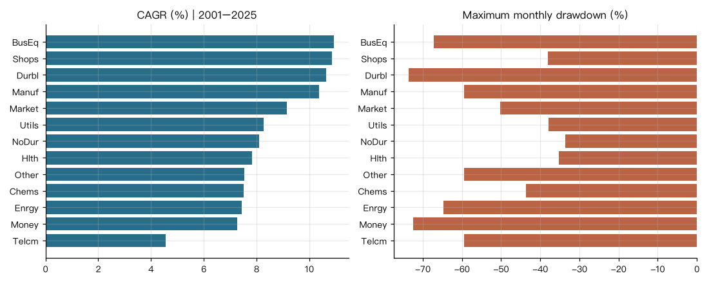
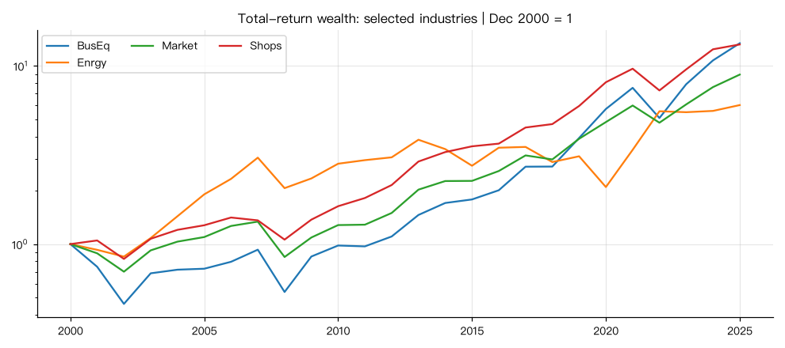
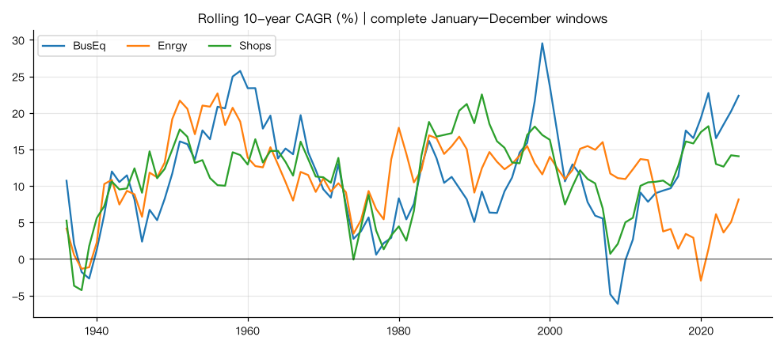
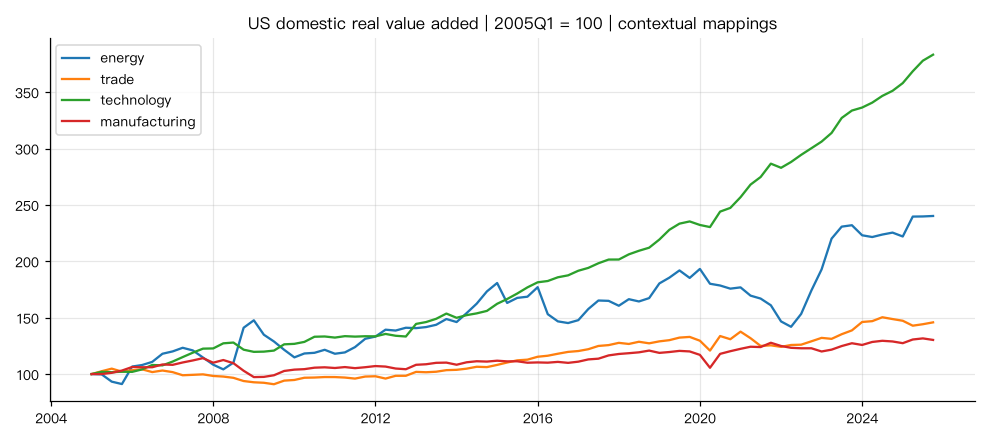
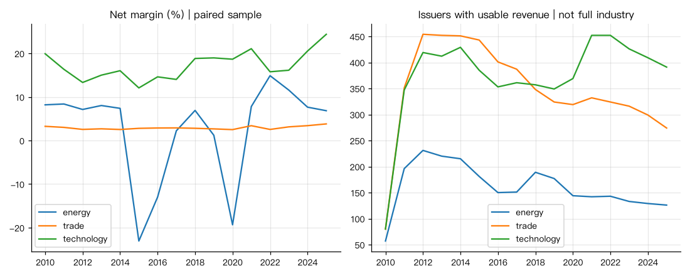

# 美国行业：经济、盈利、估值与指引专题

## 概要

**研究问题：** 哪些行业回报有经营支持，哪些差异体现风险、样本和估值？

**成果类型：** 描述与比较　**研究分支：** industry　**结论状态：** 部分结论受限

**研究范围：** US · USD · 1926-07-01 至 2025-12-31 · monthly

**数据截止：** 2026-08　**生成时间：** 2026-10-26T01:19:35+00:00

**运行 ID：** `us_industry_dossier-20261026T011924Z-78481ed1`　**结果校验值：** `8f8decd4e21bd70d`

## 主要结果

市场回报、美国境内行业产出、全球合并财报和管理层指引分别衡量不同对象。下列对应关系用于研究背景，不能据此建立会计恒等式或因果归因。

行业代码：NoDur 非耐用品；Durbl 耐用品；Manuf 机械等制造；Enrgy 能源；Chems 化工；BusEq 商用设备（含计算机、软件、电子）；Telcm 通信；Utils 公用事业；Shops 批零及部分服务；Hlth 医疗；Money 金融；Other 其他。分类不能直接替换为现代 GICS 板块。

专题解读 · energy：2010–2025 Enrgy 股票年化总收益 6.10%，月度最大回撤 -64.74%。2025 财年末所在年的 116 家可比样本公司营收同比 -2.69%。长期股票收益与最近一年经营变化不是同一比较期间。能源应同时看产量、商品价格与成本，实物产出增长不会自动转化为股东回报。2015 和 2020 年的样本利润率与现金流有助于识别这种周期性；相关数据不能单独把变化归因于油价。

经营路径 · energy：配对样本净利率为2015 年 -23.07%（165 家）、2020 年 -19.34%（132 家）、2025 年 6.85%（109 家）。这里每个年份的分子分母同口径，但跨年公司集合会变化，因此利润率路径同时包含经营与样本构成变化，不能全部解释为固定一批公司的效率改善。

风险与定价 · Enrgy：同期五因子加动量模型的市场 beta 为 1.05，R² 为 0.66；算术年化 alpha 为 -3.44%，95% 区间 -12.58% 至 5.69%，BH q=0.61。区间包含零，不能把高原始回报直接称为稳定的风险调整超额回报。R² 描述月度共同波动，不是长期收益中被经济原因解释的比例。

专题解读 · trade：2010–2025 Shops 股票年化总收益 15.19%，月度最大回撤 -26.21%。2025 财年末所在年的 259 家可比样本公司营收同比 5.35%。长期股票收益与最近一年经营变化不是同一比较期间。批零通常利润率较薄；规模增长、成本控制、库存和资本周转都会影响利润。样本的全球营收、美国零售增加值和股票 Shops 是不同集合，不能互相替代。

经营路径 · trade：配对样本净利率为2015 年 2.80%（399 家）、2020 年 2.51%（300 家）、2025 年 3.82%（260 家）。这里每个年份的分子分母同口径，但跨年公司集合会变化，因此利润率路径同时包含经营与样本构成变化，不能全部解释为固定一批公司的效率改善。

风险与定价 · Shops：同期五因子加动量模型的市场 beta 为 0.96，R² 为 0.85；算术年化 alpha 为 0.57%，95% 区间 -2.27% 至 3.40%，BH q=0.76。区间包含零，不能把高原始回报直接称为稳定的风险调整超额回报。R² 描述月度共同波动，不是长期收益中被经济原因解释的比例。

专题解读 · technology：2010–2025 BusEq 股票年化总收益 18.79%，月度最大回撤 -33.51%。2025 财年末所在年的 350 家可比样本公司营收同比 17.38%。长期股票收益与最近一年经营变化不是同一比较期间。半导体和软件的经营增长可以为回报提供背景，但 BusEq 还包含其他硬件；高回报同时涉及估值、风格与样本变化。49 行业页把 Chips 与 Softw 分开，避免把整个技术产业解释成单一周期。

经营路径 · technology：配对样本净利率为2015 年 12.09%（361 家）、2020 年 18.68%（356 家）、2025 年 24.40%（377 家）。这里每个年份的分子分母同口径，但跨年公司集合会变化，因此利润率路径同时包含经营与样本构成变化，不能全部解释为固定一批公司的效率改善。

风险与定价 · BusEq：同期五因子加动量模型的市场 beta 为 1.13，R² 为 0.91；算术年化 alpha 为 2.45%，95% 区间 -0.27% 至 5.17%，BH q=0.46。区间包含零，不能把高原始回报直接称为稳定的风险调整超额回报。R² 描述月度共同波动，不是长期收益中被经济原因解释的比例。

能源价格背景：EIA WTI 现货价的有效交易日年均值与最低值；每年要求至少 200 个观测。它不是原油期货投资回报，也不是所有能源公司实现的销售价格。

| 年 | 有效日数 | 均价（美元/桶） | 最低 |
|---|---|---|---|
| 2014 | 248 | 93.52 | 53.45 |
| 2015 | 244 | 48.73 | 34.55 |
| 2016 | 252 | 43.29 | 26.19 |
| 2019 | 250 | 56.99 | 46.31 |
| 2020 | 252 | 39.16 | -36.98 |
| 2021 | 251 | 68.14 | 47.47 |
| 2022 | 251 | 94.90 | 71.05 |
| 2025 | 248 | 65.39 | 55.44 |

市场表现：1926–2025。收益含分红，风险按月度计算；实际年化收益用 CPI 起止端点扣除通胀，未插值缺月。

| 行业 | 月数 | 名义年化 | 实际年化 | 波动 | 最大回撤 | 峰值→谷底 | 恢复月 |
|---|---|---|---|---|---|---|---|
| Hlth | 1194 | 11.57% | 8.36% | 19.07% | -74.79% | 1929-08→1932-05 | 1944-05 |
| BusEq | 1194 | 11.47% | 8.26% | 25.48% | -92.07% | 1929-08→1932-05 | 1950-01 |
| Shops | 1194 | 10.93% | 7.74% | 20.02% | -84.15% | 1928-11→1932-06 | 1944-05 |
| Durbl | 1194 | 10.90% | 7.70% | 28.48% | -90.26% | 1929-01→1932-06 | 1936-07 |
| Manuf | 1194 | 10.46% | 7.28% | 23.02% | -89.89% | 1929-08→1932-05 | 1945-04 |
| NoDur | 1194 | 10.46% | 7.28% | 15.78% | -66.74% | 1929-08→1932-05 | 1936-07 |
| Chems | 1194 | 10.42% | 7.24% | 19.57% | -85.39% | 1929-08→1932-06 | 1936-10 |
| Market | 1194 | 10.32% | 7.14% | 18.35% | -83.65% | 1929-08→1932-06 | 1945-01 |
| Enrgy | 1194 | 10.23% | 7.06% | 22.15% | -77.13% | 1929-08→1932-05 | 1936-12 |
| Money | 1194 | 9.86% | 6.69% | 23.32% | -92.12% | 1929-08→1932-05 | 1949-11 |
| Utils | 1194 | 9.19% | 6.04% | 18.84% | -84.78% | 1929-09→1935-02 | 1951-12 |
| Telcm | 1194 | 8.92% | 5.78% | 16.14% | -72.04% | 2000-03→2002-09 | 2013-12 |
| Other | 1194 | 8.08% | 4.97% | 22.46% | -90.40% | 1929-08→1932-06 | 1945-11 |

市场表现：2001–2025。收益含分红，风险按月度计算；实际年化收益用 CPI 起止端点扣除通胀，未插值缺月。

| 行业 | 月数 | 名义年化 | 实际年化 | 波动 | 最大回撤 | 峰值→谷底 | 恢复月 |
|---|---|---|---|---|---|---|---|
| BusEq | 300 | 10.93% | 8.21% | 22.10% | -67.14% | 2001-01→2002-09 | 2012-03 |
| Shops | 300 | 10.87% | 8.14% | 15.80% | -38.02% | 2007-05→2009-02 | 2010-11 |
| Durbl | 300 | 10.64% | 7.92% | 33.09% | -73.70% | 2007-06→2009-02 | 2013-05 |
| Manuf | 300 | 10.37% | 7.66% | 19.93% | -59.45% | 2007-10→2009-02 | 2011-02 |
| Market | 300 | 9.15% | 6.47% | 15.53% | -50.31% | 2007-10→2009-02 | 2012-02 |
| Utils | 300 | 8.26% | 5.60% | 14.38% | -37.91% | 2008-05→2009-02 | 2011-10 |
| NoDur | 300 | 8.09% | 5.44% | 12.37% | -33.62% | 2007-11→2009-02 | 2010-03 |
| Hlth | 300 | 7.82% | 5.17% | 14.17% | -35.29% | 2000-12→2002-09 | 2007-04 |
| Other | 300 | 7.53% | 4.89% | 17.81% | -59.45% | 2007-10→2009-02 | 2013-03 |
| Chems | 300 | 7.51% | 4.87% | 14.55% | -43.64% | 2008-05→2009-02 | 2010-10 |
| Enrgy | 300 | 7.45% | 4.81% | 24.59% | -64.74% | 2014-06→2020-03 | 2022-03 |
| Money | 300 | 7.28% | 4.64% | 19.44% | -72.47% | 2007-05→2009-02 | 2015-07 |
| Telcm | 300 | 4.55% | 1.98% | 17.99% | -59.48% | 2001-01→2002-09 | 2012-06 |

市场表现：2016–2025。收益含分红，风险按月度计算；实际年化收益用 CPI 起止端点扣除通胀，未插值缺月。

| 行业 | 月数 | 名义年化 | 实际年化 | 波动 | 最大回撤 | 峰值→谷底 | 恢复月 |
|---|---|---|---|---|---|---|---|
| BusEq | 120 | 22.35% | 18.56% | 19.15% | -33.51% | 2021-12→2022-09 | 2023-11 |
| Durbl | 120 | 19.81% | 16.10% | 40.17% | -57.74% | 2021-11→2022-12 | 2024-12 |
| Market | 120 | 14.72% | 11.16% | 15.74% | -24.84% | 2021-12→2022-09 | 2023-12 |
| Shops | 120 | 14.06% | 10.53% | 17.02% | -26.21% | 2021-12→2022-06 | 2024-01 |
| Manuf | 120 | 13.90% | 10.37% | 19.76% | -29.16% | 2019-12→2020-03 | 2020-11 |
| Money | 120 | 13.68% | 10.16% | 19.42% | -30.49% | 2019-12→2020-03 | 2020-12 |
| Other | 120 | 12.13% | 8.66% | 18.27% | -28.80% | 2021-10→2022-09 | 2023-12 |
| Utils | 120 | 10.97% | 7.54% | 14.62% | -21.65% | 2020-01→2020-03 | 2021-07 |
| Hlth | 120 | 10.11% | 6.70% | 15.17% | -17.95% | 2021-08→2022-09 | 2024-02 |
| Enrgy | 120 | 8.15% | 4.80% | 29.90% | -60.52% | 2018-09→2020-03 | 2022-01 |
| Chems | 120 | 6.27% | 2.98% | 15.06% | -25.24% | 2021-12→2022-09 | 截至期末未恢复 |
| NoDur | 120 | 5.73% | 2.45% | 13.21% | -19.03% | 2019-12→2020-03 | 2020-11 |
| Telcm | 120 | 5.28% | 2.02% | 17.11% | -36.46% | 2021-08→2022-09 | 截至期末未恢复 |

市场表现：2010–2025。收益含分红，风险按月度计算；实际年化收益用 CPI 起止端点扣除通胀，未插值缺月。

| 行业 | 月数 | 名义年化 | 实际年化 | 波动 | 最大回撤 | 峰值→谷底 | 恢复月 |
|---|---|---|---|---|---|---|---|
| BusEq | 192 | 18.79% | 15.81% | 17.98% | -33.51% | 2021-12→2022-09 | 2023-11 |
| Durbl | 192 | 17.15% | 14.22% | 34.86% | -57.74% | 2021-11→2022-12 | 2024-12 |
| Shops | 192 | 15.19% | 12.31% | 15.52% | -26.21% | 2021-12→2022-06 | 2024-01 |
| Market | 192 | 14.06% | 11.20% | 14.91% | -24.84% | 2021-12→2022-09 | 2023-12 |
| Manuf | 192 | 13.25% | 10.41% | 18.95% | -29.16% | 2019-12→2020-03 | 2020-11 |
| Money | 192 | 13.10% | 10.27% | 18.58% | -30.49% | 2019-12→2020-03 | 2020-12 |
| Hlth | 192 | 12.74% | 9.92% | 14.30% | -17.95% | 2021-08→2022-09 | 2024-02 |
| Other | 192 | 12.16% | 9.35% | 17.08% | -28.80% | 2021-10→2022-09 | 2023-12 |
| Utils | 192 | 10.23% | 7.47% | 13.45% | -21.65% | 2020-01→2020-03 | 2021-07 |
| NoDur | 192 | 9.40% | 6.66% | 12.48% | -19.03% | 2019-12→2020-03 | 2020-11 |
| Telcm | 192 | 9.11% | 6.37% | 16.03% | -36.46% | 2021-08→2022-09 | 截至期末未恢复 |
| Chems | 192 | 8.20% | 5.49% | 14.47% | -25.24% | 2021-12→2022-09 | 截至期末未恢复 |
| Enrgy | 192 | 6.10% | 3.44% | 26.56% | -64.74% | 2014-06→2020-03 | 2022-03 |

因子暴露（2001–2025）：alpha 为月截距乘 12，不是可交易收益预测。95% 区间使用 Bartlett/Newey–West HAC（6 月滞后），p 值为渐近正态近似；BH q 值在同一模型、同一窗口的行业 alpha 间调整，仍是探索性比较。

| 行业 | 模型 | 市场 beta | 年化 alpha | alpha 95%区间 | BH q | R² |
|---|---|---|---|---|---|---|
| BusEq | CAPM | 1.26 | 0.71% | -3.25% ~ 4.68% | 0.91 | 0.79 |
| Chems | CAPM | 0.77 | 0.22% | -3.30% ~ 3.74% | 0.91 | 0.67 |
| Durbl | CAPM | 1.59 | 0.49% | -7.57% ~ 8.55% | 0.91 | 0.56 |
| Enrgy | CAPM | 0.96 | 0.53% | -8.44% ~ 9.50% | 0.91 | 0.37 |
| Hlth | CAPM | 0.68 | 1.25% | -1.94% ~ 4.43% | 0.76 | 0.55 |
| Manuf | CAPM | 1.18 | 0.42% | -2.92% ~ 3.77% | 0.91 | 0.85 |
| Money | CAPM | 1.09 | -1.74% | -5.87% ~ 2.38% | 0.76 | 0.75 |
| NoDur | CAPM | 0.59 | 1.93% | -1.22% ~ 5.09% | 0.55 | 0.55 |
| Other | CAPM | 1.08 | -1.75% | -3.98% ~ 0.47% | 0.53 | 0.88 |
| Shops | CAPM | 0.90 | 2.42% | -0.48% ~ 5.32% | 0.53 | 0.78 |
| Telcm | CAPM | 0.91 | -3.18% | -7.45% ~ 1.09% | 0.53 | 0.62 |
| Utils | CAPM | 0.52 | 3.01% | -1.35% ~ 7.36% | 0.53 | 0.31 |
| BusEq | FF3 | 1.26 | 1.09% | -1.66% ~ 3.85% | 0.66 | 0.87 |
| Chems | FF3 | 0.79 | 0.06% | -3.44% ~ 3.57% | 0.99 | 0.71 |
| Durbl | FF3 | 1.46 | 0.64% | -6.97% ~ 8.25% | 0.99 | 0.60 |
| Enrgy | FF3 | 0.92 | 0.05% | -6.82% ~ 6.92% | 0.99 | 0.49 |
| Hlth | FF3 | 0.70 | 1.26% | -1.94% ~ 4.46% | 0.66 | 0.56 |
| Manuf | FF3 | 1.13 | 0.29% | -2.52% ~ 3.09% | 0.99 | 0.88 |
| Money | FF3 | 1.06 | -2.16% | -5.00% ~ 0.68% | 0.38 | 0.88 |
| NoDur | FF3 | 0.63 | 1.76% | -1.26% ~ 4.79% | 0.51 | 0.61 |
| Other | FF3 | 1.06 | -1.87% | -3.94% ~ 0.20% | 0.38 | 0.90 |
| Shops | FF3 | 0.89 | 2.49% | -0.24% ~ 5.23% | 0.38 | 0.79 |
| Telcm | FF3 | 0.95 | -3.30% | -7.57% ~ 0.96% | 0.38 | 0.64 |
| Utils | FF3 | 0.55 | 2.88% | -1.10% ~ 6.86% | 0.38 | 0.34 |
| BusEq | FF5+MOM | 1.16 | 3.98% | 1.21% ~ 6.76% | 0.06 | 0.89 |
| Chems | FF5+MOM | 0.88 | -2.94% | -6.22% ~ 0.34% | 0.31 | 0.76 |
| Durbl | FF5+MOM | 1.41 | -0.00% | -7.09% ~ 7.09% | 1.00 | 0.61 |
| Enrgy | FF5+MOM | 1.00 | -2.36% | -10.17% ~ 5.46% | 0.83 | 0.50 |
| Hlth | FF5+MOM | 0.76 | 0.66% | -2.80% ~ 4.12% | 0.85 | 0.58 |
| Manuf | FF5+MOM | 1.16 | -1.20% | -4.05% ~ 1.66% | 0.83 | 0.89 |
| Money | FF5+MOM | 1.00 | -0.58% | -3.24% ~ 2.08% | 0.85 | 0.89 |
| NoDur | FF5+MOM | 0.70 | -0.81% | -3.44% ~ 1.82% | 0.83 | 0.67 |
| Other | FF5+MOM | 1.04 | -2.05% | -4.24% ~ 0.13% | 0.31 | 0.90 |
| Shops | FF5+MOM | 0.94 | 0.95% | -1.78% ~ 3.69% | 0.83 | 0.80 |
| Telcm | FF5+MOM | 0.90 | -2.76% | -6.93% ~ 1.41% | 0.58 | 0.66 |
| Utils | FF5+MOM | 0.66 | 0.47% | -3.87% ~ 4.81% | 0.91 | 0.39 |

估值与样本背景：BE/ME 使用 French 的年度源标签，不当作 12 月末市盈率。公司数量与平均市值不能确定行业成分集中度；等权—市值加权差异包含规模与再平衡效应。

| 行业 | 2025-12 公司数 | 平均市值（百万美元） | 2025 BE/ME | 等权年化 | 市值加权年化 |
|---|---|---|---|---|---|
| BusEq | 589.00 | 47,162.79 | 0.11 | 11.06% | 10.93% |
| Chems | 79.00 | 12,458.98 | 0.24 | 9.03% | 7.51% |
| Durbl | 81.00 | 21,821.95 | 0.16 | 4.64% | 10.64% |
| Enrgy | 98.00 | 16,428.28 | 0.56 | 2.14% | 7.45% |
| Hlth | 727.00 | 7,429.66 | 0.19 | 7.96% | 7.82% |
| Manuf | 277.00 | 12,703.21 | 0.20 | 11.62% | 10.37% |
| Money | 567.00 | 13,429.85 | 0.45 | 10.67% | 7.28% |
| NoDur | 133.00 | 12,345.56 | 0.25 | 8.41% | 8.09% |
| Other | 396.00 | 14,703.80 | 0.33 | 9.13% | 7.53% |
| Shops | 260.00 | 25,908.20 | 0.11 | 11.06% | 10.87% |
| Telcm | 47.00 | 23,588.02 | 0.56 | 5.65% | 4.55% |
| Utils | 73.00 | 24,043.11 | 0.44 | 10.82% | 8.26% |

实体行业：2006Q2–2025Q4 同期端点变化。增加值为链式实际美元；就业、工时、时薪为各季度有效月份均值，缺一月即不生成季度。时薪为名义值；产能利用率的百分比变化不能误读为百分点变化。不同产业的链式美元不直接相加。

| 专题 | 指标 | FRED代码 | 起值 | 终值 | 累计变化 | 有效季度 |
|---|---|---|---|---|---|---|
| energy | rva | RVAM | 181.70 | 404.00 | 122.34% | 84 |
| energy | employment | USMINE | 681.33 | 605.00 | -11.20% | 84 |
| trade | rva | RVAR | 996.50 | 1,394.90 | 39.98% | 84 |
| trade | wholesale | RVAW | 1,035.00 | 1,312.40 | 26.80% | 84 |
| trade | employment | USTRADE | 15,300.00 | 15,429.53 | 0.85% | 84 |
| technology | rva | RVAI | 535.70 | 1,970.90 | 267.91% | 84 |
| technology | employment | USINFO | 3,040.67 | 2,847.67 | -6.35% | 84 |
| manufacturing | rva | RVAMA | 1,970.10 | 2,420.50 | 22.86% | 84 |
| manufacturing | employment | MANEMP | 14,211.00 | 12,592.00 | -11.39% | 84 |
| manufacturing | hours | AWHAEMAN | 39.97 | 40.03 | 0.17% | 79 |
| manufacturing | wage | CES3000000003 | 20.79 | 35.98 | 73.04% | 79 |
| manufacturing | output | IPMAN | 101.77 | 97.11 | -4.58% | 84 |
| manufacturing | utilization | MCUMFN | 78.84 | 74.80 | -5.12% | 84 |

energy 对应限制：采矿增加值含金属与非金属矿，不含炼油；股票能源含炼油，BLS USMINE 还含伐木。不得把矿业产出当作能源股票收入。

trade 对应限制：SEC 样本含餐饮；French Shops 还含部分服务，BEA 零售与批发分别列示，不直接相加链式美元。

technology 对应限制：SEC SIC 7370–7379 包含软件和计算机服务，3674 为半导体；BEA 信息业含出版、电信、数据服务等，半导体属于制造业。信息业只作背景，不作为半导体产出代理。

manufacturing 对应限制：BEA 制造业包含 French 的多个行业；French Manuf 不是制造业总量。

领先/滞后相关：corr(行业股票收益[t], 实际增加值或产出环比增长[t+k])。k>0 表示股票领先；对所有 -4 至 +4 季结果同时报告，不挑选最好的一项。它是当前修订值的事后相关，未作显著性或因果结论。

| 专题/序列 | 时期 | 滞后k | 配对季度 | 相关系数 |
|---|---|---|---|---|
| energy/RVAM | 2005Q1–2025Q4 | -4 | 79 | -0.05 |
| energy/RVAM | 2005Q1–2025Q4 | -3 | 80 | 0.10 |
| energy/RVAM | 2005Q1–2025Q4 | -2 | 81 | -0.12 |
| energy/RVAM | 2005Q1–2025Q4 | -1 | 82 | 0.06 |
| energy/RVAM | 2005Q1–2025Q4 | 0 | 83 | -0.30 |
| energy/RVAM | 2005Q1–2025Q4 | 1 | 83 | -0.21 |
| energy/RVAM | 2005Q1–2025Q4 | 2 | 82 | 0.10 |
| energy/RVAM | 2005Q1–2025Q4 | 3 | 81 | 0.17 |
| energy/RVAM | 2005Q1–2025Q4 | 4 | 80 | 0.10 |
| energy/RVAM | 2005Q1–2014Q4 | -4 | 35 | 0.10 |
| energy/RVAM | 2005Q1–2014Q4 | -3 | 36 | 0.27 |
| energy/RVAM | 2005Q1–2014Q4 | -2 | 37 | 0.14 |
| energy/RVAM | 2005Q1–2014Q4 | -1 | 38 | -0.10 |
| energy/RVAM | 2005Q1–2014Q4 | 0 | 39 | -0.38 |
| energy/RVAM | 2005Q1–2014Q4 | 1 | 39 | -0.45 |
| energy/RVAM | 2005Q1–2014Q4 | 2 | 38 | 0.19 |
| energy/RVAM | 2005Q1–2014Q4 | 3 | 37 | 0.09 |
| energy/RVAM | 2005Q1–2014Q4 | 4 | 36 | 0.22 |
| energy/RVAM | 2015Q1–2025Q4 | -4 | 39 | -0.13 |
| energy/RVAM | 2015Q1–2025Q4 | -3 | 40 | 0.04 |
| energy/RVAM | 2015Q1–2025Q4 | -2 | 41 | -0.28 |
| energy/RVAM | 2015Q1–2025Q4 | -1 | 42 | 0.20 |
| energy/RVAM | 2015Q1–2025Q4 | 0 | 43 | -0.24 |
| energy/RVAM | 2015Q1–2025Q4 | 1 | 43 | -0.04 |
| energy/RVAM | 2015Q1–2025Q4 | 2 | 42 | -0.01 |
| energy/RVAM | 2015Q1–2025Q4 | 3 | 41 | 0.21 |
| energy/RVAM | 2015Q1–2025Q4 | 4 | 40 | 0.04 |
| trade/RVAR | 2005Q1–2025Q4 | -4 | 79 | -0.00 |
| trade/RVAR | 2005Q1–2025Q4 | -3 | 80 | 0.25 |
| trade/RVAR | 2005Q1–2025Q4 | -2 | 81 | 0.01 |
| trade/RVAR | 2005Q1–2025Q4 | -1 | 82 | 0.03 |
| trade/RVAR | 2005Q1–2025Q4 | 0 | 83 | 0.09 |
| trade/RVAR | 2005Q1–2025Q4 | 1 | 83 | 0.31 |
| trade/RVAR | 2005Q1–2025Q4 | 2 | 82 | -0.11 |
| trade/RVAR | 2005Q1–2025Q4 | 3 | 81 | 0.14 |
| trade/RVAR | 2005Q1–2025Q4 | 4 | 80 | -0.21 |
| trade/RVAR | 2005Q1–2014Q4 | -4 | 35 | -0.02 |
| trade/RVAR | 2005Q1–2014Q4 | -3 | 36 | 0.16 |
| trade/RVAR | 2005Q1–2014Q4 | -2 | 37 | 0.07 |
| trade/RVAR | 2005Q1–2014Q4 | -1 | 38 | 0.15 |
| trade/RVAR | 2005Q1–2014Q4 | 0 | 39 | 0.25 |
| trade/RVAR | 2005Q1–2014Q4 | 1 | 39 | 0.14 |
| trade/RVAR | 2005Q1–2014Q4 | 2 | 38 | 0.18 |
| trade/RVAR | 2005Q1–2014Q4 | 3 | 37 | 0.35 |
| trade/RVAR | 2005Q1–2014Q4 | 4 | 36 | 0.07 |
| trade/RVAR | 2015Q1–2025Q4 | -4 | 39 | 0.01 |
| trade/RVAR | 2015Q1–2025Q4 | -3 | 40 | 0.28 |
| trade/RVAR | 2015Q1–2025Q4 | -2 | 41 | -0.02 |
| trade/RVAR | 2015Q1–2025Q4 | -1 | 42 | -0.02 |
| trade/RVAR | 2015Q1–2025Q4 | 0 | 43 | 0.01 |
| trade/RVAR | 2015Q1–2025Q4 | 1 | 43 | 0.38 |
| trade/RVAR | 2015Q1–2025Q4 | 2 | 42 | -0.26 |
| trade/RVAR | 2015Q1–2025Q4 | 3 | 41 | 0.04 |
| trade/RVAR | 2015Q1–2025Q4 | 4 | 40 | -0.34 |
| technology/RVAI | 2005Q1–2025Q4 | -4 | 79 | -0.21 |
| technology/RVAI | 2005Q1–2025Q4 | -3 | 80 | 0.01 |
| technology/RVAI | 2005Q1–2025Q4 | -2 | 81 | -0.22 |
| technology/RVAI | 2005Q1–2025Q4 | -1 | 82 | 0.01 |
| technology/RVAI | 2005Q1–2025Q4 | 0 | 83 | 0.25 |
| technology/RVAI | 2005Q1–2025Q4 | 1 | 83 | 0.10 |
| technology/RVAI | 2005Q1–2025Q4 | 2 | 82 | 0.09 |
| technology/RVAI | 2005Q1–2025Q4 | 3 | 81 | 0.09 |
| technology/RVAI | 2005Q1–2025Q4 | 4 | 80 | 0.09 |
| technology/RVAI | 2005Q1–2014Q4 | -4 | 35 | -0.23 |
| technology/RVAI | 2005Q1–2014Q4 | -3 | 36 | -0.05 |
| technology/RVAI | 2005Q1–2014Q4 | -2 | 37 | -0.33 |
| technology/RVAI | 2005Q1–2014Q4 | -1 | 38 | -0.03 |
| technology/RVAI | 2005Q1–2014Q4 | 0 | 39 | 0.30 |
| technology/RVAI | 2005Q1–2014Q4 | 1 | 39 | 0.04 |
| technology/RVAI | 2005Q1–2014Q4 | 2 | 38 | 0.21 |
| technology/RVAI | 2005Q1–2014Q4 | 3 | 37 | 0.04 |
| technology/RVAI | 2005Q1–2014Q4 | 4 | 36 | 0.18 |
| technology/RVAI | 2015Q1–2025Q4 | -4 | 39 | -0.31 |
| technology/RVAI | 2015Q1–2025Q4 | -3 | 40 | -0.02 |
| technology/RVAI | 2015Q1–2025Q4 | -2 | 41 | -0.19 |
| technology/RVAI | 2015Q1–2025Q4 | -1 | 42 | 0.02 |
| technology/RVAI | 2015Q1–2025Q4 | 0 | 43 | 0.17 |
| technology/RVAI | 2015Q1–2025Q4 | 1 | 43 | 0.11 |
| technology/RVAI | 2015Q1–2025Q4 | 2 | 42 | -0.12 |
| technology/RVAI | 2015Q1–2025Q4 | 3 | 41 | 0.10 |
| technology/RVAI | 2015Q1–2025Q4 | 4 | 40 | -0.08 |
| manufacturing/RVAMA | 2005Q1–2025Q4 | -4 | 79 | -0.10 |
| manufacturing/RVAMA | 2005Q1–2025Q4 | -3 | 80 | -0.20 |
| manufacturing/RVAMA | 2005Q1–2025Q4 | -2 | 81 | -0.16 |
| manufacturing/RVAMA | 2005Q1–2025Q4 | -1 | 82 | 0.10 |
| manufacturing/RVAMA | 2005Q1–2025Q4 | 0 | 83 | 0.31 |
| manufacturing/RVAMA | 2005Q1–2025Q4 | 1 | 83 | 0.46 |
| manufacturing/RVAMA | 2005Q1–2025Q4 | 2 | 82 | -0.01 |
| manufacturing/RVAMA | 2005Q1–2025Q4 | 3 | 81 | 0.08 |
| manufacturing/RVAMA | 2005Q1–2025Q4 | 4 | 80 | -0.01 |
| manufacturing/RVAMA | 2005Q1–2014Q4 | -4 | 35 | -0.09 |
| manufacturing/RVAMA | 2005Q1–2014Q4 | -3 | 36 | -0.14 |
| manufacturing/RVAMA | 2005Q1–2014Q4 | -2 | 37 | -0.22 |
| manufacturing/RVAMA | 2005Q1–2014Q4 | -1 | 38 | 0.03 |
| manufacturing/RVAMA | 2005Q1–2014Q4 | 0 | 39 | 0.62 |
| manufacturing/RVAMA | 2005Q1–2014Q4 | 1 | 39 | 0.45 |
| manufacturing/RVAMA | 2005Q1–2014Q4 | 2 | 38 | 0.24 |
| manufacturing/RVAMA | 2005Q1–2014Q4 | 3 | 37 | -0.02 |
| manufacturing/RVAMA | 2005Q1–2014Q4 | 4 | 36 | 0.01 |
| manufacturing/RVAMA | 2015Q1–2025Q4 | -4 | 39 | -0.10 |
| manufacturing/RVAMA | 2015Q1–2025Q4 | -3 | 40 | -0.26 |
| manufacturing/RVAMA | 2015Q1–2025Q4 | -2 | 41 | -0.13 |
| manufacturing/RVAMA | 2015Q1–2025Q4 | -1 | 42 | 0.16 |
| manufacturing/RVAMA | 2015Q1–2025Q4 | 0 | 43 | 0.07 |
| manufacturing/RVAMA | 2015Q1–2025Q4 | 1 | 43 | 0.49 |
| manufacturing/RVAMA | 2015Q1–2025Q4 | 2 | 42 | -0.21 |
| manufacturing/RVAMA | 2015Q1–2025Q4 | 3 | 41 | 0.15 |
| manufacturing/RVAMA | 2015Q1–2025Q4 | 4 | 40 | -0.02 |
| manufacturing/IPMAN | 2005Q1–2025Q4 | -4 | 79 | -0.14 |
| manufacturing/IPMAN | 2005Q1–2025Q4 | -3 | 80 | -0.18 |
| manufacturing/IPMAN | 2005Q1–2025Q4 | -2 | 81 | -0.10 |
| manufacturing/IPMAN | 2005Q1–2025Q4 | -1 | 82 | 0.11 |
| manufacturing/IPMAN | 2005Q1–2025Q4 | 0 | 83 | 0.15 |
| manufacturing/IPMAN | 2005Q1–2025Q4 | 1 | 83 | 0.58 |
| manufacturing/IPMAN | 2005Q1–2025Q4 | 2 | 82 | 0.02 |
| manufacturing/IPMAN | 2005Q1–2025Q4 | 3 | 81 | 0.08 |
| manufacturing/IPMAN | 2005Q1–2025Q4 | 4 | 80 | 0.08 |
| manufacturing/IPMAN | 2005Q1–2014Q4 | -4 | 35 | -0.13 |
| manufacturing/IPMAN | 2005Q1–2014Q4 | -3 | 36 | -0.22 |
| manufacturing/IPMAN | 2005Q1–2014Q4 | -2 | 37 | -0.14 |
| manufacturing/IPMAN | 2005Q1–2014Q4 | -1 | 38 | 0.15 |
| manufacturing/IPMAN | 2005Q1–2014Q4 | 0 | 39 | 0.49 |
| manufacturing/IPMAN | 2005Q1–2014Q4 | 1 | 39 | 0.64 |
| manufacturing/IPMAN | 2005Q1–2014Q4 | 2 | 38 | 0.39 |
| manufacturing/IPMAN | 2005Q1–2014Q4 | 3 | 37 | 0.18 |
| manufacturing/IPMAN | 2005Q1–2014Q4 | 4 | 36 | 0.13 |
| manufacturing/IPMAN | 2015Q1–2025Q4 | -4 | 39 | -0.15 |
| manufacturing/IPMAN | 2015Q1–2025Q4 | -3 | 40 | -0.15 |
| manufacturing/IPMAN | 2015Q1–2025Q4 | -2 | 41 | -0.09 |
| manufacturing/IPMAN | 2015Q1–2025Q4 | -1 | 42 | 0.09 |
| manufacturing/IPMAN | 2015Q1–2025Q4 | 0 | 43 | -0.08 |
| manufacturing/IPMAN | 2015Q1–2025Q4 | 1 | 43 | 0.57 |
| manufacturing/IPMAN | 2015Q1–2025Q4 | 2 | 42 | -0.25 |
| manufacturing/IPMAN | 2015Q1–2025Q4 | 3 | 41 | 0.01 |
| manufacturing/IPMAN | 2015Q1–2025Q4 | 4 | 40 | 0.05 |

宏观环境分组（2001–2025）：衰退按 NBER 事后日期；通胀按 CPI 同比的当月升降；政策利率按月均值六个月变化超过 ±0.25 个百分点分组。下表是组内月均收益 ×12，不是连续持有年化收益，也不能作为当时可得的择时信号。

| 变量 | 状态 | 行业 | 月数 | 月均收益×12 | 月标准差×√12 |
|---|---|---|---|---|---|
| recession | expansion | BusEq | 272 | 14.78% | 20.06% |
| recession | expansion | Chems | 272 | 10.06% | 13.30% |
| recession | expansion | Durbl | 272 | 18.80% | 30.44% |
| recession | expansion | Enrgy | 272 | 13.34% | 22.23% |
| recession | expansion | Hlth | 272 | 9.30% | 13.53% |
| recession | expansion | Manuf | 272 | 15.57% | 17.23% |
| recession | expansion | Money | 272 | 12.73% | 16.47% |
| recession | expansion | NoDur | 272 | 10.21% | 11.59% |
| recession | expansion | Other | 272 | 12.46% | 15.63% |
| recession | expansion | Shops | 272 | 12.80% | 14.50% |
| recession | expansion | Telcm | 272 | 9.15% | 16.96% |
| recession | expansion | Utils | 272 | 12.04% | 13.43% |
| recession | recession | BusEq | 28 | -5.37% | 36.57% |
| recession | recession | Chems | 28 | -8.53% | 23.29% |
| recession | recession | Durbl | 28 | -17.34% | 52.15% |
| recession | recession | Enrgy | 28 | -19.94% | 40.59% |
| recession | recession | Hlth | 28 | 1.36% | 19.49% |
| recession | recession | Manuf | 28 | -23.55% | 36.02% |
| recession | recession | Money | 28 | -27.60% | 36.52% |
| recession | recession | NoDur | 28 | -7.35% | 17.90% |
| recession | recession | Other | 28 | -25.83% | 30.73% |
| recession | recession | Shops | 28 | -0.07% | 25.33% |
| recession | recession | Telcm | 28 | -23.78% | 24.74% |
| recession | recession | Utils | 28 | -20.47% | 19.91% |
| inflation | falling | BusEq | 149 | 9.21% | 24.74% |
| inflation | falling | Chems | 149 | 9.24% | 15.61% |
| inflation | falling | Durbl | 149 | 12.36% | 36.92% |
| inflation | falling | Enrgy | 149 | 1.68% | 26.04% |
| inflation | falling | Hlth | 149 | 8.72% | 14.80% |
| inflation | falling | Manuf | 149 | 11.78% | 22.70% |
| inflation | falling | Money | 149 | 5.70% | 21.85% |
| inflation | falling | NoDur | 149 | 8.21% | 13.79% |
| inflation | falling | Other | 149 | 8.34% | 20.19% |
| inflation | falling | Shops | 149 | 14.27% | 17.96% |
| inflation | falling | Telcm | 149 | 5.09% | 18.65% |
| inflation | falling | Utils | 149 | 6.45% | 15.13% |
| inflation | rising | BusEq | 148 | 17.66% | 18.87% |
| inflation | rising | Chems | 148 | 7.62% | 13.58% |
| inflation | rising | Durbl | 148 | 19.75% | 28.98% |
| inflation | rising | Enrgy | 148 | 19.20% | 23.07% |
| inflation | rising | Hlth | 148 | 7.59% | 13.30% |
| inflation | rising | Manuf | 148 | 12.28% | 16.92% |
| inflation | rising | Money | 148 | 12.92% | 16.78% |
| inflation | rising | NoDur | 148 | 8.80% | 10.79% |
| inflation | rising | Other | 148 | 10.12% | 15.17% |
| inflation | rising | Shops | 148 | 9.55% | 13.30% |
| inflation | rising | Telcm | 148 | 8.49% | 17.23% |
| inflation | rising | Utils | 148 | 11.45% | 13.72% |
| policy_rate | falling | BusEq | 68 | -2.41% | 32.22% |
| policy_rate | falling | Chems | 68 | -1.94% | 18.11% |
| policy_rate | falling | Durbl | 68 | 17.78% | 45.26% |
| policy_rate | falling | Enrgy | 68 | -13.90% | 29.96% |
| policy_rate | falling | Hlth | 68 | -3.05% | 16.46% |
| policy_rate | falling | Manuf | 68 | -5.28% | 26.14% |
| policy_rate | falling | Money | 68 | -10.93% | 26.44% |
| policy_rate | falling | NoDur | 68 | -0.10% | 14.04% |
| policy_rate | falling | Other | 68 | -5.16% | 24.00% |
| policy_rate | falling | Shops | 68 | 5.70% | 20.10% |
| policy_rate | falling | Telcm | 68 | -9.94% | 23.05% |
| policy_rate | falling | Utils | 68 | -4.40% | 18.17% |
| policy_rate | rising | BusEq | 76 | 14.01% | 19.02% |
| policy_rate | rising | Chems | 76 | 6.90% | 13.45% |
| policy_rate | rising | Durbl | 76 | 0.90% | 30.97% |
| policy_rate | rising | Enrgy | 76 | 14.46% | 24.22% |
| policy_rate | rising | Hlth | 76 | 7.90% | 12.77% |
| policy_rate | rising | Manuf | 76 | 13.26% | 18.61% |
| policy_rate | rising | Money | 76 | 9.40% | 15.39% |
| policy_rate | rising | NoDur | 76 | 5.17% | 11.73% |
| policy_rate | rising | Other | 76 | 9.64% | 16.33% |
| policy_rate | rising | Shops | 76 | 10.58% | 16.15% |
| policy_rate | rising | Telcm | 76 | 4.92% | 15.71% |
| policy_rate | rising | Utils | 76 | 10.98% | 12.31% |

固定压力时期的累计总收益：窗口是事件比较，不是事后搜索的最差起止点。

| 事件 | 起止月 | 行业 | 累计收益 |
|---|---|---|---|
| Dotcom | 2000-01→2002-12 | BusEq | -71.27% |
| Dotcom | 2000-01→2002-12 | Chems | -13.10% |
| Dotcom | 2000-01→2002-12 | Durbl | -24.53% |
| Dotcom | 2000-01→2002-12 | Enrgy | 4.14% |
| Dotcom | 2000-01→2002-12 | Hlth | -7.84% |
| Dotcom | 2000-01→2002-12 | Manuf | -16.67% |
| Dotcom | 2000-01→2002-12 | Money | 5.79% |
| Dotcom | 2000-01→2002-12 | NoDur | 17.87% |
| Dotcom | 2000-01→2002-12 | Other | -38.22% |
| Dotcom | 2000-01→2002-12 | Shops | -26.14% |
| Dotcom | 2000-01→2002-12 | Telcm | -65.41% |
| Dotcom | 2000-01→2002-12 | Utils | 5.60% |
| GFC | 2007-10→2009-02 | BusEq | -46.67% |
| GFC | 2007-10→2009-02 | Chems | -41.03% |
| GFC | 2007-10→2009-02 | Durbl | -72.05% |
| GFC | 2007-10→2009-02 | Enrgy | -39.71% |
| GFC | 2007-10→2009-02 | Hlth | -29.80% |
| GFC | 2007-10→2009-02 | Manuf | -59.27% |
| GFC | 2007-10→2009-02 | Money | -70.16% |
| GFC | 2007-10→2009-02 | NoDur | -31.59% |
| GFC | 2007-10→2009-02 | Other | -58.08% |
| GFC | 2007-10→2009-02 | Shops | -33.80% |
| GFC | 2007-10→2009-02 | Telcm | -49.94% |
| GFC | 2007-10→2009-02 | Utils | -33.53% |
| Oil slump | 2014-07→2016-01 | BusEq | 5.99% |
| Oil slump | 2014-07→2016-01 | Chems | -5.38% |
| Oil slump | 2014-07→2016-01 | Durbl | -19.05% |
| Oil slump | 2014-07→2016-01 | Enrgy | -38.90% |
| Oil slump | 2014-07→2016-01 | Hlth | 7.52% |
| Oil slump | 2014-07→2016-01 | Manuf | -12.30% |
| Oil slump | 2014-07→2016-01 | Money | 0.40% |
| Oil slump | 2014-07→2016-01 | NoDur | 16.45% |
| Oil slump | 2014-07→2016-01 | Other | -5.79% |
| Oil slump | 2014-07→2016-01 | Shops | 17.13% |
| Oil slump | 2014-07→2016-01 | Telcm | 0.84% |
| Oil slump | 2014-07→2016-01 | Utils | -6.48% |
| COVID | 2020-02→2020-03 | BusEq | -15.97% |
| COVID | 2020-02→2020-03 | Chems | -17.84% |
| COVID | 2020-02→2020-03 | Durbl | -28.28% |
| COVID | 2020-02→2020-03 | Enrgy | -44.58% |
| COVID | 2020-02→2020-03 | Hlth | -10.19% |
| COVID | 2020-02→2020-03 | Manuf | -27.10% |
| COVID | 2020-02→2020-03 | Money | -28.75% |
| COVID | 2020-02→2020-03 | NoDur | -18.68% |
| COVID | 2020-02→2020-03 | Other | -24.61% |
| COVID | 2020-02→2020-03 | Shops | -14.10% |
| COVID | 2020-02→2020-03 | Telcm | -18.62% |
| COVID | 2020-02→2020-03 | Utils | -21.65% |
| Inflation 2022 | 2022-01→2022-12 | BusEq | -32.29% |
| Inflation 2022 | 2022-01→2022-12 | Chems | -14.08% |
| Inflation 2022 | 2022-01→2022-12 | Durbl | -55.67% |
| Inflation 2022 | 2022-01→2022-12 | Enrgy | 64.64% |
| Inflation 2022 | 2022-01→2022-12 | Hlth | -5.73% |
| Inflation 2022 | 2022-01→2022-12 | Manuf | -10.09% |
| Inflation 2022 | 2022-01→2022-12 | Money | -9.92% |
| Inflation 2022 | 2022-01→2022-12 | NoDur | 1.33% |
| Inflation 2022 | 2022-01→2022-12 | Other | -20.06% |
| Inflation 2022 | 2022-01→2022-12 | Shops | -24.47% |
| Inflation 2022 | 2022-01→2022-12 | Telcm | -23.29% |
| Inflation 2022 | 2022-01→2022-12 | Utils | 2.96% |

财报样本：2817 家历史申报主体（其中 2816 家有已解析事实），154670 个年度指标事实。按各期 SIC 选样，不等于上市普通股成分。按财年结束的日历年归档；2010 年附近的 XBRL 分阶段覆盖尤其不完整。进入/退出只表示本研究样本变化，不能解释为 IPO/退市。

利润率采用同一批同时有利润与营收的公司的合计比率。增长只用连续两年都有该指标的公司；零或负的合计基期不输出增长率。不同指标覆盖不同，不能混合它们的总额。后续年度比较列的重述不纳入，本表只纳入当年申报及修正申报。

energy：年度经营表现与样本覆盖。营收为十亿美元，增长为同公司同比。

| 财年末所在年 | 公司/新增/退出 | 营收覆盖 | 营收合计 | 同公司增长/数量 | 净利率/数量 | 经营利率/数量 | FCF/数量 |
|---|---|---|---|---|---|---|---|
| 2010 | 72/31/4 | 57 | 748.84 | 23.13% / 34 | 8.20% / 47 | 13.68% / 39 | 45.95 / 49 |
| 2011 | 331/265/6 | 196 | 891.82 | 15.78% / 50 | 8.39% / 166 | 16.00% / 149 | 45.90 / 143 |
| 2012 | 385/83/29 | 231 | 856.07 | -20.92% / 172 | 7.14% / 198 | 10.66% / 182 | 26,713.54 / 147 |
| 2013 | 388/45/42 | 220 | 843.11 | -5.38% / 187 | 8.04% / 186 | 12.21% / 168 | 20.88 / 148 |
| 2014 | 372/45/61 | 215 | 835.06 | -0.33% / 178 | 7.39% / 188 | 15.48% / 167 | 17.84 / 148 |
| 2015 | 327/22/67 | 181 | 538.67 | -35.64% / 163 | -23.07% / 165 | -65.92% / 139 | 3.59 / 134 |
| 2016 | 280/16/63 | 150 | 408.07 | -20.89% / 138 | -12.99% / 137 | -27.48% / 115 | 10.31 / 104 |
| 2017 | 270/34/44 | 151 | 501.96 | 24.94% / 119 | 2.24% / 141 | 4.87% / 120 | 41.26 / 102 |
| 2018 | 246/20/44 | 189 | 703.71 | 18.05% / 119 | 6.92% / 175 | 8.39% / 152 | 57.75 / 102 |
| 2019 | 216/11/41 | 177 | 918.46 | -1.62% / 149 | 1.21% / 162 | 2.64% / 145 | 40.84 / 88 |
| 2020 | 185/3/34 | 144 | 649.60 | -34.37% / 139 | -19.34% / 132 | -31.27% / 116 | 3.33 / 69 |
| 2021 | 174/9/20 | 142 | 1,064.99 | 64.64% / 126 | 7.81% / 128 | 9.76% / 116 | 94.53 / 65 |
| 2022 | 178/15/11 | 143 | 1,599.11 | 52.65% / 129 | 14.89% / 136 | 20.92% / 121 | 177.28 / 68 |
| 2023 | 169/10/19 | 133 | 1,342.20 | -15.58% / 123 | 11.59% / 118 | 15.72% / 113 | 95.27 / 72 |
| 2024 | 150/7/26 | 129 | 1,272.98 | -2.20% / 118 | 7.67% / 112 | 8.80% / 110 | 70.85 / 58 |
| 2025 | 145/9/14 | 126 | 1,259.62 | -2.69% / 116 | 6.85% / 109 | 9.11% / 111 | 65.10 / 62 |

trade：年度经营表现与样本覆盖。营收为十亿美元，增长为同公司同比。

| 财年末所在年 | 公司/新增/退出 | 营收覆盖 | 营收合计 | 同公司增长/数量 | 净利率/数量 | 经营利率/数量 | FCF/数量 |
|---|---|---|---|---|---|---|---|
| 2010 | 82/65/1 | 80 | 1,929.44 | 10.84% / 17 | 3.26% / 66 | 5.37% / 72 | 76.75 / 79 |
| 2011 | 395/313/0 | 351 | 2,673.09 | 7.11% / 79 | 3.02% / 300 | 5.10% / 308 | 77.04 / 311 |
| 2012 | 526/185/54 | 454 | 2,955.38 | 6.17% / 297 | 2.56% / 396 | 4.76% / 389 | 82.82 / 404 |
| 2013 | 522/64/68 | 452 | 3,050.89 | 3.79% / 390 | 2.69% / 399 | 4.72% / 387 | 86.82 / 401 |
| 2014 | 513/72/81 | 451 | 3,278.03 | 5.30% / 386 | 2.54% / 406 | 4.70% / 394 | 80.05 / 400 |
| 2015 | 495/52/70 | 443 | 3,361.67 | 4.02% / 396 | 2.80% / 399 | 4.60% / 397 | 115.18 / 389 |
| 2016 | 442/23/76 | 401 | 3,341.63 | 3.83% / 375 | 2.88% / 362 | 4.72% / 361 | 118.39 / 355 |
| 2017 | 430/42/54 | 387 | 3,552.36 | 4.38% / 346 | 2.90% / 359 | 4.55% / 354 | 117.21 / 351 |
| 2018 | 396/18/52 | 348 | 3,662.31 | 7.58% / 325 | 2.81% / 327 | 4.33% / 319 | 139.95 / 338 |
| 2019 | 380/23/39 | 324 | 3,745.22 | 6.56% / 296 | 2.68% / 302 | 4.31% / 299 | 148.44 / 326 |
| 2020 | 370/30/40 | 319 | 3,851.26 | 3.74% / 288 | 2.51% / 300 | 3.74% / 291 | 163.42 / 308 |
| 2021 | 389/43/24 | 332 | 4,243.16 | 11.63% / 294 | 3.41% / 313 | 4.52% / 301 | 164.25 / 323 |
| 2022 | 373/22/38 | 324 | 4,747.07 | 11.95% / 299 | 2.55% / 309 | 4.67% / 299 | 118.01 / 319 |
| 2023 | 354/15/34 | 316 | 4,958.34 | 5.25% / 296 | 3.14% / 300 | 4.65% / 292 | 162.73 / 303 |
| 2024 | 338/18/34 | 299 | 5,219.51 | 4.42% / 281 | 3.42% / 287 | 4.79% / 278 | 179.42 / 286 |
| 2025 | 312/12/38 | 274 | 5,302.90 | 5.35% / 259 | 3.82% / 260 | 5.25% / 251 | 153.44 / 260 |

technology：年度经营表现与样本覆盖。营收为十亿美元，增长为同公司同比。

| 财年末所在年 | 公司/新增/退出 | 营收覆盖 | 营收合计 | 同公司增长/数量 | 净利率/数量 | 经营利率/数量 | FCF/数量 |
|---|---|---|---|---|---|---|---|
| 2010 | 84/67/1 | 80 | 340.41 | 27.04% / 17 | 19.93% / 71 | 26.41% / 77 | 66.72 / 77 |
| 2011 | 409/330/5 | 347 | 488.92 | 14.20% / 74 | 16.36% / 310 | 21.93% / 327 | 81.03 / 320 |
| 2012 | 507/150/52 | 419 | 517.44 | 4.86% / 301 | 13.34% / 378 | 18.39% / 391 | 98.64 / 382 |
| 2013 | 488/49/68 | 412 | 544.67 | 4.97% / 363 | 15.02% / 379 | 19.21% / 381 | 99.16 / 383 |
| 2014 | 506/80/62 | 429 | 596.65 | 8.63% / 364 | 16.03% / 402 | 19.83% / 396 | 108.91 / 403 |
| 2015 | 457/46/95 | 385 | 584.23 | 4.97% / 341 | 12.09% / 361 | 17.13% / 367 | 102.79 / 360 |
| 2016 | 411/52/98 | 353 | 596.20 | 5.22% / 308 | 14.63% / 336 | 19.05% / 341 | 125.60 / 315 |
| 2017 | 418/64/57 | 361 | 678.09 | 14.86% / 303 | 14.04% / 340 | 20.83% / 346 | 145.27 / 334 |
| 2018 | 416/50/52 | 357 | 825.92 | 17.67% / 293 | 18.85% / 343 | 23.94% / 348 | 173.12 / 335 |
| 2019 | 408/44/52 | 349 | 912.51 | 9.01% / 304 | 18.98% / 330 | 21.32% / 337 | 194.97 / 330 |
| 2020 | 437/68/39 | 369 | 1,015.31 | 10.37% / 315 | 18.68% / 356 | 21.41% / 356 | 220.15 / 335 |
| 2021 | 536/139/40 | 452 | 1,281.53 | 23.73% / 328 | 21.10% / 433 | 23.99% / 431 | 282.49 / 424 |
| 2022 | 524/61/73 | 452 | 1,376.77 | 10.99% / 395 | 15.79% / 438 | 19.62% / 440 | 237.19 / 413 |
| 2023 | 487/34/71 | 426 | 1,453.70 | 6.03% / 388 | 16.15% / 415 | 20.55% / 415 | 261.11 / 393 |
| 2024 | 461/31/57 | 409 | 1,611.33 | 14.09% / 375 | 20.55% / 397 | 24.81% / 397 | 336.96 / 374 |
| 2025 | 443/43/61 | 391 | 1,903.42 | 17.38% / 350 | 24.40% / 377 | 29.16% / 375 | 389.59 / 354 |

资本配置（2025 财年末所在年）：资本开支、股息、回购均为有配对数据公司的金额/营收。回购是现金流指标，不是在每股收益增长之外再次累加的回报来源。表内集中度仅为此财报样本营收前五名份额，不是行业市场份额或股票权重。

| 专题 | 资本开支/营收（数量） | 分红/营收（数量） | 回购/营收（数量） | 营收前五占比 |
|---|---|---|---|---|
| energy | 8.62% (56) | 4.37% (51) | 4.30% (49) | 67.11% |
| technology | 17.01% (324) | 5.06% (44) | 12.04% (197) | 56.74% |
| trade | 4.25% (240) | 1.33% (118) | 1.28% (160) | — |

余额（2025 财年末所在年，十亿美元/有效公司数）：每个单元格是其自身有效样本，不能把不同覆盖的列相减算净债务；长期债务两部分也不能冒充全部借款。

| 专题 | 资产 | 权益 | 现金 | 长期债务当前部分 | 长期债务非当前部分 |
|---|---|---|---|---|---|
| energy | 1,970.71 / 145 | 945.33 / 121 | 52.81 / 128 | 4.44 / 41 | 106.62 / 52 |
| technology | 3,720.32 / 440 | 1,891.43 / 424 | 329.72 / 370 | 20.88 / 74 | 382.60 / 121 |
| trade | 3,225.46 / 311 | 929.45 / 290 | 220.41 / 240 | 10.63 / 88 | 320.62 / 123 |

Damodaran 独立行业快照：按官网归档链接的日期命名（例如 pedata24.xls 是 2025 年 1 月）。分类和供应商历年有变化；仅按原始同名行业列示选定时点，不映射成 French 行业。Trailing PE 的聚合定义与亏损公司处理会影响比较，不能视为可直接交易的指数市盈率。完整原表仅保留本地。

| 原始行业名称 | 快照年1月 | 指标 | 值 | 原表定位 |
|---|---|---|---|---|
| Oil/Gas (Integrated) | 2015 | net_margin | 9.99% | [Sheet1!R63C3](https://pages.stern.nyu.edu/~adamodar/pc/archives/margin14.xls) |
| Oil/Gas (Production and Exploration) | 2015 | net_margin | 7.52% | [Sheet1!R64C3](https://pages.stern.nyu.edu/~adamodar/pc/archives/margin14.xls) |
| Retail (General) | 2015 | net_margin | 2.67% | [Sheet1!R82C3](https://pages.stern.nyu.edu/~adamodar/pc/archives/margin14.xls) |
| Retail (Grocery and Food) | 2015 | net_margin | 2.71% | [Sheet1!R83C3](https://pages.stern.nyu.edu/~adamodar/pc/archives/margin14.xls) |
| Semiconductor | 2015 | net_margin | 13.70% | [Sheet1!R87C3](https://pages.stern.nyu.edu/~adamodar/pc/archives/margin14.xls) |
| Software (System & Application) | 2015 | net_margin | 17.34% | [Sheet1!R93C3](https://pages.stern.nyu.edu/~adamodar/pc/archives/margin14.xls) |
| Oil/Gas (Integrated) | 2020 | net_margin | 6.76% | [Sheet1!R63C4](https://pages.stern.nyu.edu/~adamodar/pc/archives/margin19.xls) |
| Oil/Gas (Production and Exploration) | 2020 | net_margin | 8.51% | [Sheet1!R64C4](https://pages.stern.nyu.edu/~adamodar/pc/archives/margin19.xls) |
| Retail (General) | 2020 | net_margin | 2.44% | [Sheet1!R82C4](https://pages.stern.nyu.edu/~adamodar/pc/archives/margin19.xls) |
| Retail (Grocery and Food) | 2020 | net_margin | 1.44% | [Sheet1!R83C4](https://pages.stern.nyu.edu/~adamodar/pc/archives/margin19.xls) |
| Semiconductor | 2020 | net_margin | 19.42% | [Sheet1!R87C4](https://pages.stern.nyu.edu/~adamodar/pc/archives/margin19.xls) |
| Software (System & Application) | 2020 | net_margin | 19.54% | [Sheet1!R93C4](https://pages.stern.nyu.edu/~adamodar/pc/archives/margin19.xls) |
| Oil/Gas (Integrated) | 2025 | net_margin | 9.75% | [Industry Averages!R63C4](https://pages.stern.nyu.edu/~adamodar/pc/archives/margin24.xls) |
| Oil/Gas (Production and Exploration) | 2025 | net_margin | 19.52% | [Industry Averages!R64C4](https://pages.stern.nyu.edu/~adamodar/pc/archives/margin24.xls) |
| Retail (General) | 2025 | net_margin | 4.60% | [Industry Averages!R82C4](https://pages.stern.nyu.edu/~adamodar/pc/archives/margin24.xls) |
| Retail (Grocery and Food) | 2025 | net_margin | 1.97% | [Industry Averages!R83C4](https://pages.stern.nyu.edu/~adamodar/pc/archives/margin24.xls) |
| Semiconductor | 2025 | net_margin | 19.96% | [Industry Averages!R87C4](https://pages.stern.nyu.edu/~adamodar/pc/archives/margin24.xls) |
| Software (System & Application) | 2025 | net_margin | 22.94% | [Industry Averages!R93C4](https://pages.stern.nyu.edu/~adamodar/pc/archives/margin24.xls) |
| Oil/Gas (Integrated) | 2026 | net_margin | 8.30% | [Industry Averages!R63C4](https://pages.stern.nyu.edu/~adamodar/pc/datasets/margin.xls) |
| Oil/Gas (Production and Exploration) | 2026 | net_margin | 14.63% | [Industry Averages!R64C4](https://pages.stern.nyu.edu/~adamodar/pc/datasets/margin.xls) |
| Retail (General) | 2026 | net_margin | 5.61% | [Industry Averages!R82C4](https://pages.stern.nyu.edu/~adamodar/pc/datasets/margin.xls) |
| Retail (Grocery and Food) | 2026 | net_margin | 1.32% | [Industry Averages!R83C4](https://pages.stern.nyu.edu/~adamodar/pc/datasets/margin.xls) |
| Semiconductor | 2026 | net_margin | 30.45% | [Industry Averages!R87C4](https://pages.stern.nyu.edu/~adamodar/pc/datasets/margin.xls) |
| Software (System & Application) | 2026 | net_margin | 25.49% | [Industry Averages!R93C4](https://pages.stern.nyu.edu/~adamodar/pc/datasets/margin.xls) |
| Oil/Gas (Integrated) | 2015 | trailing_pe | 9.47 | [Sheet1!R62C4](https://pages.stern.nyu.edu/~adamodar/pc/archives/pedata14.xls) |
| Oil/Gas (Production and Exploration) | 2015 | trailing_pe | 29.39 | [Sheet1!R63C4](https://pages.stern.nyu.edu/~adamodar/pc/archives/pedata14.xls) |
| Retail (General) | 2015 | trailing_pe | 27.65 | [Sheet1!R81C4](https://pages.stern.nyu.edu/~adamodar/pc/archives/pedata14.xls) |
| Retail (Grocery and Food) | 2015 | trailing_pe | 31.83 | [Sheet1!R82C4](https://pages.stern.nyu.edu/~adamodar/pc/archives/pedata14.xls) |
| Semiconductor | 2015 | trailing_pe | 93.00 | [Sheet1!R86C4](https://pages.stern.nyu.edu/~adamodar/pc/archives/pedata14.xls) |
| Software (System & Application) | 2015 | trailing_pe | 85.73 | [Sheet1!R92C4](https://pages.stern.nyu.edu/~adamodar/pc/archives/pedata14.xls) |
| Oil/Gas (Integrated) | 2020 | trailing_pe | 22.67 | [Sheet1!R62C4](https://pages.stern.nyu.edu/~adamodar/pc/archives/pedata19.xls) |
| Oil/Gas (Production and Exploration) | 2020 | trailing_pe | 8.66 | [Sheet1!R63C4](https://pages.stern.nyu.edu/~adamodar/pc/archives/pedata19.xls) |
| Retail (General) | 2020 | trailing_pe | 18.64 | [Sheet1!R81C4](https://pages.stern.nyu.edu/~adamodar/pc/archives/pedata19.xls) |
| Retail (Grocery and Food) | 2020 | trailing_pe | 395.14 | [Sheet1!R82C4](https://pages.stern.nyu.edu/~adamodar/pc/archives/pedata19.xls) |
| Semiconductor | 2020 | trailing_pe | 97.09 | [Sheet1!R86C4](https://pages.stern.nyu.edu/~adamodar/pc/archives/pedata19.xls) |
| Software (System & Application) | 2020 | trailing_pe | 110.90 | [Sheet1!R92C4](https://pages.stern.nyu.edu/~adamodar/pc/archives/pedata19.xls) |
| Oil/Gas (Integrated) | 2025 | trailing_pe | 10.83 | [Industry Averages!R62C5](https://pages.stern.nyu.edu/~adamodar/pc/archives/pedata24.xls) |
| Oil/Gas (Production and Exploration) | 2025 | trailing_pe | 19.10 | [Industry Averages!R63C5](https://pages.stern.nyu.edu/~adamodar/pc/archives/pedata24.xls) |
| Retail (General) | 2025 | trailing_pe | 25.79 | [Industry Averages!R81C5](https://pages.stern.nyu.edu/~adamodar/pc/archives/pedata24.xls) |
| Retail (Grocery and Food) | 2025 | trailing_pe | 21.12 | [Industry Averages!R82C5](https://pages.stern.nyu.edu/~adamodar/pc/archives/pedata24.xls) |
| Semiconductor | 2025 | trailing_pe | 54.22 | [Industry Averages!R86C5](https://pages.stern.nyu.edu/~adamodar/pc/archives/pedata24.xls) |
| Software (System & Application) | 2025 | trailing_pe | 203.77 | [Industry Averages!R92C5](https://pages.stern.nyu.edu/~adamodar/pc/archives/pedata24.xls) |
| Oil/Gas (Integrated) | 2026 | trailing_pe | 16.24 | [Industry Averages!R62C5](https://pages.stern.nyu.edu/~adamodar/pc/datasets/pedata.xls) |
| Oil/Gas (Production and Exploration) | 2026 | trailing_pe | 30.98 | [Industry Averages!R63C5](https://pages.stern.nyu.edu/~adamodar/pc/datasets/pedata.xls) |
| Retail (General) | 2026 | trailing_pe | 51.00 | [Industry Averages!R81C5](https://pages.stern.nyu.edu/~adamodar/pc/datasets/pedata.xls) |
| Retail (Grocery and Food) | 2026 | trailing_pe | 20.54 | [Industry Averages!R82C5](https://pages.stern.nyu.edu/~adamodar/pc/datasets/pedata.xls) |
| Semiconductor | 2026 | trailing_pe | 100.18 | [Industry Averages!R86C5](https://pages.stern.nyu.edu/~adamodar/pc/datasets/pedata.xls) |
| Software (System & Application) | 2026 | trailing_pe | 79.17 | [Industry Averages!R92C5](https://pages.stern.nyu.edu/~adamodar/pc/datasets/pedata.xls) |

管理层指引：6 家公司、2020–2025 年选择性目标期案例，另含 Intel 同一全年目标的修订。此样本不能衡量全市场超预期概率；不是分析师一致预期。金额为十亿美元；目标期、GAAP 口径与结果公布前的指引逐项匹配。

| 公司/目标 | 预测日→结果日 | 区间 | 首次实际 | 偏离中点 | 结果 | 原公告 |
|---|---|---|---|---|---|---|
| AMD/2020Q4 | 2020-10-27→2021-01-26 | 2.9–3.1 | 3.24 | 8.13% | above_range | [指引](https://ir.amd.com/financial-information/sec-filings/content/0000002488-20-000161/q32020991.htm) / [实际](https://ir.amd.com/financial-information/sec-filings/content/0000002488-21-000009/q420991.htm) |
| Amazon/2021Q3 | 2021-07-29→2021-10-28 | 106–112 | 110.81 | 1.66% | within_range | [指引](https://press.aboutamazon.com/2021/7/amazon-com-announces-second-quarter-results) / [实际](https://press.aboutamazon.com/2021/10/amazon-com-announces-third-quarter-results) |
| Intel/2022Q2 | 2022-04-28→2022-07-28 | 18–18 | 15.32 | -14.88% | below_range | [指引](https://www.intc.com/news-events/press-releases/detail/1541/intel-reports-first-quarter-2022-financial-results) / [实际](https://www.intc.com/filings-reports/all-sec-filings/content/0000050863-22-000029/q222_earningsrelease.htm) |
| Adobe/FY2023Q2 | 2023-03-15→2023-06-15 | 4.75–4.78 | 4.82 | 1.07% | above_range | [指引](https://www.sec.gov/Archives/edgar/data/796343/000079634323000044/adbeex991q123.htm) / [实际](https://www.sec.gov/Archives/edgar/data/796343/000079634323000133/adbeex991q223.htm) |
| NVIDIA/FY2025Q3 | 2024-08-28→2024-11-20 | 31.85–33.15 | 35.08 | 7.94% | above_range | [指引](https://investor.nvidia.com/news/press-release-details/2024/NVIDIA-Announces-Financial-Results-for-Second-Quarter-Fiscal-2025/default.aspx) / [实际](https://investor.nvidia.com/news/press-release-details/2024/NVIDIA-Announces-Financial-Results-for-Third-Quarter-Fiscal-2025/default.aspx) |
| Salesforce/FY2026Q1 | 2025-02-26→2025-05-28 | 9.71–9.76 | 9.80 | 0.67% | above_range | [指引](https://investor.salesforce.com/news/news-details/2025/Salesforce-Announces-Fourth-Quarter-and-Fiscal-Year-2025-Results/) / [实际](https://www.salesforce.com/news/press-releases/2025/05/28/fy26-q1-earnings/) |
| Intel/FY2022 | 2022-04-28→2023-01-26 | 76–76 | 63.05 | -17.03% | below_range | [指引](https://www.intc.com/news-events/press-releases/detail/1541/intel-reports-first-quarter-2022-financial-results) / [实际](https://www.intc.com/news-events/press-releases/detail/1600/intel-reports-fourth-quarter-and-full-year-2022-financial) |
| Intel/FY2022 | 2022-07-28→2023-01-26 | 65–68 | 63.05 | -5.18% | below_range | [指引](https://www.intc.com/filings-reports/all-sec-filings/content/0000050863-22-000029/q222_earningsrelease.htm) / [实际](https://www.intc.com/news-events/press-releases/detail/1600/intel-reports-fourth-quarter-and-full-year-2022-financial) |

Actual is the release's rounded 9.8 billion headline; deviation is approximate.

Intel FY2022：2022-07-28 相对 intel_2022fy_april 的指引中点修订为 -12.50%。这是同一目标的修订，不是不同季度间的增长。

## 图表

## 证据范围与未完结年度

完整数值与方法参数保存在结构化 result.json；固定版本重算见运行验证。

滚动收益覆盖 5、10、20 年；滚动五因子+动量暴露使用 10 年窗口、每五年末报告。相关矩阵和所有回归保存在结构化结果。

2026 年尚未完结，只列累计更新：

| 行业 | 截至 | 月份 | 累计总收益 |
|---|---|---|---|
| BusEq | 2026-08 | 8 | 17.00% |
| Chems | 2026-08 | 8 | 10.81% |
| Durbl | 2026-08 | 8 | -13.47% |
| Enrgy | 2026-08 | 8 | 45.41% |
| Hlth | 2026-08 | 8 | 12.29% |
| Manuf | 2026-08 | 8 | 19.55% |
| Money | 2026-08 | 8 | 9.42% |
| NoDur | 2026-08 | 8 | 12.88% |
| Other | 2026-08 | 8 | 5.15% |
| Shops | 2026-08 | 8 | 5.94% |
| Telcm | 2026-08 | 8 | 2.14% |
| Utils | 2026-08 | 8 | 5.35% |

| 不支持的结论 | 原因 |
|---|---|
| 精确的行业盈利—估值回报分解 | 缺少对应各期 CRSP 成分、权重、价格与公司行动；BE/ME 只作估值背景 |
| 历史一致预期与公告日超额回报 | 只有选定管理层指引案例和月度收益；不能替代分析师一致预期或日度事件研究 |
| 因果关系 | 因子暴露、同步和领先滞后相关均为事后描述；宏观数据为当前修订版本 |

## 验证

**annual_compounding：** 通过

**guidance_timing：** 通过

**calendar_integrity：** 通过；Incomplete return windows are withheld; no gap concatenation

**原始快照抽查：** 通过；抽查 12 个观测，不一致 0 个

## 数据与方法

| 角色 | 数据集 | 版本 | 来源 | 核验状态 |
|---|---|---|---|---|
| returns | french_ind12_vw | `v20261023T224138Z-786d9898` | ken_french | access_verified |
| equal_weight | french_ind12_ew | `v20261026T004107Z-e034ee19` | ken_french | access_verified |
| firms | french_ind12_firms | `v20261026T004108Z-55d1e242` | ken_french | access_verified |
| size | french_ind12_size | `v20261026T004108Z-da1f7c5f` | ken_french | access_verified |
| bm | french_ind12_bm | `v20261026T004108Z-692b23d1` | ken_french | access_verified |
| annual_check | french_ind12_annual | `v20261026T004109Z-9c12f291` | ken_french | access_verified |
| ff3 | french_ff3 | `v20261023T224136Z-97921212` | ken_french | use_verified |
| ff5 | french_ff5 | `v20261023T224136Z-dc32763b` | ken_french | access_verified |
| momentum | french_mom | `v20261023T224137Z-a7da223f` | ken_french | access_verified |
| cpi | fred_cpiaucns | `v20261026T004118Z-861621ea` | fred_graph | access_verified |
| econ_rvam | fred_rvam | `v20261026T004115Z-25f1ae91` | fred_graph | access_verified |
| econ_usmine | fred_usmine | `v20261026T004117Z-fdb54ddc` | fred_graph | access_verified |
| econ_rvar | fred_rvar | `v20261026T004115Z-c25c86a6` | fred_graph | access_verified |
| econ_rvaw | fred_rvaw | `v20261026T004116Z-bc17ccfc` | fred_graph | access_verified |
| econ_ustrade | fred_ustrade | `v20261026T004117Z-85acf579` | fred_graph | access_verified |
| econ_rvai | fred_rvai | `v20261026T004116Z-96320185` | fred_graph | access_verified |
| econ_usinfo | fred_usinfo | `v20261026T004117Z-96ba6435` | fred_graph | access_verified |
| econ_rvama | fred_rvama | `v20261026T004115Z-811606e1` | fred_graph | access_verified |
| econ_manemp | fred_manemp | `v20261026T004116Z-3e4a85e6` | fred_graph | access_verified |
| econ_awhaeman | fred_awhaeman | `v20261026T004117Z-aff3220e` | fred_graph | access_verified |
| econ_ces3000000003 | fred_ces3000000003 | `v20261026T004117Z-a47d809d` | fred_graph | access_verified |
| econ_ipman | fred_ipman | `v20261026T004118Z-0b8e53f4` | fred_graph | access_verified |
| econ_mcumfn | fred_mcumfn | `v20261026T004118Z-dd4688fd` | fred_graph | access_verified |
| fundamentals | industry_sec_facts | `v20261026T011005Z-908f9c5f` | sec_edgar | access_verified |
| valuation | industry_valuation | `v20261026T005559Z-283f99fa` | damodaran | access_verified |
| guidance | industry_guidance | `v20261026T005159Z-5f7b81d8` | company_ir | access_verified |
| recession | fred_usrec | `v20261026T004118Z-8b636e6f` | fred_graph | access_verified |
| policy_rate | fred_dff | `v20261023T221222Z-6c4cf08a` | fred_graph | use_verified |
| oil_price | fred_dcoilwtico | `v20261026T010529Z-d30d91ed` | fred_graph | access_verified |

**方法：** 四层行业研究：连续月度总收益、CPI 端点实际回报、HAC 因子暴露、实体行业相关、历史 SIC 财报样本与指引事件。各层对象分别定义，不作因果推断。

## 限制

- 当前修订版本的事后研究，不支持历史可交易性或因果推断

- BE/ME 按 French 源年份列示，不能充当行业市盈率或年末估值

- 等权与市值加权差异不是成分集中度；行业定义和样本随时间变化

- 1926–2025 窗口有行业尚未形成，缺失窗口不输出完整期间收益

- 市场统计止于 2025；2026 仅另列不完整年度累计收益

- SEC 历史申报样本不等于 French 股票成分；财年末按日历年分桶，全球合并营收不等于美国国内产出

- 早期 XBRL 分阶段实施；年度样本不平衡，进入退出不等于 IPO 或退市

- 财报只取当年申报与修正申报，不引入以后年度比较列中的重述；现金流减资本开支不是严格 FCFF

- 指引为选择性案例，不能估计全行业超预期频率；公告时间只精确到日

- Damodaran 行业分类与数据供应商历年变动，不跨分类强行拼成同口径收益归因

- 季度 TTM、分部口径、完整行业指数估值及历史分析师一致预期仍需额外验证数据
