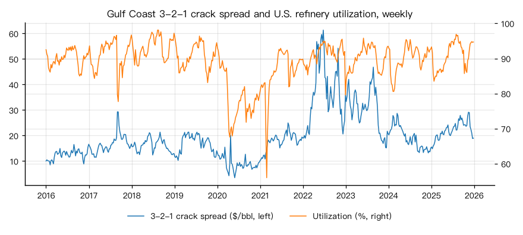
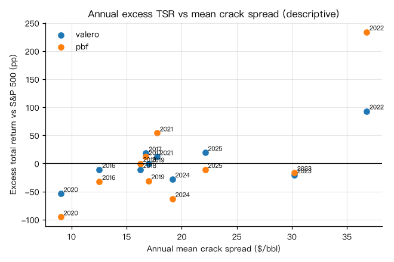

# 美国炼油利用率、裂解价差与炼油公司股东总收益（2016–2025 年）

## 概要

**研究问题：** 2016–2025 年美国炼厂周度利用率与墨西哥湾沿岸 3-2-1 裂解价差的历史关系如何？ 同期独立炼油公司 Valero、PBF Energy 的日历年股东总收益相对标普 500 的表现，与年均价差、利用率如何对照？

**成果类型：** 描述与比较　**研究分支：** refining_investment　**结论状态：** 完整

**研究范围：** US · petroleum_refining · 2016-01-01 至 2025-12-31 · weekly

**数据截止：** 2025-12-26　**生成时间：** 2026-10-30T23:43:02+00:00

**运行 ID：** `us_refining_investment_2016_2025-20261030T234301Z-c403687f`　**结果校验值：** `b567506fdfa42785`

## 主要结果

每个研究单元单独定级：A 表示输入在声明范围内核验通过，不等于关系稳定或可用于预测；C 与未评估的单元不生成数值。

| 研究单元 | 输入能力 | 依据 |
|---|---|---|
| crack_spread | A：已核验输入 | 关键基准输入全部核验通过，未使用假设参数 |
| utilization_crack | A：已核验输入 | 关键基准输入全部核验通过，未使用假设参数 |
| tsr:valero | A：已核验输入 | 关键基准输入全部核验通过，未使用假设参数 |
| comparison:valero | A：已核验输入 | 关键基准输入全部核验通过，未使用假设参数 |
| tsr:pbf | A：已核验输入 | 关键基准输入全部核验通过，未使用假设参数 |
| comparison:pbf | A：已核验输入 | 关键基准输入全部核验通过，未使用假设参数 |

3-2-1 裂解价差（墨西哥湾沿岸汽油与超低硫柴油、WTI 库欣）2016-01-01 至 2025-12-26 共 522 周：平均 19.74、中位数 17.99 美元/桶，最低 3.48（2020-05-29），最高 61.35（2022-06-24），负值 0 周。

周度利用率与价差的水平相关：Pearson 0.30、Spearman 0.26（522 周）。两者都有季节性，并同受 2020 年需求冲击等共同因素影响；相关不说明谁影响谁。

| 年份 | 周数 | 平均利用率 | 平均价差（美元/桶） | 价差变化 | 年内相关（Pearson / Spearman） |
|---|---|---|---|---|---|
| 2016 | 53 | 90.1% | 12.52 | — | 0.23 / 0.21 |
| 2017 | 52 | 90.8% | 16.75 | 4.23 | -0.34 / 0.05 |
| 2018 | 52 | 93.1% | 16.24 | -0.51 | 0.20 / 0.21 |
| 2019 | 52 | 90.6% | 16.99 | 0.75 | -0.06 / -0.05 |
| 2020 | 52 | 78.6% | 9.02 | -7.96 | 0.44 / 0.48 |
| 2021 | 53 | 85.9% | 17.76 | 8.74 | 0.38 / 0.28 |
| 2022 | 52 | 91.2% | 36.80 | 19.04 | 0.33 / 0.33 |
| 2023 | 52 | 90.1% | 30.23 | -6.57 | 0.28 / 0.27 |
| 2024 | 52 | 89.9% | 19.16 | -11.07 | -0.59 / -0.49 |
| 2025 | 52 | 90.8% | 22.13 | 2.97 | 0.33 / 0.34 |

Valero Energy 10 年累计总收益 245.4%（年化 13.2%），同期标普 500 298.3%（年化 14.8%）；4 年跑赢标普 500。

| 年份 | Valero Energy 总收益 | 标普 500 | 超额收益 | 申报 |
|---|---|---|---|---|
| 2016 | 0.8% | 12.0% | -11.2% | 0001035002-21-000051 |
| 2017 | 40.0% | 21.8% | 18.2% | 0001035002-21-000051 |
| 2018 | -15.7% | -4.4% | -11.3% | 0001035002-21-000051 |
| 2019 | 30.4% | 31.5% | -1.1% | 0001035002-21-000051 |
| 2020 | -35.6% | 18.4% | -54.0% | 0001035002-21-000051 |
| 2021 | 40.3% | 28.7% | 11.6% | 0001628280-26-011499 |
| 2022 | 75.0% | -18.1% | 93.1% | 0001628280-26-011499 |
| 2023 | 5.9% | 26.3% | -20.4% | 0001628280-26-011499 |
| 2024 | -2.9% | 25.0% | -27.9% | 0001628280-26-011499 |
| 2025 | 37.1% | 17.9% | 19.2% | 0001628280-26-011499 |

PBF Energy 10 年累计总收益 -2.8%（年化 -0.3%），同期标普 500 298.3%（年化 14.8%）；3 年跑赢标普 500。

| 年份 | PBF Energy 总收益 | 标普 500 | 超额收益 | 申报 |
|---|---|---|---|---|
| 2016 | -20.6% | 12.0% | -32.5% | 0001534504-21-000008 |
| 2017 | 33.6% | 21.8% | 11.7% | 0001534504-21-000008 |
| 2018 | -4.9% | -4.4% | -0.6% | 0001534504-21-000008 |
| 2019 | 0.2% | 31.5% | -31.3% | 0001534504-21-000008 |
| 2020 | -77.1% | 18.4% | -95.5% | 0001534504-21-000008 |
| 2021 | 82.7% | 28.7% | 54.0% | 0001534504-26-000010 |
| 2022 | 215.8% | -18.1% | 233.9% | 0001534504-26-000010 |
| 2023 | 10.0% | 26.3% | -16.3% | 0001534504-26-000010 |
| 2024 | -38.0% | 25.0% | -63.0% | 0001534504-26-000010 |
| 2025 | 6.7% | 17.9% | -11.1% | 0001534504-26-000010 |

年度超额收益与价差、利用率的 Spearman 相关（排序关系；样本只有十年左右，不检验显著性）：

| 公司 | 与年均价差 | 与价差变化 | 与年均利用率 |
|---|---|---|---|
| Valero Energy | 0.45（10 年） | 0.92（9 年） | 0.59（10 年） |
| PBF Energy | 0.47（10 年） | 0.90（9 年） | 0.58（10 年） |

## 图表

## 口径与覆盖

预期周 522，四项齐全 522；缺失周 0。缺失周不插值，缺周年份不给年度汇总。

日历年总收益 = 相邻年末累计总收益指数之比 − 1；每年取声明的主申报中第一份同时含两个年末的申报，指数保留两位小数，重叠申报的核对按舍入区间进行。

模型能回答：周度炼厂利用率与声明裂解价差的历史关系（水平相关与年度汇总）；选定炼油公司日历年股东总收益相对标普 500 的表现，与年均价差、利用率的描述性对照。

模型不能回答：炼厂或公司的实际炼油毛利（价差是指标定义）；股价预测、交易信号或因果关系；业绩图未以文字列出数值的公司；一体化石油公司（上游、化工、零售另有影响）。

## 验证

**重叠申报收益核对（valero）：** 通过；3 份申报，10 个重叠年份的收益核对，不一致 0 个（同一年由两份申报换算的收益，按指数两位小数传播舍入区间，区间相交即一致）

**重叠申报收益核对（pbf）：** 通过；3 份申报，10 个重叠年份的收益核对，不一致 0 个（同一年由两份申报换算的收益，按指数两位小数传播舍入区间，区间相交即一致）

**标普 500 跨公司核对：** 通过；valero、pbf 的申报之间 10 个年度收益核对，不一致 0 个

**原始快照抽查：** 跳过；没有可在原始 CSV 中定位的合格观测

## 数据与方法

| 角色 | 数据集 | 版本 | 来源 | 核验状态 |
|---|---|---|---|---|
| utilization | eia_refinery_utilization | `v20261028T014517Z-ef9df9e1` | eia | use_verified |
| crude | eia_spot_wti_cushing | `v20261030T231054Z-0d65dee2` | eia | use_verified |
| gasoline | eia_spot_gasoline_gulf | `v20261030T231056Z-8037df11` | eia | use_verified |
| distillate | eia_spot_ulsd_gulf | `v20261030T231057Z-f181367f` | eia | use_verified |
| tsr_valero | sec_tsr_valero | `v20261030T231100Z-41e2aeda` | sec_edgar | use_verified |
| tsr_pbf | sec_tsr_pbf | `v20261030T231102Z-58e32642` | sec_edgar | use_verified |

**方法：** 逐周计算 3-2-1 裂解价差 = (2 × 42 × 汽油 + 1 × 42 × 柴油 − 3 × 原油) ÷ 3（美元/桶），缺任一成分的周不计算；利用率与价差取同周水平相关与逐年汇总。公司日历年总收益由 10-K 业绩图累计总收益指数相邻年末之比换算，重叠申报与跨公司的标普 500 按舍入区间核对；超额收益 = 公司 − 标普 500。

**比较基准：** 标普 500 累计总收益指数（同一份 10-K 业绩图）

**可用时间规则：** 观测期间结束后第 0 天结束时（来源时区）

## 限制

- 裂解价差是声明的指标定义，不是炼厂实际毛利；不含 RIN 合规成本、运输、产品结构与原油价差

- 现货价为 EIA 对日度收盘价的周均值，日度价格来自 Refinitiv（LSEG）；只使用当前修订版本

- 利用率是美国全国周度估计，不区分地区（PADD）或炼厂，也不等于样本公司的利用率

- 公司只有 Valero 与 PBF 两家独立炼油公司；Valero 另有乙醇与可再生柴油业务，PBF 有物流业务，总收益不只反映炼油

- 业绩图数值为公司在 10-K 中披露的累计总收益（含股息再投资），未与独立价格来源核对

- 描述历史关系，不是因果解释、交易信号或收益预测

- 未纳入 Phillips 66、Marathon Petroleum、HF Sinclair、Delek US、CVR Energy：10-K 业绩图只有图片，没有以文字列出的数值表，不能逐值核对；本项目也没有已核验的个股总收益来源

- 未纳入 Exxon Mobil 等一体化石油公司：Exxon 的 10-K 没有业绩图；一体化公司还受上游、化工与零售影响，需分部数据另行对照

- 年度对照只有 10 年（价差变化 9 年），Spearman 相关只描述排序关系，不检验显著性
