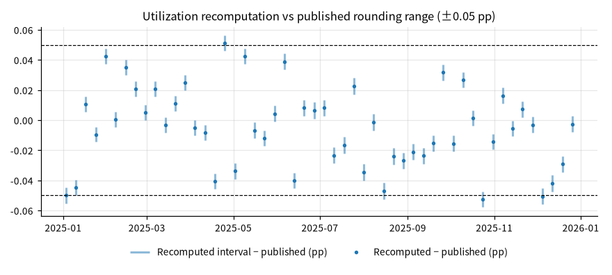
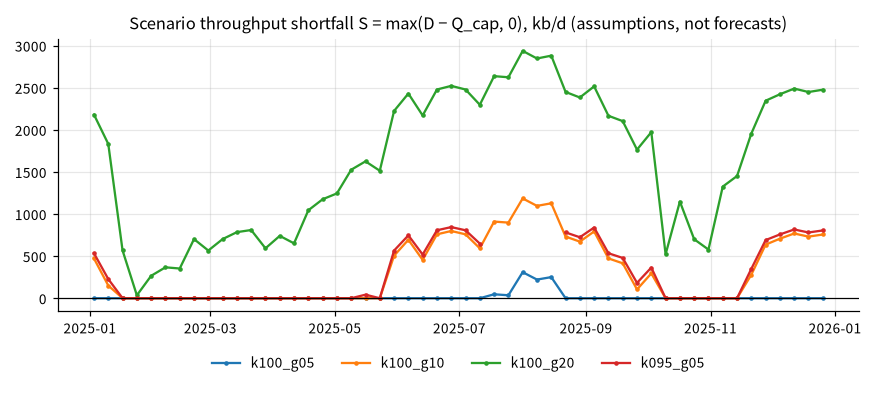

# 美国炼油处理能力情景（2025 年周度基准）

## 概要

**研究问题：** 以 2025 年每周的实际总投入为基准，目标处理量提高 5%–20% 时，在可处理上限为可运行产能一定比例的假设下， 每周会出现多大的机械性处理缺口？

**成果类型：** 情景与策略模拟　**研究分支：** refining_throughput　**结论状态：** 部分结论受限

**研究范围：** US · petroleum_refining · 2025-01-01 至 2025-12-31 · weekly

**数据截止：** 2025-12-26　**生成时间：** 2026-10-31T13:05:50+00:00

**运行 ID：** `us_refining_throughput_scenarios_2025-20261031T130550Z-d33b3e4b`　**结果校验值：** `fe2eaf816aa12b92`

## 主要结果

每个研究单元单独定级：A 表示基准输入在声明范围内核验通过，不等于预测有效；B 表示使用了允许假设清单内的参数，结果是情景；C 与未评估的单元不生成数值。

| 研究单元 | 输入能力 | 依据 |
|---|---|---|
| weekly_statistics | A：已核验输入 | 关键基准输入全部核验通过，未使用假设参数 |
| scenario:k100_g05 | B：明示假设的情景 | 使用假设参数 kappa = 1.0 |
| scenario:k100_g10 | B：明示假设的情景 | 使用假设参数 kappa = 1.0 |
| scenario:k100_g20 | B：明示假设的情景 | 使用假设参数 kappa = 1.0 |
| scenario:k095_g05 | B：明示假设的情景 | 使用假设参数 kappa = 0.95 |
| scenario:k105_g10 | C：受阻，不生成数值 | 参数 kappa = 1.05 超出允许范围 [0.9, 1]（可处理上限 ÷ 可运行产能（日历日口径）） |

2025-01-03 至 2025-12-26 共 52 周三项数值齐全。周均总投入 16,574 千桶/日，周均可运行产能 18,254 千桶/日历日；官方周度利用率平均 90.8%，最低 83.5%（2025-01-24），最高 96.9%（2025-08-01），达到或超过 95% 的有 5 周。按总投入之和 ÷ 产能之和计的窗口利用率为 90.80%。

窗口内可运行产能出现 8 个取值（18,089, 18,160, 18,161, 18,326, 18,347, 18,354, 18,406, 18,416），与周度利用率以最近报告的月度产能为分母一致。

情景：D = (1 + g) × G，Q_cap = kappa × K，Q = min(D, Q_cap)，S = max(D − Q_cap, 0)；单位千桶/日。g 是外生情景定义，kappa 是假设参数；缺口不是历史真实短缺，也不是燃料短缺或需求预测。

| 情景 | g | kappa | 输入能力 | 计算周 | 不自洽周 | 有缺口周 | 平均目标处理量 | 平均可处理量 | 平均缺口 | 最大缺口（周） |
|---|---|---|---|---|---|---|---|---|---|---|
| k100_g05 | 5% | 1.00 | B：明示假设的情景 | 52 | 0 | 5 | 17,403 | 17,386 | 16.6 | 309.1（2025-08-01） |
| k100_g10 | 10% | 1.00 | B：明示假设的情景 | 52 | 0 | 27 | 18,232 | 17,890 | 341.7 | 1,185.2（2025-08-01） |
| k100_g20 | 20% | 1.00 | B：明示假设的情景 | 52 | 0 | 52 | 19,889 | 18,254 | 1,635.2 | 2,937.4（2025-08-01） |
| k095_g05 | 5% | 0.95 | B：明示假设的情景 | 47 | 5 | 23 | 17,309 | 17,014 | 294.6 | 844.8（2025-06-27） |
| k105_g10 | 10% | 1.05 | C：受阻，不生成数值 | — | — | — | — | — | — | — |

假设参照（不进入计算）：2015-01-01 至 2025-12-31 的 574 周官方利用率平均 89.3%，95 分位 95.5%，最高 98.1%（2018-08-10）。用途核验：部分在核验范围内（partial），未覆盖 2015-01-01—2024-12-31。

## 图表

## 口径、假设与覆盖

预期周 52，三项齐全 52；缺失周 0；数据最后观测 2026-10-23。缺失周不插值。

模型能回答：周度总投入、可运行产能与利用率的齐全性、复算与描述统计；给定处理上限假设下，目标处理量提高时的机械性处理缺口。

模型不能回答：汽油、馏分油等产品供需或短缺（不含收率、进口、库存与物流）；价格、裂解价差、炼厂或公司利润；单个炼厂、地区（PADD）或公司；需求预测；增幅 g 是外生情景定义。

假设 kappa（可处理上限 ÷ 可运行产能（日历日口径），允许范围 [0.9, 1.0]；k100_g05 = 1.0、k100_g10 = 1.0、k100_g20 = 1.0、k095_g05 = 0.95）：上限 1.00 即可运行产能本身，日历日产能已计入通常停机，不再另扣；1990 年以来的周度利用率极少超过 100%。 下限 0.90 接近近年周度利用率的平均水平，作为偏紧一端。区间是机械敏感性范围，不是可持续运行上限的估计

| 不支持的结论 | 原因 |
|---|---|
| 情景 k105_g10 | 输入能力为 C：参数 kappa = 1.05 超出允许范围 [0.9, 1]（可处理上限 ÷ 可运行产能（日历日口径）） |

## 验证

**利用率区间复算：** 通过；52 周复算，不相容 0 周，复算与公布值最大差 0.053 个百分点（按 G、K 整数与 U 一位小数的公布精度传播舍入区间，复算区间与 U ± 0.05 相交即相容；不设经验容差）

**基准情景核对：** 通过；kappa = 1、g = 0 时 52 周中可处理量等于实际总投入的 52 周，基准已超过可运行产能的 0 周标为不自洽

**原始快照抽查：** 跳过；没有可在原始 CSV 中定位的合格观测

## 数据与方法

| 角色 | 数据集 | 版本 | 来源 | 核验状态 |
|---|---|---|---|---|
| inputs | eia_refinery_gross_inputs | `v20261031T130532Z-1b58f864` | eia | use_verified |
| capacity | eia_refinery_operable_capacity | `v20261031T130532Z-063f81ec` | eia | use_verified |
| utilization | eia_refinery_utilization | `v20261031T130533Z-7137591f` | eia | use_verified |

**方法：** 逐周核对 EIA 周度总投入、可运行产能与官方利用率；按公布精度的舍入区间复算利用率；缺失周不插值、不混用四周平均。情景中 D = (1 + g) × G、Q_cap = kappa × K，经固定系数约束引擎计算可处理量与缺口；g 为外生情景定义，kappa 为允许假设清单内的参数。

**比较基准：** 基准情景（g = 0）下每周可处理量等于实际总投入

**可用时间规则：** 观测期间结束后第 0 天结束时（来源时区）

## 限制

- 只计算处理量的机械关系；不含产品收率、进口、库存、物流与价格，不是汽油需求预测、燃料短缺或炼厂利润结论

- 增幅 g 与上限比例 kappa 都是假设，不代表概率；缺口是情景下的计算结果，不是历史真实短缺

- 美国全国合计，不区分地区（PADD）、炼厂或公司；周度数据为估计值，只使用当前修订版本

- 假设参照期 2015-01-01 至 2025-12-31 的利用率不全在用途核验范围内（部分在核验范围内；未覆盖 2015-01-01—2024-12-31）；参照只说明允许范围的依据，不进入计算

- 情景 k095_g05：5 周的基准总投入已超过假设上限，标为不自洽，未计入缺口
