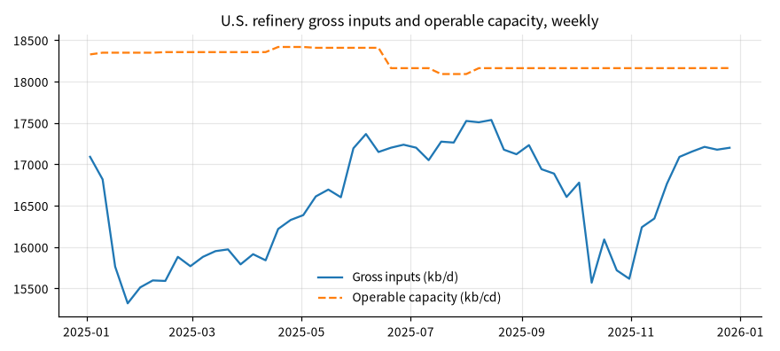

# 美国炼油周度总投入、产能与利用率（2025 年）

## 概要

**研究问题：** 2025 年美国炼厂每周的总投入、可运行产能与官方利用率是否齐全、同口径？ 按公布精度复算的利用率是否与官方值相容？全年处理量与产能的关系如何？

**成果类型：** 描述与比较　**研究分支：** refining_throughput　**结论状态：** 完整

**研究范围：** US · petroleum_refining · 2025-01-01 至 2025-12-31 · weekly

**数据截止：** 2025-12-26　**生成时间：** 2026-10-30T23:46:10+00:00

**运行 ID：** `us_refining_utilization_2025-20261030T234609Z-d6e20900`　**结果校验值：** `c78a6ec9803751ef`

## 主要结果

每个研究单元单独定级：A 表示基准输入在声明范围内核验通过，不等于预测有效；B 表示使用了允许假设清单内的参数，结果是情景；C 与未评估的单元不生成数值。

| 研究单元 | 输入能力 | 依据 |
|---|---|---|
| weekly_statistics | A：已核验输入 | 关键基准输入全部核验通过，未使用假设参数 |

2025-01-03 至 2025-12-26 共 52 周三项数值齐全。周均总投入 16,574 千桶/日，周均可运行产能 18,254 千桶/日历日；官方周度利用率平均 90.8%，最低 83.5%（2025-01-24），最高 96.9%（2025-08-01），达到或超过 95% 的有 5 周。按总投入之和 ÷ 产能之和计的窗口利用率为 90.80%。

窗口内可运行产能出现 8 个取值（18,089, 18,160, 18,161, 18,326, 18,347, 18,354, 18,406, 18,416），与周度利用率以最近报告的月度产能为分母一致。

## 图表

## 口径、假设与覆盖

预期周 52，三项齐全 52；缺失周 0；数据最后观测 2026-10-23。缺失周不插值。

模型能回答：周度总投入、可运行产能与利用率的齐全性、复算与描述统计；给定处理上限假设下，目标处理量提高时的机械性处理缺口。

模型不能回答：汽油、馏分油等产品供需或短缺（不含收率、进口、库存与物流）；价格、裂解价差、炼厂或公司利润；单个炼厂、地区（PADD）或公司；需求预测；增幅 g 是外生情景定义。

## 验证

**利用率区间复算：** 通过；52 周复算，不相容 0 周，复算与公布值最大差 0.053 个百分点（按 G、K 整数与 U 一位小数的公布精度传播舍入区间，复算区间与 U ± 0.05 相交即相容；不设经验容差）

**原始快照抽查：** 跳过；没有可在原始 CSV 中定位的合格观测

## 数据与方法

| 角色 | 数据集 | 版本 | 来源 | 核验状态 |
|---|---|---|---|---|
| inputs | eia_refinery_gross_inputs | `v20261030T234556Z-1b58f864` | eia | use_verified |
| capacity | eia_refinery_operable_capacity | `v20261030T234556Z-063f81ec` | eia | use_verified |
| utilization | eia_refinery_utilization | `v20261030T234556Z-7137591f` | eia | use_verified |

**方法：** 逐周核对 EIA 周度总投入、可运行产能与官方利用率；按公布精度的舍入区间复算利用率；缺失周不插值、不混用四周平均。

**比较基准：** EIA 公布的周度利用率（WPULEUS3）

**可用时间规则：** 观测期间结束后第 0 天结束时（来源时区）

## 限制

- 周度数据为 Weekly Petroleum Status Report 的估计，与月度、年度定稿可能不同；只使用当前修订版本

- 美国全国合计，不区分地区（PADD）、炼厂或公司

- 总投入（Gross Inputs）包含原油以外的投入，不等于原油加工量

- 描述历史，不是需求、产量或利润预测
