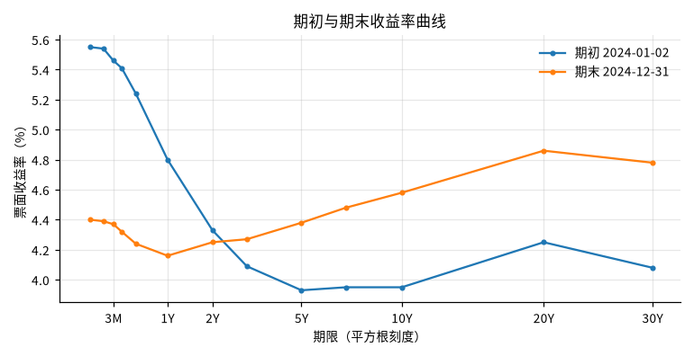
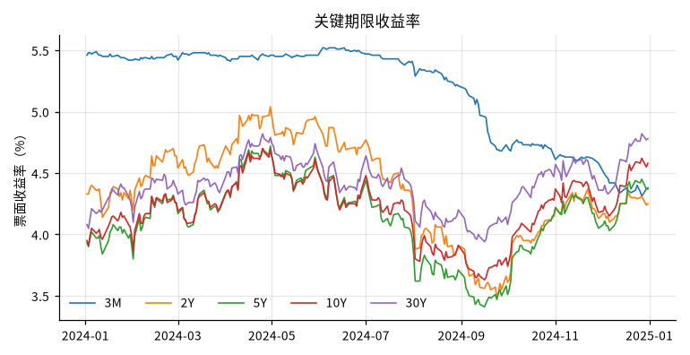
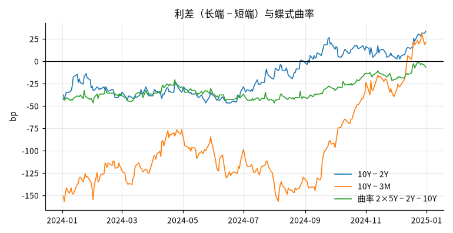

# 2024 年美国国债收益率曲线变化

## 概要

**研究问题：** 2024 年美国国债名义票面收益率曲线的水平、斜率与曲率如何变化？

**成果类型：** 描述与比较　**研究分支：** rates_curve　**结论状态：** 完整

**研究范围：** US · USD · 2024-01-01 至 2024-12-31 · daily

**数据截止：** 2024-12-31　**生成时间：** 2026-10-23T21:16:27+00:00

**运行 ID：** `ust_curve_2024-20261023T211627Z-5dae9d29`　**结果校验值：** `91bc3c984bd29156`

## 主要结果

变化以首个有效观测（2024-01-02）为基准，至最后有效观测（2024-12-31）；不是跨年末口径，也不是持有期回报。

| 期限 | 期初 % | 期末 % | 变化 bp | 最低 %（日期） | 最高 %（日期） | 均值 % |
|---|---|---|---|---|---|---|
| 3M | 5.46 | 4.37 | -109 | 4.31（2024-12-27） | 5.52（2024-06-03） | 5.18 |
| 2Y | 4.33 | 4.25 | -8 | 3.49（2024-09-24） | 5.04（2024-04-30） | 4.37 |
| 5Y | 3.93 | 4.38 | 45 | 3.41（2024-09-16） | 4.72（2024-04-30） | 4.13 |
| 10Y | 3.95 | 4.58 | 63 | 3.63（2024-09-16） | 4.70（2024-04-25） | 4.21 |
| 30Y | 4.08 | 4.78 | 70 | 3.94（2024-09-16） | 4.82（2024-04-25） | 4.41 |

倒挂定义为利差严格小于 0；恰为 0 的日期单独列出，不计入倒挂。

| 利差（长端 − 短端） | 期初 bp | 期末 bp | 变化 bp | 最低 bp | 最高 bp | 倒挂天数 / 占比 | 零利差天数 |
|---|---|---|---|---|---|---|---|
| 10Y − 2Y | -38 | 33 | 71 | -47 | 33 | 166 / 66% | 3 |
| 10Y − 3M | -151 | 21 | 172 | -157 | 31 | 238 / 95% | 0 |

| 曲率 | 期初 bp | 期末 bp | 变化 bp | 均值 bp |
|---|---|---|---|---|
| 2×5Y − 2Y − 10Y | -42 | -7 | 35 | -33 |

| 期限 | 期初 % | 期末 % | 变化 bp |
|---|---|---|---|
| 1M | 5.55 | 4.40 | -115 |
| 2M | 5.54 | 4.39 | -115 |
| 3M | 5.46 | 4.37 | -109 |
| 4M | 5.41 | 4.32 | -109 |
| 6M | 5.24 | 4.24 | -100 |
| 1Y | 4.80 | 4.16 | -64 |
| 2Y | 4.33 | 4.25 | -8 |
| 3Y | 4.09 | 4.27 | 18 |
| 5Y | 3.93 | 4.38 | 45 |
| 7Y | 3.95 | 4.48 | 53 |
| 10Y | 3.95 | 4.58 | 63 |
| 20Y | 4.25 | 4.86 | 61 |
| 30Y | 4.08 | 4.78 | 70 |

## 图表

## 覆盖与限制范围

250/250 个应已发布的观测日有数据，期间完整；覆盖 2024-01-02 至 2024-12-31。研究窗口内预期观测日 250 天（日历 us_treasury_daily）。覆盖要求 95%（决定期间统计能否输出；期间完整另需无缺失且日历已核验）。

| 期限 | 有效观测 | 占比（分母为应已发布的观测日） |
|---|---|---|
| 3M | 250 | 100.0% |
| 2Y | 250 | 100.0% |
| 5Y | 250 | 100.0% |
| 10Y | 250 | 100.0% |
| 30Y | 250 | 100.0% |

## 验证

**交叉核验：** 通过；对照 fred_dgs10，共同日期 250 天，最大差 0.0000（容差 0.005）。两者同源（Treasury/H.15），一致只说明接入与解析正确，不构成独立验证

**原始快照抽查：** 通过；抽查 12 个观测，不一致 0 个

## 数据与方法

| 角色 | 数据集 | 版本 | 来源 | 核验状态 |
|---|---|---|---|---|
| curve | ust_par_yield_curve | `v20261023T211623Z-99cae924` | ust_treasury | use_verified |
| cross_check | fred_dgs10 | `v20261023T211626Z-fd5ce4d8` | fred_graph | access_verified |

**方法：** 按日对齐合格观测，计算关键期限水平、利差（长端−短端）与蝶式曲率（2×中端−短端−长端）；不插值、不填补缺失

**比较基准：** 期初曲线（研究期间首个有效交易日）

**可用时间规则：** 观测日次日 0 点（来源时区）

## 限制

- 票面收益率（par yield）曲线，不是零息或远期曲线，也不是债券或债券基金的持有期回报

- 名义收益率，未扣除通胀

- 期间描述，不含预测或交易含义；相关变化不构成因果解释

- Treasury 官网不提供历史版本，使用本地快照；结果对应快照内容
