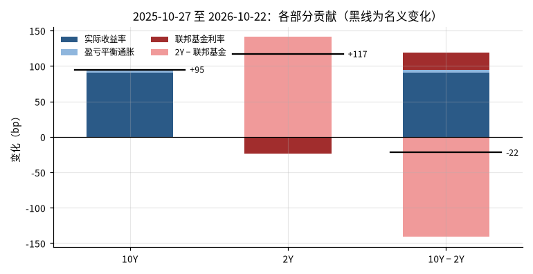
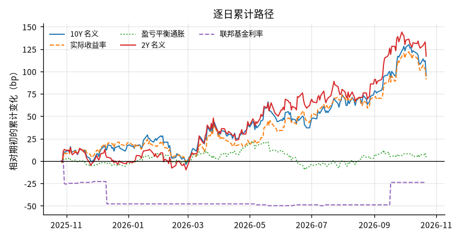

# 美国国债曲线变化的分解（近一年）

## 概要

**研究问题：** 期间内 10 年期与 2 年期国债收益率及其利差的变化，各有多少来自实际利率、通胀补偿、已实施的政策利率与市场对未来政策路径的定价？

**成果类型：** 解释与归因　**研究分支：** curve_attribution　**结论状态：** 完整

**研究范围：** US · USD · 2025-10-25 至 2026-10-25 · daily

**数据截止：** 2026-10-22　**生成时间：** 2026-10-25T00:36:57+00:00

**运行 ID：** `ust_curve_attribution_last_year-20261025T003656Z-38465216`　**结果校验值：** `88871f80929e01aa`

## 主要结果

2025-10-27 至 2026-10-22（共同观测日 248 天）。会计恒等式分解，不估计参数，不作因果推断；占比只在名义变化不小于 10 bp 时给出，端点前后移动 5 个共同日期时范围超过 15 个百分点即视为不稳定。

| 项目 | 期初 % | 期末 % | 变化 bp | 占名义变化 | 端点敏感性范围 |
|---|---|---|---|---|---|
| 10Y 名义 | 4.01 | 4.96 | 95 |  |  |
| 　实际收益率 | 1.73 | 2.64 | 91 | 96% | 92%–99% |
| 　盈亏平衡通胀 | 2.28 | 2.32 | 4 | 4% | 1%–8% |
| 　取整残差 |  |  | -0.00 |  |  |
| 2Y 名义 | 3.48 | 4.65 | 117 |  |  |
| 　联邦基金有效利率 | 4.12 | 3.88 | -24 | -21% | -23%–2%（不稳定） |
| 　2Y − 联邦基金利率 | -0.64 | 0.77 | 141 | 121% | 98%–123%（不稳定） |
| 10Y − 2Y | 0.53 | 0.31 | -22 |  |  |

| 斜率变化的组成 | bp |
|---|---|
| 实际收益率 | 91.0 |
| 盈亏平衡通胀 | 4.0 |
| 取整残差 | -0.0 |
| − 联邦基金有效利率 | 24.0 |
| − (2Y − 联邦基金利率) | -141.0 |

## 图表

## 分解明细与背景

请求期间 2025-10-25 至 2026-10-25；共同观测日 248 天，期初 2025-10-27，期末 2026-10-22。各部分观测天数：long 249，short 249，real 248，breakeven 249，policy 363（联邦基金利率含周末与假日，只用与其他输入的共同日期）。

背景（不参与分解）：CPI 同比 2025-09 为 3.0%，2025-09 为 3.0%。

背景（不参与分解）：美联储总资产 2025-10-22 为 6.590 万亿美元，2026-10-21 为 6.754 万亿美元（2.5%）。

## 验证

**恒等式核对：** 通过；248 个共同日期，名义 − 实际 − 盈亏平衡的最大残差 0.00 bp（容差 0.5 bp）

**交叉核验：** 通过；对照 fred_dgs10，共同日期 248 天，最大差 0.0000（容差 0.005）。两者同源（Treasury/H.15），一致只说明接入与解析正确，不构成独立验证

**原始快照抽查：** 通过；抽查 12 个观测，不一致 0 个

## 数据与方法

| 角色 | 数据集 | 版本 | 来源 | 核验状态 |
|---|---|---|---|---|
| curve | ust_par_yield_curve | `v20261025T003641Z-99cae924` | ust_treasury | use_verified |
| real | fred_dfii10 | `v20261025T003643Z-bd6357c0` | fred_graph | access_verified |
| breakeven | fred_t10yie | `v20261025T003643Z-c7c18f6c` | fred_graph | access_verified |
| policy | fred_dff | `v20261025T003642Z-6c4cf08a` | fred_graph | access_verified |
| cross_check | fred_dgs10 | `v20261025T003642Z-aaa499ac` | fred_graph | access_verified |
| cpi | fred_cpiaucsl | `v20261025T003642Z-3ff089d9` | fred_graph | access_verified |
| fed_assets | fred_walcl | `v20261025T003643Z-1690b202` | fred_graph | access_verified |

**方法：** 会计恒等式分解：Δ10Y = Δ实际收益率 + Δ盈亏平衡通胀；Δ2Y = Δ联邦基金有效利率 + Δ(2Y − 联邦基金利率)；斜率变化由以上四项组成。只用所有输入都有观测值的共同日期，不插值、不前值填充；不估计参数，不作因果推断。

**比较基准：** 期初（窗口内第一个共同观测日）

**可用时间规则：** 观测日次日 0 点（来源时区）

## 限制

- 会计恒等式分解，不是因果推断

- 盈亏平衡通胀含通胀风险溢价与流动性溢价，不等于通胀预期；2Y 与联邦基金利率之差不能拆分为政策预期与期限溢价

- 使用最新修订数据；CPI 与美联储总资产只作背景，不参与分解
