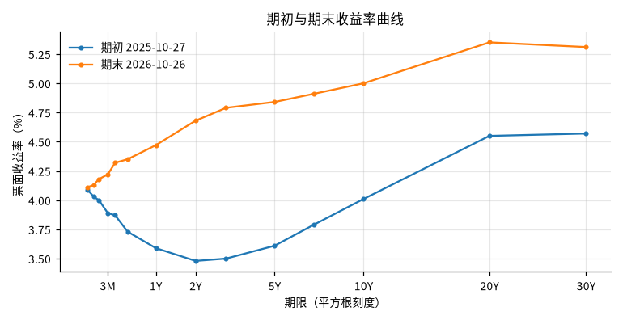
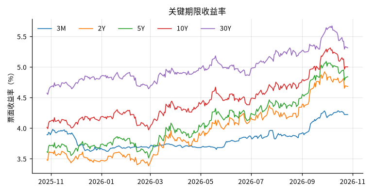
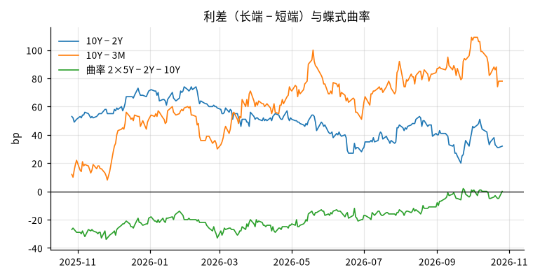

# 近一年美国国债收益率曲线变化

## 概要

**研究问题：** 最近一年美国国债名义票面收益率曲线的水平、斜率与曲率如何变化？

**成果类型：** 描述与比较　**研究分支：** rates_curve　**结论状态：** 部分结论受限

**研究范围：** US · USD · 2025-10-26 至 2026-10-26 · daily

**数据截止：** 2026-10-26　**生成时间：** 2026-10-26T23:29:40+00:00

**运行 ID：** `ust_curve_last_year-20261026T232940Z-4d180d30`　**结果校验值：** `aae633062b4f37e9`

## 主要结果

变化以首个有效观测（2025-10-27）为基准，至最后有效观测（2026-10-26）；不是跨年末口径，也不是持有期回报。标 * 的指标有缺口，其最低、最高、均值与倒挂天数只基于已观测日期，不能推及整个期间。

| 期限 | 期初 % | 期末 % | 变化 bp | 最低 %（日期） | 最高 %（日期） | 均值 % |
|---|---|---|---|---|---|---|
| 3M * | 3.89 | 4.22 | 33 | 3.62（2025-12-18） | 4.28（2026-09-28） | 3.82 |
| 2Y * | 3.48 | 4.68 | 120 | 3.38（2026-02-27） | 4.92（2026-09-28） | 3.95 |
| 5Y * | 3.61 | 4.84 | 123 | 3.51（2026-02-27） | 5.09（2026-09-30） | 4.11 |
| 10Y * | 4.01 | 5.00 | 99 | 3.97（2026-02-27） | 5.31（2026-10-05） | 4.45 |
| 30Y * | 4.57 | 5.31 | 74 | 4.55（2025-10-28） | 5.67（2026-10-07） | 4.99 |

倒挂定义为利差严格小于 0；恰为 0 的日期单独列出，不计入倒挂。

| 利差（长端 − 短端） | 期初 bp | 期末 bp | 变化 bp | 最低 bp | 最高 bp | 倒挂天数 / 占比 | 零利差天数 |
|---|---|---|---|---|---|---|---|
| 10Y − 2Y * | 53 | 32 | -21 | 20 | 74 | 0 / 0% | 0 |
| 10Y − 3M * | 12 | 78 | 66 | 8 | 109 | 0 / 0% | 0 |

| 曲率 | 期初 bp | 期末 bp | 变化 bp | 均值 bp |
|---|---|---|---|---|
| 2×5Y − 2Y − 10Y * | -27 | 0 | 27 | -18 |

| 期限 | 期初 % | 期末 % | 变化 bp |
|---|---|---|---|
| 1M | 4.09 | 4.11 | 2 |
| 1.5M | 4.03 | 4.13 | 10 |
| 2M | 4.00 | 4.18 | 18 |
| 3M | 3.89 | 4.22 | 33 |
| 4M | 3.87 | 4.32 | 45 |
| 6M | 3.73 | 4.35 | 62 |
| 1Y | 3.59 | 4.47 | 88 |
| 2Y | 3.48 | 4.68 | 120 |
| 3Y | 3.50 | 4.79 | 129 |
| 5Y | 3.61 | 4.84 | 123 |
| 7Y | 3.79 | 4.91 | 112 |
| 10Y | 4.01 | 5.00 | 99 |
| 20Y | 4.55 | 5.35 | 80 |
| 30Y | 4.57 | 5.31 | 74 |

## 图表

## 覆盖与限制范围

250/250 个应已发布的观测日有数据；相关日期超出日历核验范围，无法证明完整（预期日历未在 2026-10-23 至 2026-10-26 核验，无法证明这些日期没有缺失）；覆盖 2025-10-27 至 2026-10-26。研究窗口内预期观测日 250 天（日历 us_treasury_daily）。覆盖要求 95%（决定期间统计能否输出；期间完整另需无缺失且日历已核验）。

| 期限 | 有效观测 | 占比（分母为应已发布的观测日） |
|---|---|---|
| 3M | 250 | 100.0% |
| 2Y | 250 | 100.0% |
| 5Y | 250 | 100.0% |
| 10Y | 250 | 100.0% |
| 30Y | 250 | 100.0% |

## 验证

**交叉核验：** 通过；对照 fred_dgs10，共同日期 249 天，最大差 0.0000（容差 0.005）。两者同源（Treasury/H.15），一致只说明接入与解析正确，不构成独立验证

**原始快照抽查：** 通过；抽查 12 个观测，不一致 0 个

## 数据与方法

| 角色 | 数据集 | 版本 | 来源 | 核验状态 |
|---|---|---|---|---|
| curve | ust_par_yield_curve | `v20261026T232911Z-2675c358` | ust_treasury | use_verified |
| cross_check | fred_dgs10 | `v20261026T232925Z-1a85fd26` | fred_graph | access_verified |

**方法：** 按日对齐合格观测，计算关键期限水平、利差（长端−短端）与蝶式曲率（2×中端−短端−长端）；不插值、不填补缺失

**比较基准：** 期初曲线（窗口内首个有效交易日）

**可用时间规则：** 观测日次日 0 点（来源时区）

## 限制

- 票面收益率（par yield）曲线，不是零息或远期曲线，也不是债券或债券基金的持有期回报

- 名义收益率，未扣除通胀

- 期间描述，不含预测或交易含义；相关变化不构成因果解释

- 窗口终点为运行当天，最新一两个交易日可能尚未发布

- Treasury 官网不提供历史版本，使用本地快照；结果对应快照内容

- 预期观测日历 us_treasury_daily 未在 2026-10-23 至 2026-10-26 核验，该段的预期日期按规则推定，临时休市或额外发布日可能使日期覆盖略有偏差，无法证明没有缺失

- 研究期间未能证明完整（预期日历未在 2026-10-23 至 2026-10-26 核验，无法证明这些日期没有缺失）。均值、极值与倒挂天数只基于已观测日期，是已观测样本统计，不能推及整个期间
