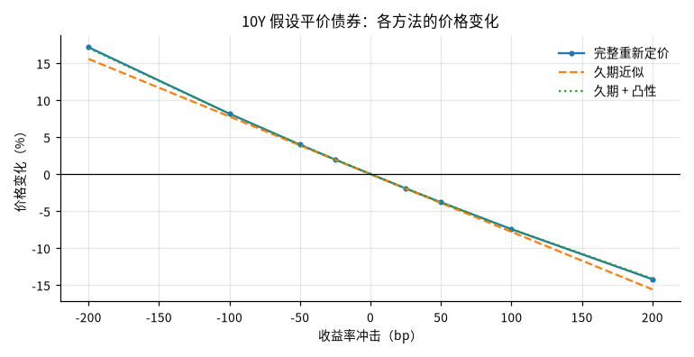
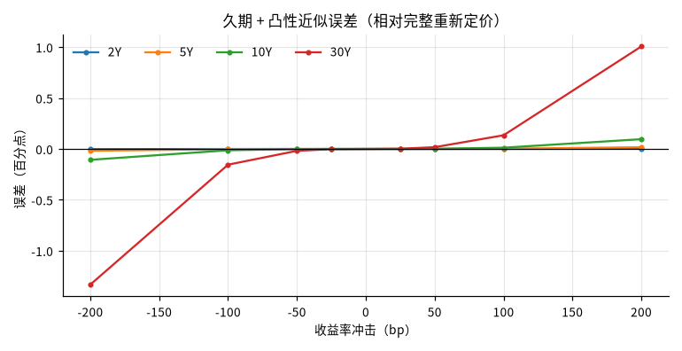

# 假设平价国债的利率敏感性情景

## 概要

**研究问题：** 以最近一个交易日的美国国债票面收益率构造假设平价债券，收益率平移时价格如何变化？ 久期与久期 + 凸性近似相对完整重新定价的误差有多大？

**成果类型：** 情景与策略模拟　**研究分支：** par_bond_scenarios　**结论状态：** 完整

**研究范围：** US · USD · 2026-10-10 至 2026-10-24 · daily

**数据截止：** 2026-10-23　**生成时间：** 2026-10-24T01:00:23+00:00

**运行 ID：** `ust_par_bond_rate_risk-20261024T010023Z-a7e0bbe7`　**结果校验值：** `c42ab9b804c05b36`

## 主要结果

基准日 2026-10-23：各期限按当日票面收益率构造票息等于收益率的假设平价债券。价格变化为相对基准价格的百分比；误差 = 近似 − 完整重新定价（百分点）。不是预测，冲击幅度不代表概率。

| 期限 | 票息 = 收益率 % | 价格 | 麦考利久期（年） | 修正久期（年） | 凸性 | DV01（每 100 面值） |
|---|---|---|---|---|---|---|
| 2Y | 4.69 | 100.0000 | 1.932 | 1.888 | 4.56 | 0.0189 |
| 5Y | 4.82 | 100.0000 | 4.502 | 4.396 | 22.77 | 0.0440 |
| 10Y | 5.00 | 100.0000 | 7.989 | 7.795 | 73.63 | 0.0779 |
| 30Y | 5.33 | 100.0000 | 15.287 | 14.890 | 332.43 | 0.1489 |

| 2Y 冲击 bp | 完整重新定价 % | 久期近似 % | 久期 + 凸性 % | 久期误差 pp | 久期 + 凸性误差 pp |
|---|---|---|---|---|---|
| -200 | 3.869 | 3.776 | 3.867 | -0.093 | -0.0018 |
| -100 | 1.911 | 1.888 | 1.911 | -0.023 | -0.0002 |
| -50 | 0.950 | 0.944 | 0.950 | -0.006 | -0.0000 |
| -25 | 0.473 | 0.472 | 0.473 | -0.001 | -0.0000 |
| +25 | -0.471 | -0.472 | -0.471 | -0.001 | 0.0000 |
| +50 | -0.938 | -0.944 | -0.938 | -0.006 | 0.0000 |
| +100 | -1.865 | -1.888 | -1.865 | -0.023 | 0.0002 |
| +200 | -3.687 | -3.776 | -3.685 | -0.089 | 0.0017 |

| 5Y 冲击 bp | 完整重新定价 % | 久期近似 % | 久期 + 凸性 % | 久期误差 pp | 久期 + 凸性误差 pp |
|---|---|---|---|---|---|
| -200 | 9.266 | 8.793 | 9.248 | -0.473 | -0.0180 |
| -100 | 4.513 | 4.396 | 4.510 | -0.116 | -0.0022 |
| -50 | 2.227 | 2.198 | 2.227 | -0.029 | -0.0003 |
| -25 | 1.106 | 1.099 | 1.106 | -0.007 | -0.0000 |
| +25 | -1.092 | -1.099 | -1.092 | -0.007 | 0.0000 |
| +50 | -2.170 | -2.198 | -2.170 | -0.028 | 0.0003 |
| +100 | -4.285 | -4.396 | -4.283 | -0.112 | 0.0021 |
| +200 | -8.354 | -8.793 | -8.338 | -0.438 | 0.0169 |

| 10Y 冲击 bp | 完整重新定价 % | 久期近似 % | 久期 + 凸性 % | 久期误差 pp | 久期 + 凸性误差 pp |
|---|---|---|---|---|---|
| -200 | 17.169 | 15.589 | 17.062 | -1.579 | -0.1069 |
| -100 | 8.176 | 7.795 | 8.163 | -0.381 | -0.0130 |
| -50 | 3.991 | 3.897 | 3.989 | -0.094 | -0.0016 |
| -25 | 1.972 | 1.949 | 1.972 | -0.023 | -0.0002 |
| +25 | -1.926 | -1.949 | -1.926 | -0.023 | 0.0002 |
| +50 | -3.807 | -3.897 | -3.805 | -0.090 | 0.0016 |
| +100 | -7.439 | -7.795 | -7.426 | -0.356 | 0.0123 |
| +200 | -14.212 | -15.589 | -14.117 | -1.377 | 0.0958 |

| 30Y 冲击 bp | 完整重新定价 % | 久期近似 % | 久期 + 凸性 % | 久期误差 pp | 久期 + 凸性误差 pp |
|---|---|---|---|---|---|
| -200 | 37.760 | 29.780 | 36.428 | -7.981 | -1.3322 |
| -100 | 16.706 | 14.890 | 16.552 | -1.817 | -0.1545 |
| -50 | 7.879 | 7.445 | 7.860 | -0.434 | -0.0186 |
| -25 | 3.829 | 3.722 | 3.826 | -0.106 | -0.0023 |
| +25 | -3.621 | -3.722 | -3.619 | -0.102 | 0.0022 |
| +50 | -7.047 | -7.445 | -7.029 | -0.398 | 0.0174 |
| +100 | -13.362 | -14.890 | -13.228 | -1.528 | 0.1343 |
| +200 | -24.137 | -29.780 | -23.131 | -5.642 | 1.0064 |

## 图表

## 假设与输入

基准日 2026-10-23（研究窗口终点 2026-10-24，相隔 1 天）；窗口内曲线日 9 天，基准日为所有所需期限同时有值的最后一天。

使用期限：2Y、5Y、10Y、30Y（请求 2Y、5Y、10Y、30Y）。

## 验证

**封闭解与重新定价核对：** 通过；16 项核对，未通过 0 项（平价价格 = 面值；解析修正久期 = 平价债券封闭解；解析久期、凸性 ≈ 有限差分完整重新定价）

**原始快照抽查：** 通过；抽查 12 个观测，不一致 0 个

## 数据与方法

| 角色 | 数据集 | 版本 | 来源 | 核验状态 |
|---|---|---|---|---|
| curve | ust_par_yield_curve | `v20261024T010012Z-99cae924` | ust_treasury | access_verified |

**方法：** 以基准日各期限票面收益率为票息与到期收益率构造假设平价债券（每年 2 次付息、估值日为付息日、无应计利息）；对债券自身收益率施加平移冲击，比较完整重新定价与修正久期、久期 + 凸性近似。

**比较基准：** 完整重新定价（按冲击后收益率贴现全部现金流）

**可用时间规则：** 观测日次日 0 点（来源时区）

## 限制

- 假设债券：票息等于基准日票面收益率、恰在付息日估值、无应计利息；不是任何真实国债或债券基金（如 TLT）的风险

- 冲击施加在每只债券自身的收益率上（平移），不是对整条曲线的一致重定价；票面收益率不等于零息利率

- 冲击幅度是假设情景，不代表概率或预测

- 只计算价格变化，不含持有期票息收入、再投资与融资成本
