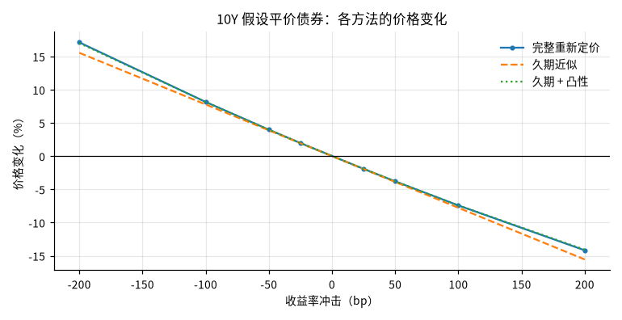
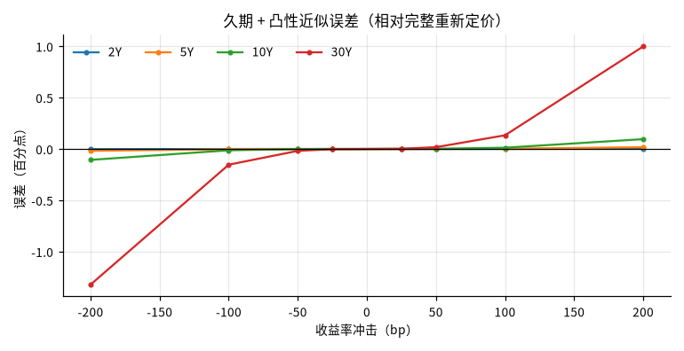

# 假设平价国债的利率敏感性情景

## 概要

**研究问题：** 以最近一个交易日的美国国债票面收益率构造假设平价债券，收益率平移时价格如何变化？ 久期与久期 + 凸性近似相对完整重新定价的误差有多大？

**成果类型：** 情景与策略模拟　**研究分支：** par_bond_scenarios　**结论状态：** 完整

**研究范围：** US · USD · 2026-10-15 至 2026-10-29 · daily

**数据截止：** 2026-10-28　**生成时间：** 2026-10-29T02:42:24+00:00

**运行 ID：** `ust_par_bond_rate_risk-20261029T024223Z-57304acc`　**结果校验值：** `c2e3cb243d18736a`

## 主要结果

基准日 2026-10-28：各期限按当日票面收益率构造票息等于收益率的假设平价债券。价格变化为相对基准价格的百分比；误差 = 近似 − 完整重新定价（百分点）。不是预测，冲击幅度不代表概率。

| 期限 | 票息 = 收益率 % | 价格 | 麦考利久期（年） | 修正久期（年） | 凸性 | DV01（每 100 面值） |
|---|---|---|---|---|---|---|
| 2Y | 4.67 | 100.0000 | 1.933 | 1.888 | 4.56 | 0.0189 |
| 5Y | 4.85 | 100.0000 | 4.500 | 4.393 | 22.74 | 0.0439 |
| 10Y | 5.05 | 100.0000 | 7.973 | 7.776 | 73.38 | 0.0778 |
| 30Y | 5.37 | 100.0000 | 15.222 | 14.824 | 330.14 | 0.1482 |

| 2Y 冲击 bp | 完整重新定价 % | 久期近似 % | 久期 + 凸性 % | 久期误差 pp | 久期 + 凸性误差 pp |
|---|---|---|---|---|---|
| -200 | 3.870 | 3.777 | 3.868 | -0.093 | -0.0018 |
| -100 | 1.912 | 1.888 | 1.911 | -0.023 | -0.0002 |
| -50 | 0.950 | 0.944 | 0.950 | -0.006 | -0.0000 |
| -25 | 0.474 | 0.472 | 0.474 | -0.001 | -0.0000 |
| +25 | -0.471 | -0.472 | -0.471 | -0.001 | 0.0000 |
| +50 | -0.939 | -0.944 | -0.939 | -0.006 | 0.0000 |
| +100 | -1.866 | -1.888 | -1.866 | -0.023 | 0.0002 |
| +200 | -3.688 | -3.777 | -3.686 | -0.089 | 0.0017 |

| 5Y 冲击 bp | 完整重新定价 % | 久期近似 % | 久期 + 凸性 % | 久期误差 pp | 久期 + 凸性误差 pp |
|---|---|---|---|---|---|
| -200 | 9.259 | 8.786 | 9.241 | -0.473 | -0.0180 |
| -100 | 4.509 | 4.393 | 4.507 | -0.116 | -0.0022 |
| -50 | 2.225 | 2.197 | 2.225 | -0.029 | -0.0003 |
| -25 | 1.105 | 1.098 | 1.105 | -0.007 | -0.0000 |
| +25 | -1.091 | -1.098 | -1.091 | -0.007 | 0.0000 |
| +50 | -2.168 | -2.197 | -2.168 | -0.028 | 0.0003 |
| +100 | -4.281 | -4.393 | -4.279 | -0.112 | 0.0021 |
| +200 | -8.348 | -8.786 | -8.331 | -0.438 | 0.0169 |

| 10Y 冲击 bp | 完整重新定价 % | 久期近似 % | 久期 + 凸性 % | 久期误差 pp | 久期 + 凸性误差 pp |
|---|---|---|---|---|---|
| -200 | 17.126 | 15.552 | 17.020 | -1.574 | -0.1065 |
| -100 | 8.156 | 7.776 | 8.143 | -0.380 | -0.0129 |
| -50 | 3.981 | 3.888 | 3.980 | -0.093 | -0.0016 |
| -25 | 1.967 | 1.944 | 1.967 | -0.023 | -0.0002 |
| +25 | -1.921 | -1.944 | -1.921 | -0.023 | 0.0002 |
| +50 | -3.798 | -3.888 | -3.796 | -0.090 | 0.0016 |
| +100 | -7.422 | -7.776 | -7.409 | -0.355 | 0.0122 |
| +200 | -14.180 | -15.552 | -14.085 | -1.372 | 0.0954 |

| 30Y 冲击 bp | 完整重新定价 % | 久期近似 % | 久期 + 凸性 % | 久期误差 pp | 久期 + 凸性误差 pp |
|---|---|---|---|---|---|
| -200 | 37.571 | 29.647 | 36.250 | -7.924 | -1.3209 |
| -100 | 16.627 | 14.824 | 16.474 | -1.804 | -0.1532 |
| -50 | 7.843 | 7.412 | 7.824 | -0.431 | -0.0185 |
| -25 | 3.811 | 3.706 | 3.809 | -0.105 | -0.0023 |
| +25 | -3.605 | -3.706 | -3.603 | -0.101 | 0.0022 |
| +50 | -7.016 | -7.412 | -6.999 | -0.395 | 0.0172 |
| +100 | -13.306 | -14.824 | -13.173 | -1.518 | 0.1332 |
| +200 | -24.042 | -29.647 | -23.044 | -5.605 | 0.9982 |

## 图表

## 假设与输入

基准日 2026-10-28（研究窗口终点 2026-10-29，相隔 1 天）；窗口内曲线日 10 天，基准日为所有所需期限同时有值的最后一天。

使用期限：2Y、5Y、10Y、30Y（请求 2Y、5Y、10Y、30Y）。

## 验证

**封闭解与重新定价核对：** 通过；16 项核对，未通过 0 项（平价价格 = 面值；解析修正久期 = 平价债券封闭解；解析久期、凸性 ≈ 有限差分完整重新定价）

**原始快照抽查：** 通过；抽查 12 个观测，不一致 0 个

## 数据与方法

| 角色 | 数据集 | 版本 | 来源 | 核验状态 |
|---|---|---|---|---|
| curve | ust_par_yield_curve | `v20261029T024156Z-c7af9d18` | ust_treasury | access_verified |

**方法：** 以基准日各期限票面收益率为票息与到期收益率构造假设平价债券（每年 2 次付息、估值日为付息日、无应计利息）；对债券自身收益率施加平移冲击，比较完整重新定价与修正久期、久期 + 凸性近似。

**比较基准：** 完整重新定价（按冲击后收益率贴现全部现金流）

**可用时间规则：** 观测日次日 0 点（来源时区）

## 限制

- 假设债券：票息等于基准日票面收益率、恰在付息日估值、无应计利息；不是任何真实国债或债券基金（如 TLT）的风险

- 冲击施加在每只债券自身的收益率上（平移），不是对整条曲线的一致重定价；票面收益率不等于零息利率

- 冲击幅度是假设情景，不代表概率或预测

- 只计算价格变化，不含持有期票息收入、再投资与融资成本
