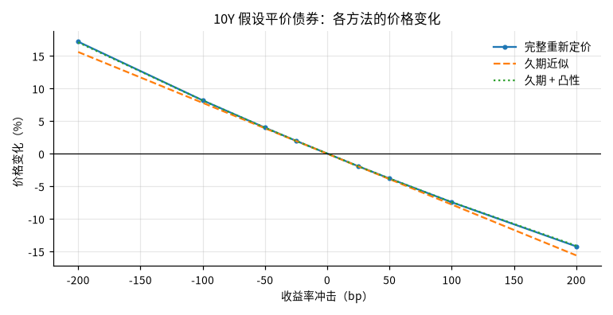
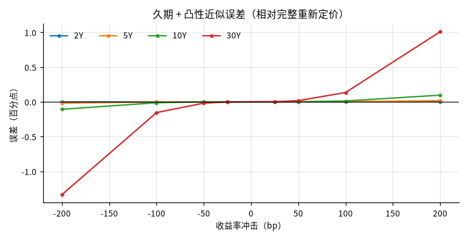

# 假设平价国债的利率敏感性情景

## 概要

**研究问题：** 以最近一个交易日的美国国债票面收益率构造假设平价债券，收益率平移时价格如何变化？ 久期与久期 + 凸性近似相对完整重新定价的误差有多大？

**成果类型：** 情景与策略模拟　**研究分支：** par_bond_scenarios　**结论状态：** 完整

**研究范围：** US · USD · 2026-10-16 至 2026-10-30 · daily

**数据截止：** 2026-10-29　**生成时间：** 2026-10-30T00:23:50+00:00

**运行 ID：** `ust_par_bond_rate_risk-20261030T002350Z-b3d4d00b`　**结果校验值：** `4ac4f5e66cc5e989`

## 主要结果

基准日 2026-10-29：各期限按当日票面收益率构造票息等于收益率的假设平价债券。价格变化为相对基准价格的百分比；误差 = 近似 − 完整重新定价（百分点）。不是预测，冲击幅度不代表概率。

| 期限 | 票息 = 收益率 % | 价格 | 麦考利久期（年） | 修正久期（年） | 凸性 | DV01（每 100 面值） |
|---|---|---|---|---|---|---|
| 2Y | 4.61 | 100.0000 | 1.933 | 1.890 | 4.57 | 0.0189 |
| 5Y | 4.78 | 100.0000 | 4.506 | 4.401 | 22.80 | 0.0440 |
| 10Y | 4.98 | 100.0000 | 7.996 | 7.802 | 73.73 | 0.0780 |
| 30Y | 5.32 | 100.0000 | 15.303 | 14.906 | 333.01 | 0.1491 |

| 2Y 冲击 bp | 完整重新定价 % | 久期近似 % | 久期 + 凸性 % | 久期误差 pp | 久期 + 凸性误差 pp |
|---|---|---|---|---|---|
| -200 | 3.873 | 3.780 | 3.871 | -0.093 | -0.0018 |
| -100 | 1.913 | 1.890 | 1.913 | -0.023 | -0.0002 |
| -50 | 0.951 | 0.945 | 0.951 | -0.006 | -0.0000 |
| -25 | 0.474 | 0.472 | 0.474 | -0.001 | -0.0000 |
| +25 | -0.471 | -0.472 | -0.471 | -0.001 | 0.0000 |
| +50 | -0.939 | -0.945 | -0.939 | -0.006 | 0.0000 |
| +100 | -1.867 | -1.890 | -1.867 | -0.023 | 0.0002 |
| +200 | -3.690 | -3.780 | -3.688 | -0.090 | 0.0017 |

| 5Y 冲击 bp | 完整重新定价 % | 久期近似 % | 久期 + 凸性 % | 久期误差 pp | 久期 + 凸性误差 pp |
|---|---|---|---|---|---|
| -200 | 9.276 | 8.802 | 9.258 | -0.474 | -0.0181 |
| -100 | 4.517 | 4.401 | 4.515 | -0.116 | -0.0022 |
| -50 | 2.229 | 2.201 | 2.229 | -0.029 | -0.0003 |
| -25 | 1.107 | 1.100 | 1.107 | -0.007 | -0.0000 |
| +25 | -1.093 | -1.100 | -1.093 | -0.007 | 0.0000 |
| +50 | -2.172 | -2.201 | -2.172 | -0.028 | 0.0003 |
| +100 | -4.289 | -4.401 | -4.287 | -0.112 | 0.0022 |
| +200 | -8.363 | -8.802 | -8.346 | -0.439 | 0.0170 |

| 10Y 冲击 bp | 完整重新定价 % | 久期近似 % | 久期 + 凸性 % | 久期误差 pp | 久期 + 凸性误差 pp |
|---|---|---|---|---|---|
| -200 | 17.186 | 15.604 | 17.078 | -1.582 | -0.1071 |
| -100 | 8.184 | 7.802 | 8.171 | -0.382 | -0.0130 |
| -50 | 3.995 | 3.901 | 3.993 | -0.094 | -0.0016 |
| -25 | 1.974 | 1.950 | 1.974 | -0.023 | -0.0002 |
| +25 | -1.928 | -1.950 | -1.927 | -0.023 | 0.0002 |
| +50 | -3.810 | -3.901 | -3.809 | -0.091 | 0.0016 |
| +100 | -7.446 | -7.802 | -7.433 | -0.356 | 0.0123 |
| +200 | -14.225 | -15.604 | -14.129 | -1.379 | 0.0960 |

| 30Y 冲击 bp | 完整重新定价 % | 久期近似 % | 久期 + 凸性 % | 久期误差 pp | 久期 + 凸性误差 pp |
|---|---|---|---|---|---|
| -200 | 37.808 | 29.813 | 36.473 | -7.995 | -1.3351 |
| -100 | 16.726 | 14.906 | 16.571 | -1.820 | -0.1548 |
| -50 | 7.888 | 7.453 | 7.869 | -0.435 | -0.0187 |
| -25 | 3.833 | 3.727 | 3.831 | -0.106 | -0.0023 |
| +25 | -3.625 | -3.727 | -3.623 | -0.102 | 0.0022 |
| +50 | -7.054 | -7.453 | -7.037 | -0.399 | 0.0174 |
| +100 | -13.376 | -14.906 | -13.241 | -1.530 | 0.1346 |
| +200 | -24.161 | -29.813 | -23.153 | -5.652 | 1.0085 |

## 图表

## 假设与输入

基准日 2026-10-29（研究窗口终点 2026-10-30，相隔 1 天）；窗口内曲线日 10 天，基准日为所有所需期限同时有值的最后一天。

使用期限：2Y、5Y、10Y、30Y（请求 2Y、5Y、10Y、30Y）。

## 验证

**封闭解与重新定价核对：** 通过；16 项核对，未通过 0 项（平价价格 = 面值；解析修正久期 = 平价债券封闭解；解析久期、凸性 ≈ 有限差分完整重新定价）

**原始快照抽查：** 通过；抽查 12 个观测，不一致 0 个

## 数据与方法

| 角色 | 数据集 | 版本 | 来源 | 核验状态 |
|---|---|---|---|---|
| curve | ust_par_yield_curve | `v20261030T002312Z-b8ab888a` | ust_treasury | access_verified |

**方法：** 以基准日各期限票面收益率为票息与到期收益率构造假设平价债券（每年 2 次付息、估值日为付息日、无应计利息）；对债券自身收益率施加平移冲击，比较完整重新定价与修正久期、久期 + 凸性近似。

**比较基准：** 完整重新定价（按冲击后收益率贴现全部现金流）

**可用时间规则：** 观测日次日 0 点（来源时区）

## 限制

- 假设债券：票息等于基准日票面收益率、恰在付息日估值、无应计利息；不是任何真实国债或债券基金（如 TLT）的风险

- 冲击施加在每只债券自身的收益率上（平移），不是对整条曲线的一致重定价；票面收益率不等于零息利率

- 冲击幅度是假设情景，不代表概率或预测

- 只计算价格变化，不含持有期票息收入、再投资与融资成本
