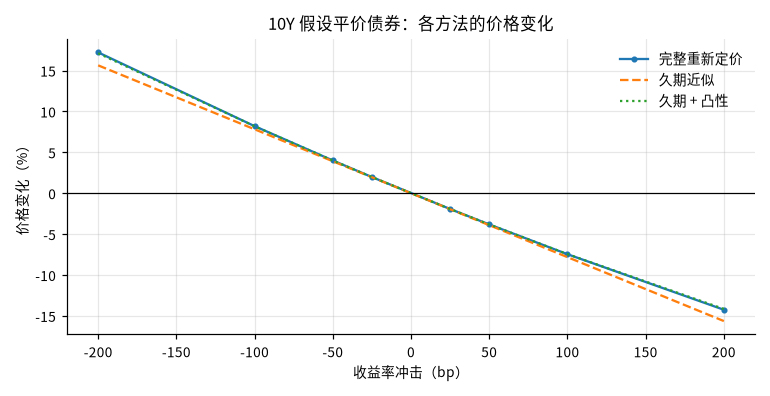
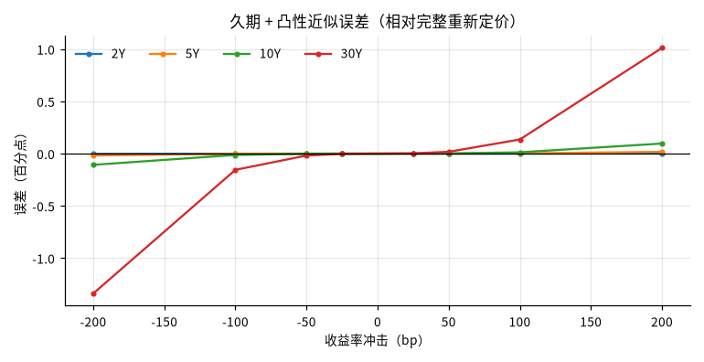

# 假设平价国债的利率敏感性情景

## 概要

**研究问题：** 以最近一个交易日的美国国债票面收益率构造假设平价债券，收益率平移时价格如何变化？ 久期与久期 + 凸性近似相对完整重新定价的误差有多大？

**成果类型：** 情景与策略模拟　**研究分支：** par_bond_scenarios　**结论状态：** 完整

**研究范围：** US · USD · 2026-10-17 至 2026-10-31 · daily

**数据截止：** 2026-10-30　**生成时间：** 2026-10-31T00:16:12+00:00

**运行 ID：** `ust_par_bond_rate_risk-20261031T001612Z-0918eff8`　**结果校验值：** `aac9857106cfe2d7`

## 主要结果

基准日 2026-10-30：各期限按当日票面收益率构造票息等于收益率的假设平价债券。价格变化为相对基准价格的百分比；误差 = 近似 − 完整重新定价（百分点）。不是预测，冲击幅度不代表概率。

| 期限 | 票息 = 收益率 % | 价格 | 麦考利久期（年） | 修正久期（年） | 凸性 | DV01（每 100 面值） |
|---|---|---|---|---|---|---|
| 2Y | 4.56 | 100.0000 | 1.934 | 1.891 | 4.57 | 0.0189 |
| 5Y | 4.71 | 100.0000 | 4.513 | 4.409 | 22.87 | 0.0441 |
| 10Y | 4.94 | 100.0000 | 8.010 | 7.817 | 73.93 | 0.0782 |
| 30Y | 5.31 | 100.0000 | 15.319 | 14.923 | 333.58 | 0.1492 |

| 2Y 冲击 bp | 完整重新定价 % | 久期近似 % | 久期 + 凸性 % | 久期误差 pp | 久期 + 凸性误差 pp |
|---|---|---|---|---|---|
| -200 | 3.875 | 3.782 | 3.873 | -0.093 | -0.0018 |
| -100 | 1.914 | 1.891 | 1.914 | -0.023 | -0.0002 |
| -50 | 0.951 | 0.945 | 0.951 | -0.006 | -0.0000 |
| -25 | 0.474 | 0.473 | 0.474 | -0.001 | -0.0000 |
| +25 | -0.471 | -0.473 | -0.471 | -0.001 | 0.0000 |
| +50 | -0.940 | -0.945 | -0.940 | -0.006 | 0.0000 |
| +100 | -1.868 | -1.891 | -1.868 | -0.023 | 0.0002 |
| +200 | -3.692 | -3.782 | -3.691 | -0.090 | 0.0017 |

| 5Y 冲击 bp | 完整重新定价 % | 久期近似 % | 久期 + 凸性 % | 久期误差 pp | 久期 + 凸性误差 pp |
|---|---|---|---|---|---|
| -200 | 9.293 | 8.818 | 9.275 | -0.475 | -0.0181 |
| -100 | 4.526 | 4.409 | 4.523 | -0.117 | -0.0022 |
| -50 | 2.233 | 2.205 | 2.233 | -0.029 | -0.0003 |
| -25 | 1.109 | 1.102 | 1.109 | -0.007 | -0.0000 |
| +25 | -1.095 | -1.102 | -1.095 | -0.007 | 0.0000 |
| +50 | -2.176 | -2.205 | -2.176 | -0.028 | 0.0003 |
| +100 | -4.297 | -4.409 | -4.295 | -0.112 | 0.0022 |
| +200 | -8.378 | -8.818 | -8.361 | -0.440 | 0.0170 |

| 10Y 冲击 bp | 完整重新定价 % | 久期近似 % | 久期 + 凸性 % | 久期误差 pp | 久期 + 凸性误差 pp |
|---|---|---|---|---|---|
| -200 | 17.220 | 15.633 | 17.112 | -1.586 | -0.1074 |
| -100 | 8.199 | 7.817 | 8.186 | -0.383 | -0.0131 |
| -50 | 4.002 | 3.908 | 4.001 | -0.094 | -0.0016 |
| -25 | 1.977 | 1.954 | 1.977 | -0.023 | -0.0002 |
| +25 | -1.931 | -1.954 | -1.931 | -0.023 | 0.0002 |
| +50 | -3.818 | -3.908 | -3.816 | -0.091 | 0.0016 |
| +100 | -7.459 | -7.817 | -7.447 | -0.357 | 0.0124 |
| +200 | -14.251 | -15.633 | -14.155 | -1.382 | 0.0963 |

| 30Y 冲击 bp | 完整重新定价 % | 久期近似 % | 久期 + 凸性 % | 久期误差 pp | 久期 + 凸性误差 pp |
|---|---|---|---|---|---|
| -200 | 37.856 | 29.846 | 36.518 | -8.010 | -1.3379 |
| -100 | 16.746 | 14.923 | 16.591 | -1.823 | -0.1551 |
| -50 | 7.897 | 7.462 | 7.879 | -0.436 | -0.0187 |
| -25 | 3.837 | 3.731 | 3.835 | -0.107 | -0.0023 |
| +25 | -3.629 | -3.731 | -3.627 | -0.102 | 0.0022 |
| +50 | -7.062 | -7.462 | -7.045 | -0.400 | 0.0174 |
| +100 | -13.390 | -14.923 | -13.255 | -1.533 | 0.1348 |
| +200 | -24.185 | -29.846 | -23.175 | -5.661 | 1.0106 |

## 图表

## 假设与输入

基准日 2026-10-30（研究窗口终点 2026-10-31，相隔 1 天）；窗口内曲线日 10 天，基准日为所有所需期限同时有值的最后一天。

使用期限：2Y、5Y、10Y、30Y（请求 2Y、5Y、10Y、30Y）。

## 验证

**封闭解与重新定价核对：** 通过；16 项核对，未通过 0 项（平价价格 = 面值；解析修正久期 = 平价债券封闭解；解析久期、凸性 ≈ 有限差分完整重新定价）

**原始快照抽查：** 通过；抽查 12 个观测，不一致 0 个

## 数据与方法

| 角色 | 数据集 | 版本 | 来源 | 核验状态 |
|---|---|---|---|---|
| curve | ust_par_yield_curve | `v20261031T001543Z-0e8cfee0` | ust_treasury | access_verified |

**方法：** 以基准日各期限票面收益率为票息与到期收益率构造假设平价债券（每年 2 次付息、估值日为付息日、无应计利息）；对债券自身收益率施加平移冲击，比较完整重新定价与修正久期、久期 + 凸性近似。

**比较基准：** 完整重新定价（按冲击后收益率贴现全部现金流）

**可用时间规则：** 观测日次日 0 点（来源时区）

## 限制

- 假设债券：票息等于基准日票面收益率、恰在付息日估值、无应计利息；不是任何真实国债或债券基金（如 TLT）的风险

- 冲击施加在每只债券自身的收益率上（平移），不是对整条曲线的一致重定价；票面收益率不等于零息利率

- 冲击幅度是假设情景，不代表概率或预测

- 只计算价格变化，不含持有期票息收入、再投资与融资成本
