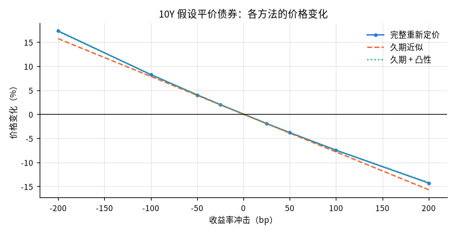
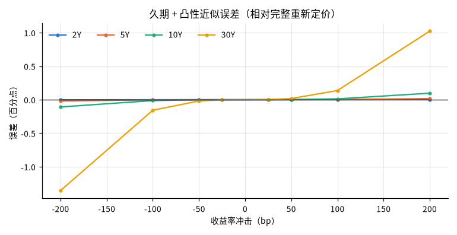

# 假设平价国债的利率敏感性情景

## 概要

**研究问题：** 以最近一个交易日的美国国债票面收益率构造假设平价债券，收益率平移时价格如何变化？ 久期与久期 + 凸性近似相对完整重新定价的误差有多大？

**成果类型：** 情景与策略模拟　**研究分支：** par_bond_scenarios　**结论状态：** 完整

**研究范围：** US · USD · 2026-10-23 至 2026-11-06 · daily

**数据截止：** 2026-11-05　**生成时间：** 2026-11-06T03:36:19+00:00

**运行 ID：** `ust_par_bond_rate_risk-20261106T033619Z-b4d19d36`　**结果校验值：** `b800c83c896fc7f9`

## 主要结果

基准日 2026-11-05：各期限按当日票面收益率构造票息等于收益率的假设平价债券。价格变化为相对基准价格的百分比；误差 = 近似 − 完整重新定价（百分点）。不是预测，冲击幅度不代表概率。

| 期限 | 票息 = 收益率 % | 价格 | 麦考利久期（年） | 修正久期（年） | 凸性 | DV01（每 100 面值） |
|---|---|---|---|---|---|---|
| 2Y | 4.46 | 100.0000 | 1.936 | 1.893 | 4.58 | 0.0189 |
| 5Y | 4.59 | 100.0000 | 4.524 | 4.423 | 22.97 | 0.0442 |
| 10Y | 4.84 | 100.0000 | 8.044 | 7.854 | 74.44 | 0.0785 |
| 30Y | 5.25 | 100.0000 | 15.418 | 15.024 | 337.07 | 0.1502 |

| 2Y 冲击 bp | 完整重新定价 % | 久期近似 % | 久期 + 凸性 % | 久期误差 pp | 久期 + 凸性误差 pp |
|---|---|---|---|---|---|
| -200 | 3.880 | 3.787 | 3.878 | -0.093 | -0.0018 |
| -100 | 1.916 | 1.893 | 1.916 | -0.023 | -0.0002 |
| -50 | 0.952 | 0.947 | 0.952 | -0.006 | -0.0000 |
| -25 | 0.475 | 0.473 | 0.475 | -0.001 | -0.0000 |
| +25 | -0.472 | -0.473 | -0.472 | -0.001 | 0.0000 |
| +50 | -0.941 | -0.947 | -0.941 | -0.006 | 0.0000 |
| +100 | -1.871 | -1.893 | -1.870 | -0.023 | 0.0002 |
| +200 | -3.697 | -3.787 | -3.695 | -0.090 | 0.0018 |

| 5Y 冲击 bp | 完整重新定价 % | 久期近似 % | 久期 + 凸性 % | 久期误差 pp | 久期 + 凸性误差 pp |
|---|---|---|---|---|---|
| -200 | 9.323 | 8.846 | 9.305 | -0.478 | -0.0182 |
| -100 | 4.540 | 4.423 | 4.538 | -0.117 | -0.0022 |
| -50 | 2.240 | 2.211 | 2.240 | -0.029 | -0.0003 |
| -25 | 1.113 | 1.106 | 1.113 | -0.007 | -0.0000 |
| +25 | -1.099 | -1.106 | -1.099 | -0.007 | 0.0000 |
| +50 | -2.183 | -2.211 | -2.183 | -0.028 | 0.0003 |
| +100 | -4.310 | -4.423 | -4.308 | -0.113 | 0.0022 |
| +200 | -8.403 | -8.846 | -8.386 | -0.442 | 0.0171 |

| 10Y 冲击 bp | 完整重新定价 % | 久期近似 % | 久期 + 凸性 % | 久期误差 pp | 久期 + 凸性误差 pp |
|---|---|---|---|---|---|
| -200 | 17.305 | 15.708 | 17.196 | -1.597 | -0.1083 |
| -100 | 8.239 | 7.854 | 8.226 | -0.385 | -0.0132 |
| -50 | 4.022 | 3.927 | 4.020 | -0.095 | -0.0016 |
| -25 | 1.987 | 1.963 | 1.987 | -0.023 | -0.0002 |
| +25 | -1.940 | -1.963 | -1.940 | -0.023 | 0.0002 |
| +50 | -3.835 | -3.927 | -3.834 | -0.091 | 0.0016 |
| +100 | -7.494 | -7.854 | -7.482 | -0.360 | 0.0125 |
| +200 | -14.316 | -15.708 | -14.219 | -1.392 | 0.0971 |

| 30Y 冲击 bp | 完整重新定价 % | 久期近似 % | 久期 + 凸性 % | 久期误差 pp | 久期 + 凸性误差 pp |
|---|---|---|---|---|---|
| -200 | 38.144 | 30.047 | 36.789 | -8.097 | -1.3552 |
| -100 | 16.866 | 15.024 | 16.709 | -1.842 | -0.1571 |
| -50 | 7.952 | 7.512 | 7.933 | -0.440 | -0.0189 |
| -25 | 3.864 | 3.756 | 3.861 | -0.108 | -0.0023 |
| +25 | -3.653 | -3.756 | -3.651 | -0.103 | 0.0022 |
| +50 | -7.108 | -7.512 | -7.091 | -0.404 | 0.0177 |
| +100 | -13.475 | -15.024 | -13.338 | -1.549 | 0.1365 |
| +200 | -24.329 | -30.047 | -23.306 | -5.718 | 1.0232 |

## 图表

## 假设与输入

基准日 2026-11-05（研究窗口终点 2026-11-06，相隔 1 天）；窗口内曲线日 10 天，基准日为所有所需期限同时有值的最后一天。

使用期限：2Y、5Y、10Y、30Y（请求 2Y、5Y、10Y、30Y）。

## 验证

**封闭解与重新定价核对：** 通过；16 项核对，未通过 0 项（平价价格 = 面值；解析修正久期 = 平价债券封闭解；解析久期、凸性 ≈ 有限差分完整重新定价）

**原始快照抽查：** 通过；抽查 12 个观测，不一致 0 个

## 数据与方法

| 角色 | 数据集 | 版本 | 来源 | 核验状态 |
|---|---|---|---|---|
| curve | ust_par_yield_curve | `v20261106T033549Z-179fac9f` | ust_treasury | access_verified |

**方法：** 以基准日各期限票面收益率为票息与到期收益率构造假设平价债券（每年 2 次付息、估值日为付息日、无应计利息）；对债券自身收益率施加平移冲击，比较完整重新定价与修正久期、久期 + 凸性近似。

**比较基准：** 完整重新定价（按冲击后收益率贴现全部现金流）

**可用时间规则：** 观测日次日 0 点（来源时区）

## 限制

- 假设债券：票息等于基准日票面收益率、恰在付息日估值、无应计利息；不是任何真实国债或债券基金（如 TLT）的风险

- 冲击施加在每只债券自身的收益率上（平移），不是对整条曲线的一致重定价；票面收益率不等于零息利率

- 冲击幅度是假设情景，不代表概率或预测

- 只计算价格变化，不含持有期票息收入、再投资与融资成本
