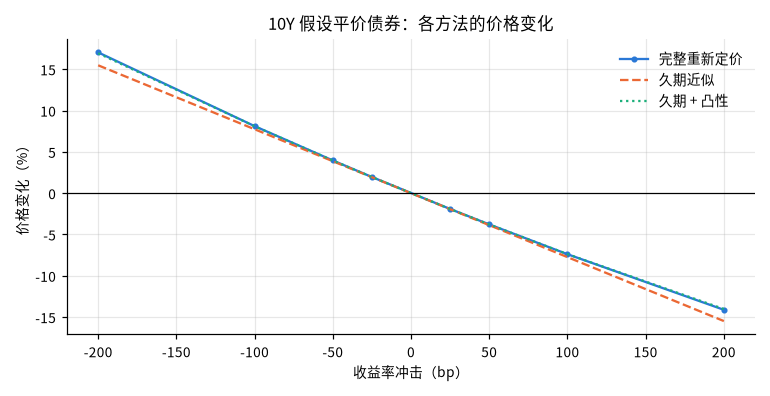
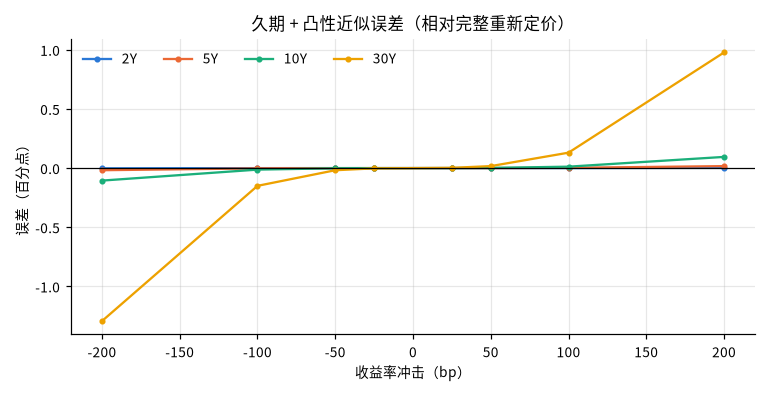

# 假设平价国债的利率敏感性情景

## 概要

**研究问题：** 以最近一个交易日的美国国债票面收益率构造假设平价债券，收益率平移时价格如何变化？ 久期与久期 + 凸性近似相对完整重新定价的误差有多大？

**成果类型：** 情景与策略模拟　**研究分支：** par_bond_scenarios　**结论状态：** 完整

**研究范围：** US · USD · 2026-11-01 至 2026-11-15 · daily

**数据截止：** 2026-11-13　**生成时间：** 2026-11-15T13:23:44+00:00

**运行 ID：** `ust_par_bond_rate_risk-20261115T132344Z-2594587c`　**结果校验值：** `32c7bccbdefa8e15`

## 主要结果

基准日 2026-11-13：各期限按当日票面收益率构造票息等于收益率的假设平价债券。价格变化为相对基准价格的百分比；误差 = 近似 − 完整重新定价（百分点）。不是预测，冲击幅度不代表概率。

| 期限 | 票息 = 收益率 % | 价格 | 麦考利久期（年） | 修正久期（年） | 凸性 | DV01（每 100 面值） |
|---|---|---|---|---|---|---|
| 2Y | 4.88 | 100.0000 | 1.930 | 1.884 | 4.54 | 0.0188 |
| 5Y | 4.98 | 100.0000 | 4.487 | 4.378 | 22.63 | 0.0438 |
| 10Y | 5.15 | 100.0000 | 7.939 | 7.740 | 72.88 | 0.0774 |
| 30Y | 5.47 | 100.0000 | 15.061 | 14.660 | 324.50 | 0.1466 |

| 2Y 冲击 bp | 完整重新定价 % | 久期近似 % | 久期 + 凸性 % | 久期误差 pp | 久期 + 凸性误差 pp |
|---|---|---|---|---|---|
| -200 | 3.860 | 3.767 | 3.858 | -0.093 | -0.0018 |
| -100 | 1.907 | 1.884 | 1.906 | -0.023 | -0.0002 |
| -50 | 0.948 | 0.942 | 0.948 | -0.006 | -0.0000 |
| -25 | 0.472 | 0.471 | 0.472 | -0.001 | -0.0000 |
| +25 | -0.470 | -0.471 | -0.470 | -0.001 | 0.0000 |
| +50 | -0.936 | -0.942 | -0.936 | -0.006 | 0.0000 |
| +100 | -1.861 | -1.884 | -1.861 | -0.022 | 0.0002 |
| +200 | -3.678 | -3.767 | -3.677 | -0.089 | 0.0017 |

| 5Y 冲击 bp | 完整重新定价 % | 久期近似 % | 久期 + 凸性 % | 久期误差 pp | 久期 + 凸性误差 pp |
|---|---|---|---|---|---|
| -200 | 9.227 | 8.757 | 9.209 | -0.470 | -0.0179 |
| -100 | 4.494 | 4.378 | 4.491 | -0.115 | -0.0022 |
| -50 | 2.218 | 2.189 | 2.217 | -0.029 | -0.0003 |
| -25 | 1.102 | 1.095 | 1.102 | -0.007 | -0.0000 |
| +25 | -1.088 | -1.095 | -1.088 | -0.007 | 0.0000 |
| +50 | -2.161 | -2.189 | -2.161 | -0.028 | 0.0003 |
| +100 | -4.267 | -4.378 | -4.265 | -0.111 | 0.0021 |
| +200 | -8.321 | -8.757 | -8.304 | -0.436 | 0.0168 |

| 10Y 冲击 bp | 完整重新定价 % | 久期近似 % | 久期 + 凸性 % | 久期误差 pp | 久期 + 凸性误差 pp |
|---|---|---|---|---|---|
| -200 | 17.042 | 15.479 | 16.937 | -1.563 | -0.1056 |
| -100 | 8.117 | 7.740 | 8.104 | -0.377 | -0.0128 |
| -50 | 3.962 | 3.870 | 3.961 | -0.093 | -0.0016 |
| -25 | 1.958 | 1.935 | 1.958 | -0.023 | -0.0002 |
| +25 | -1.912 | -1.935 | -1.912 | -0.023 | 0.0002 |
| +50 | -3.780 | -3.870 | -3.779 | -0.090 | 0.0015 |
| +100 | -7.387 | -7.740 | -7.375 | -0.352 | 0.0122 |
| +200 | -14.116 | -15.479 | -14.022 | -1.363 | 0.0947 |

| 30Y 冲击 bp | 完整重新定价 % | 久期近似 % | 久期 + 凸性 % | 久期误差 pp | 久期 + 凸性误差 pp |
|---|---|---|---|---|---|
| -200 | 37.103 | 29.320 | 35.810 | -7.783 | -1.2930 |
| -100 | 16.432 | 14.660 | 16.282 | -1.772 | -0.1500 |
| -50 | 7.754 | 7.330 | 7.736 | -0.424 | -0.0181 |
| -25 | 3.769 | 3.665 | 3.766 | -0.104 | -0.0022 |
| +25 | -3.566 | -3.665 | -3.564 | -0.099 | 0.0021 |
| +50 | -6.941 | -7.330 | -6.924 | -0.389 | 0.0169 |
| +100 | -13.168 | -14.660 | -13.037 | -1.492 | 0.1304 |
| +200 | -23.808 | -29.320 | -22.830 | -5.512 | 0.9778 |

## 图表

## 假设与输入

基准日 2026-11-13（研究窗口终点 2026-11-15，相隔 2 天）；窗口内曲线日 9 天，基准日为所有所需期限同时有值的最后一天。

使用期限：2Y、5Y、10Y、30Y（请求 2Y、5Y、10Y、30Y）。

## 验证

**封闭解与重新定价核对：** 通过；16 项核对，未通过 0 项（平价价格 = 面值；解析修正久期 = 平价债券封闭解；解析久期、凸性 ≈ 有限差分完整重新定价）

**原始快照抽查：** 通过；抽查 12 个观测，不一致 0 个

## 数据与方法

| 角色 | 数据集 | 版本 | 来源 | 核验状态 |
|---|---|---|---|---|
| curve | ust_par_yield_curve | `v20261115T131528Z-aacb87ae` | ust_treasury | access_verified |

**方法：** 以基准日各期限票面收益率为票息与到期收益率构造假设平价债券（每年 2 次付息、估值日为付息日、无应计利息）；对债券自身收益率施加平移冲击，比较完整重新定价与修正久期、久期 + 凸性近似。

**比较基准：** 完整重新定价（按冲击后收益率贴现全部现金流）

**可用时间规则：** 观测日次日 0 点（来源时区）

## 限制

- 假设债券：票息等于基准日票面收益率、恰在付息日估值、无应计利息；不是任何真实国债或债券基金（如 TLT）的风险

- 冲击施加在每只债券自身的收益率上（平移），不是对整条曲线的一致重定价；票面收益率不等于零息利率

- 冲击幅度是假设情景，不代表概率或预测

- 只计算价格变化，不含持有期票息收入、再投资与融资成本
