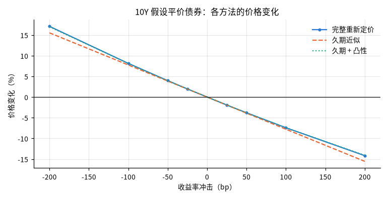
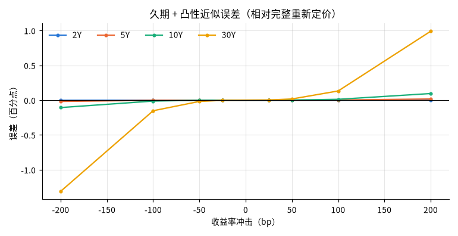

# 假设平价国债的利率敏感性情景

## 概要

**研究问题：** 以最近一个交易日的美国国债票面收益率构造假设平价债券，收益率平移时价格如何变化？ 久期与久期 + 凸性近似相对完整重新定价的误差有多大？

**成果类型：** 情景与策略模拟　**研究分支：** par_bond_scenarios　**结论状态：** 完整

**研究范围：** US · USD · 2026-11-05 至 2026-11-19 · daily

**数据截止：** 2026-11-18　**生成时间：** 2026-11-19T04:27:41+00:00

**运行 ID：** `ust_par_bond_rate_risk-20261119T042740Z-940b565d`　**结果校验值：** `5d42c0b1578b8808`

## 主要结果

基准日 2026-11-18：各期限按当日票面收益率构造票息等于收益率的假设平价债券。价格变化为相对基准价格的百分比；误差 = 近似 − 完整重新定价（百分点）。不是预测，冲击幅度不代表概率。

| 期限 | 票息 = 收益率 % | 价格 | 麦考利久期（年） | 修正久期（年） | 凸性 | DV01（每 100 面值） |
|---|---|---|---|---|---|---|
| 2Y | 4.80 | 100.0000 | 1.931 | 1.886 | 4.55 | 0.0189 |
| 5Y | 4.89 | 100.0000 | 4.496 | 4.388 | 22.71 | 0.0439 |
| 10Y | 5.07 | 100.0000 | 7.966 | 7.769 | 73.28 | 0.0777 |
| 30Y | 5.41 | 100.0000 | 15.157 | 14.758 | 327.87 | 0.1476 |

| 2Y 冲击 bp | 完整重新定价 % | 久期近似 % | 久期 + 凸性 % | 久期误差 pp | 久期 + 凸性误差 pp |
|---|---|---|---|---|---|
| -200 | 3.864 | 3.771 | 3.862 | -0.093 | -0.0018 |
| -100 | 1.908 | 1.886 | 1.908 | -0.023 | -0.0002 |
| -50 | 0.948 | 0.943 | 0.948 | -0.006 | -0.0000 |
| -25 | 0.473 | 0.471 | 0.473 | -0.001 | -0.0000 |
| +25 | -0.470 | -0.471 | -0.470 | -0.001 | 0.0000 |
| +50 | -0.937 | -0.943 | -0.937 | -0.006 | 0.0000 |
| +100 | -1.863 | -1.886 | -1.863 | -0.023 | 0.0002 |
| +200 | -3.682 | -3.771 | -3.680 | -0.089 | 0.0017 |

| 5Y 冲击 bp | 完整重新定价 % | 久期近似 % | 久期 + 凸性 % | 久期误差 pp | 久期 + 凸性误差 pp |
|---|---|---|---|---|---|
| -200 | 9.249 | 8.777 | 9.231 | -0.472 | -0.0180 |
| -100 | 4.504 | 4.388 | 4.502 | -0.116 | -0.0022 |
| -50 | 2.223 | 2.194 | 2.223 | -0.029 | -0.0003 |
| -25 | 1.104 | 1.097 | 1.104 | -0.007 | -0.0000 |
| +25 | -1.090 | -1.097 | -1.090 | -0.007 | 0.0000 |
| +50 | -2.166 | -2.194 | -2.166 | -0.028 | 0.0003 |
| +100 | -4.277 | -4.388 | -4.275 | -0.111 | 0.0021 |
| +200 | -8.340 | -8.777 | -8.323 | -0.437 | 0.0169 |

| 10Y 冲击 bp | 完整重新定价 % | 久期近似 % | 久期 + 凸性 % | 久期误差 pp | 久期 + 凸性误差 pp |
|---|---|---|---|---|---|
| -200 | 17.110 | 15.538 | 17.003 | -1.572 | -0.1063 |
| -100 | 8.148 | 7.769 | 8.135 | -0.379 | -0.0129 |
| -50 | 3.978 | 3.884 | 3.976 | -0.093 | -0.0016 |
| -25 | 1.965 | 1.942 | 1.965 | -0.023 | -0.0002 |
| +25 | -1.920 | -1.942 | -1.919 | -0.023 | 0.0002 |
| +50 | -3.794 | -3.884 | -3.793 | -0.090 | 0.0015 |
| +100 | -7.415 | -7.769 | -7.402 | -0.354 | 0.0122 |
| +200 | -14.167 | -15.538 | -14.072 | -1.370 | 0.0953 |

| 30Y 冲击 bp | 完整重新定价 % | 久期近似 % | 久期 + 凸性 % | 久期误差 pp | 久期 + 凸性误差 pp |
|---|---|---|---|---|---|
| -200 | 37.383 | 29.515 | 36.073 | -7.867 | -1.3097 |
| -100 | 16.549 | 14.758 | 16.397 | -1.791 | -0.1519 |
| -50 | 7.807 | 7.379 | 7.789 | -0.428 | -0.0183 |
| -25 | 3.794 | 3.689 | 3.792 | -0.105 | -0.0022 |
| +25 | -3.589 | -3.689 | -3.587 | -0.100 | 0.0022 |
| +50 | -6.986 | -7.379 | -6.969 | -0.393 | 0.0171 |
| +100 | -13.250 | -14.758 | -13.118 | -1.507 | 0.1321 |
| +200 | -23.948 | -29.515 | -22.958 | -5.567 | 0.9900 |

## 图表

## 假设与输入

基准日 2026-11-18（研究窗口终点 2026-11-19，相隔 1 天）；窗口内曲线日 9 天，基准日为所有所需期限同时有值的最后一天。

使用期限：2Y、5Y、10Y、30Y（请求 2Y、5Y、10Y、30Y）。

## 验证

**封闭解与重新定价核对：** 通过；16 项核对，未通过 0 项（平价价格 = 面值；解析修正久期 = 平价债券封闭解；解析久期、凸性 ≈ 有限差分完整重新定价）

**原始快照抽查：** 通过；抽查 12 个观测，不一致 0 个

## 数据与方法

| 角色 | 数据集 | 版本 | 来源 | 核验状态 |
|---|---|---|---|---|
| curve | ust_par_yield_curve | `v20261119T042705Z-96314d98` | ust_treasury | access_verified |

**方法：** 以基准日各期限票面收益率为票息与到期收益率构造假设平价债券（每年 2 次付息、估值日为付息日、无应计利息）；对债券自身收益率施加平移冲击，比较完整重新定价与修正久期、久期 + 凸性近似。

**比较基准：** 完整重新定价（按冲击后收益率贴现全部现金流）

**可用时间规则：** 观测日次日 0 点（来源时区）

## 限制

- 假设债券：票息等于基准日票面收益率、恰在付息日估值、无应计利息；不是任何真实国债或债券基金（如 TLT）的风险

- 冲击施加在每只债券自身的收益率上（平移），不是对整条曲线的一致重定价；票面收益率不等于零息利率

- 冲击幅度是假设情景，不代表概率或预测

- 只计算价格变化，不含持有期票息收入、再投资与融资成本
