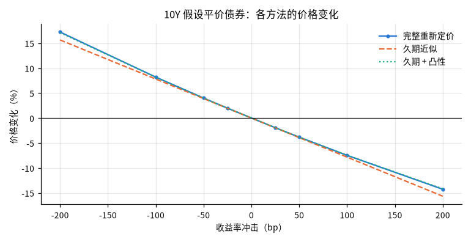
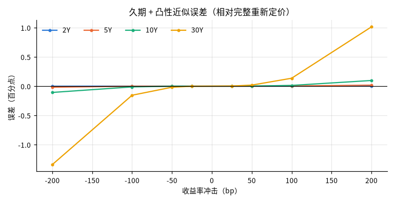

# 假设平价国债的利率敏感性情景

## 概要

**研究问题：** 以最近一个交易日的美国国债票面收益率构造假设平价债券，收益率平移时价格如何变化？ 久期与久期 + 凸性近似相对完整重新定价的误差有多大？

**成果类型：** 情景与策略模拟　**研究分支：** par_bond_scenarios　**结论状态：** 完整

**研究范围：** US · USD · 2026-11-11 至 2026-11-25 · daily

**数据截止：** 2026-11-24　**生成时间：** 2026-11-25T05:40:41+00:00

**运行 ID：** `ust_par_bond_rate_risk-20261125T054040Z-882f5da1`　**结果校验值：** `d6b5b469d6f97611`

## 主要结果

基准日 2026-11-24：各期限按当日票面收益率构造票息等于收益率的假设平价债券。价格变化为相对基准价格的百分比；误差 = 近似 − 完整重新定价（百分点）。不是预测，冲击幅度不代表概率。

| 期限 | 票息 = 收益率 % | 价格 | 麦考利久期（年） | 修正久期（年） | 凸性 | DV01（每 100 面值） |
|---|---|---|---|---|---|---|
| 2Y | 4.63 | 100.0000 | 1.933 | 1.889 | 4.56 | 0.0189 |
| 5Y | 4.69 | 100.0000 | 4.515 | 4.411 | 22.88 | 0.0441 |
| 10Y | 4.91 | 100.0000 | 8.020 | 7.828 | 74.09 | 0.0783 |
| 30Y | 5.30 | 100.0000 | 15.336 | 14.940 | 334.16 | 0.1494 |

| 2Y 冲击 bp | 完整重新定价 % | 久期近似 % | 久期 + 凸性 % | 久期误差 pp | 久期 + 凸性误差 pp |
|---|---|---|---|---|---|
| -200 | 3.872 | 3.779 | 3.870 | -0.093 | -0.0018 |
| -100 | 1.912 | 1.889 | 1.912 | -0.023 | -0.0002 |
| -50 | 0.950 | 0.945 | 0.950 | -0.006 | -0.0000 |
| -25 | 0.474 | 0.472 | 0.474 | -0.001 | -0.0000 |
| +25 | -0.471 | -0.472 | -0.471 | -0.001 | 0.0000 |
| +50 | -0.939 | -0.945 | -0.939 | -0.006 | 0.0000 |
| +100 | -1.867 | -1.889 | -1.867 | -0.023 | 0.0002 |
| +200 | -3.689 | -3.779 | -3.688 | -0.090 | 0.0017 |

| 5Y 冲击 bp | 完整重新定价 % | 久期近似 % | 久期 + 凸性 % | 久期误差 pp | 久期 + 凸性误差 pp |
|---|---|---|---|---|---|
| -200 | 9.298 | 8.823 | 9.280 | -0.476 | -0.0181 |
| -100 | 4.528 | 4.411 | 4.526 | -0.117 | -0.0022 |
| -50 | 2.235 | 2.206 | 2.234 | -0.029 | -0.0003 |
| -25 | 1.110 | 1.103 | 1.110 | -0.007 | -0.0000 |
| +25 | -1.096 | -1.103 | -1.096 | -0.007 | 0.0000 |
| +50 | -2.177 | -2.206 | -2.177 | -0.028 | 0.0003 |
| +100 | -4.299 | -4.411 | -4.297 | -0.112 | 0.0022 |
| +200 | -8.382 | -8.823 | -8.365 | -0.441 | 0.0170 |

| 10Y 冲击 bp | 完整重新定价 % | 久期近似 % | 久期 + 凸性 % | 久期误差 pp | 久期 + 凸性误差 pp |
|---|---|---|---|---|---|
| -200 | 17.245 | 15.656 | 17.137 | -1.589 | -0.1077 |
| -100 | 8.211 | 7.828 | 8.198 | -0.384 | -0.0131 |
| -50 | 4.008 | 3.914 | 4.007 | -0.094 | -0.0016 |
| -25 | 1.980 | 1.957 | 1.980 | -0.023 | -0.0002 |
| +25 | -1.934 | -1.957 | -1.934 | -0.023 | 0.0002 |
| +50 | -3.823 | -3.914 | -3.821 | -0.091 | 0.0016 |
| +100 | -7.470 | -7.828 | -7.457 | -0.358 | 0.0124 |
| +200 | -14.270 | -15.656 | -14.174 | -1.385 | 0.0965 |

| 30Y 冲击 bp | 完整重新定价 % | 久期近似 % | 久期 + 凸性 % | 久期误差 pp | 久期 + 凸性误差 pp |
|---|---|---|---|---|---|
| -200 | 37.904 | 29.880 | 36.563 | -8.024 | -1.3408 |
| -100 | 16.766 | 14.940 | 16.611 | -1.826 | -0.1555 |
| -50 | 7.906 | 7.470 | 7.888 | -0.436 | -0.0187 |
| -25 | 3.842 | 3.735 | 3.839 | -0.107 | -0.0023 |
| +25 | -3.633 | -3.735 | -3.631 | -0.102 | 0.0022 |
| +50 | -7.070 | -7.470 | -7.052 | -0.400 | 0.0175 |
| +100 | -13.404 | -14.940 | -13.269 | -1.536 | 0.1351 |
| +200 | -24.209 | -29.880 | -23.196 | -5.671 | 1.0127 |

## 图表

## 假设与输入

基准日 2026-11-24（研究窗口终点 2026-11-25，相隔 1 天）；窗口内曲线日 9 天，基准日为所有所需期限同时有值的最后一天。

使用期限：2Y、5Y、10Y、30Y（请求 2Y、5Y、10Y、30Y）。

## 验证

**封闭解与重新定价核对：** 通过；16 项核对，未通过 0 项（平价价格 = 面值；解析修正久期 = 平价债券封闭解；解析久期、凸性 ≈ 有限差分完整重新定价）

**原始快照抽查：** 通过；抽查 12 个观测，不一致 0 个

## 数据与方法

| 角色 | 数据集 | 版本 | 来源 | 核验状态 |
|---|---|---|---|---|
| curve | ust_par_yield_curve | `v20261125T054001Z-24d13ae5` | ust_treasury | access_verified |

**方法：** 以基准日各期限票面收益率为票息与到期收益率构造假设平价债券（每年 2 次付息、估值日为付息日、无应计利息）；对债券自身收益率施加平移冲击，比较完整重新定价与修正久期、久期 + 凸性近似。

**比较基准：** 完整重新定价（按冲击后收益率贴现全部现金流）

**可用时间规则：** 观测日次日 0 点（来源时区）

## 限制

- 假设债券：票息等于基准日票面收益率、恰在付息日估值、无应计利息；不是任何真实国债或债券基金（如 TLT）的风险

- 冲击施加在每只债券自身的收益率上（平移），不是对整条曲线的一致重定价；票面收益率不等于零息利率

- 冲击幅度是假设情景，不代表概率或预测

- 只计算价格变化，不含持有期票息收入、再投资与融资成本
