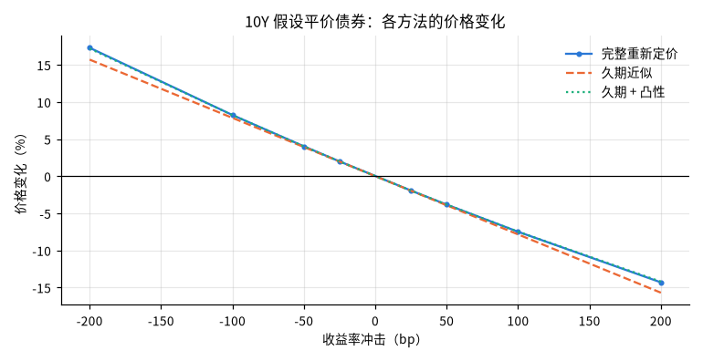
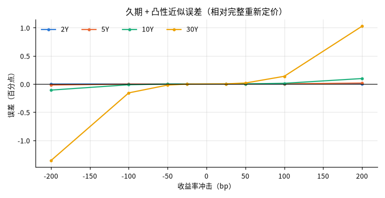

# 假设平价国债的利率敏感性情景

## 概要

**研究问题：** 以最近一个交易日的美国国债票面收益率构造假设平价债券，收益率平移时价格如何变化？ 久期与久期 + 凸性近似相对完整重新定价的误差有多大？

**成果类型：** 情景与策略模拟　**研究分支：** par_bond_scenarios　**结论状态：** 完整

**研究范围：** US · USD · 2026-11-13 至 2026-11-27 · daily

**数据截止：** 2026-11-25　**生成时间：** 2026-11-27T03:51:27+00:00

**运行 ID：** `ust_par_bond_rate_risk-20261127T035127Z-f8f8a221`　**结果校验值：** `6d50927b1be541eb`

## 主要结果

基准日 2026-11-25：各期限按当日票面收益率构造票息等于收益率的假设平价债券。价格变化为相对基准价格的百分比；误差 = 近似 − 完整重新定价（百分点）。不是预测，冲击幅度不代表概率。

| 期限 | 票息 = 收益率 % | 价格 | 麦考利久期（年） | 修正久期（年） | 凸性 | DV01（每 100 面值） |
|---|---|---|---|---|---|---|
| 2Y | 4.61 | 100.0000 | 1.933 | 1.890 | 4.57 | 0.0189 |
| 5Y | 4.65 | 100.0000 | 4.519 | 4.416 | 22.92 | 0.0442 |
| 10Y | 4.85 | 100.0000 | 8.040 | 7.850 | 74.39 | 0.0785 |
| 30Y | 5.24 | 100.0000 | 15.435 | 15.041 | 337.66 | 0.1504 |

| 2Y 冲击 bp | 完整重新定价 % | 久期近似 % | 久期 + 凸性 % | 久期误差 pp | 久期 + 凸性误差 pp |
|---|---|---|---|---|---|
| -200 | 3.873 | 3.780 | 3.871 | -0.093 | -0.0018 |
| -100 | 1.913 | 1.890 | 1.913 | -0.023 | -0.0002 |
| -50 | 0.951 | 0.945 | 0.951 | -0.006 | -0.0000 |
| -25 | 0.474 | 0.472 | 0.474 | -0.001 | -0.0000 |
| +25 | -0.471 | -0.472 | -0.471 | -0.001 | 0.0000 |
| +50 | -0.939 | -0.945 | -0.939 | -0.006 | 0.0000 |
| +100 | -1.867 | -1.890 | -1.867 | -0.023 | 0.0002 |
| +200 | -3.690 | -3.780 | -3.688 | -0.090 | 0.0017 |

| 5Y 冲击 bp | 完整重新定价 % | 久期近似 % | 久期 + 凸性 % | 久期误差 pp | 久期 + 凸性误差 pp |
|---|---|---|---|---|---|
| -200 | 9.308 | 8.832 | 9.290 | -0.477 | -0.0182 |
| -100 | 4.533 | 4.416 | 4.530 | -0.117 | -0.0022 |
| -50 | 2.237 | 2.208 | 2.237 | -0.029 | -0.0003 |
| -25 | 1.111 | 1.104 | 1.111 | -0.007 | -0.0000 |
| +25 | -1.097 | -1.104 | -1.097 | -0.007 | 0.0000 |
| +50 | -2.180 | -2.208 | -2.179 | -0.028 | 0.0003 |
| +100 | -4.303 | -4.416 | -4.301 | -0.112 | 0.0022 |
| +200 | -8.390 | -8.832 | -8.373 | -0.441 | 0.0171 |

| 10Y 冲击 bp | 完整重新定价 % | 久期近似 % | 久期 + 凸性 % | 久期误差 pp | 久期 + 凸性误差 pp |
|---|---|---|---|---|---|
| -200 | 17.296 | 15.700 | 17.188 | -1.596 | -0.1082 |
| -100 | 8.235 | 7.850 | 8.222 | -0.385 | -0.0132 |
| -50 | 4.020 | 3.925 | 4.018 | -0.095 | -0.0016 |
| -25 | 1.986 | 1.963 | 1.986 | -0.023 | -0.0002 |
| +25 | -1.939 | -1.963 | -1.939 | -0.023 | 0.0002 |
| +50 | -3.834 | -3.925 | -3.832 | -0.091 | 0.0016 |
| +100 | -7.491 | -7.850 | -7.478 | -0.360 | 0.0125 |
| +200 | -14.309 | -15.700 | -14.212 | -1.391 | 0.0970 |

| 30Y 冲击 bp | 完整重新定价 % | 久期近似 % | 久期 + 凸性 % | 久期误差 pp | 久期 + 凸性误差 pp |
|---|---|---|---|---|---|
| -200 | 38.192 | 30.081 | 36.834 | -8.111 | -1.3581 |
| -100 | 16.886 | 15.041 | 16.729 | -1.846 | -0.1574 |
| -50 | 7.961 | 7.520 | 7.942 | -0.441 | -0.0190 |
| -25 | 3.868 | 3.760 | 3.866 | -0.108 | -0.0023 |
| +25 | -3.657 | -3.760 | -3.655 | -0.103 | 0.0022 |
| +50 | -7.116 | -7.520 | -7.098 | -0.404 | 0.0177 |
| +100 | -13.489 | -15.041 | -13.352 | -1.551 | 0.1368 |
| +200 | -24.353 | -30.081 | -23.328 | -5.728 | 1.0254 |

## 图表

## 假设与输入

基准日 2026-11-25（研究窗口终点 2026-11-27，相隔 2 天）；窗口内曲线日 9 天，基准日为所有所需期限同时有值的最后一天。

使用期限：2Y、5Y、10Y、30Y（请求 2Y、5Y、10Y、30Y）。

## 验证

**封闭解与重新定价核对：** 通过；16 项核对，未通过 0 项（平价价格 = 面值；解析修正久期 = 平价债券封闭解；解析久期、凸性 ≈ 有限差分完整重新定价）

**原始快照抽查：** 通过；抽查 12 个观测，不一致 0 个

## 数据与方法

| 角色 | 数据集 | 版本 | 来源 | 核验状态 |
|---|---|---|---|---|
| curve | ust_par_yield_curve | `v20261127T035023Z-b4631db8` | ust_treasury | access_verified |

**方法：** 以基准日各期限票面收益率为票息与到期收益率构造假设平价债券（每年 2 次付息、估值日为付息日、无应计利息）；对债券自身收益率施加平移冲击，比较完整重新定价与修正久期、久期 + 凸性近似。

**比较基准：** 完整重新定价（按冲击后收益率贴现全部现金流）

**可用时间规则：** 观测日次日 0 点（来源时区）

## 限制

- 假设债券：票息等于基准日票面收益率、恰在付息日估值、无应计利息；不是任何真实国债或债券基金（如 TLT）的风险

- 冲击施加在每只债券自身的收益率上（平移），不是对整条曲线的一致重定价；票面收益率不等于零息利率

- 冲击幅度是假设情景，不代表概率或预测

- 只计算价格变化，不含持有期票息收入、再投资与融资成本
